# Hospital Finance Module — Architecture & Roadmap

This document analyzes real-world hospital finance requirements, maps them to the **NovaCure** platform as it exists today, and recommends how to implement finance **without premature microservice complexity** while leaving a clean path to scale later.

**Status:** Architecture & planning only — no implementation yet.

---

## 1. What Hospital Finance Actually Does

Clinical modules answer: *“Treat the patient.”*

Finance answers: *“Capture every billable service, price it correctly, collect payment (patient or insurer), account for it, and report on it.”*

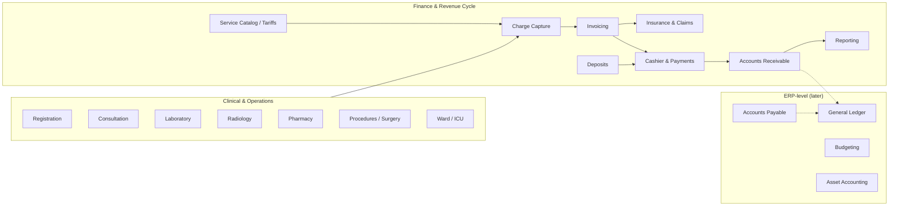

### 1.1 Full hospital finance scope (reference)

| Area | Typical EHR priority | NovaCure relevance |
|------|---------------------|-------------------|
| **Patient billing** | Phase 1 — core | High — every clinical event must become a charge |
| **Cashier & payments** | Phase 1 | High — cash, card, mobile money, mixed |
| **Patient deposits** | Phase 1–2 | High — admission deposits, consume, refund |
| **Insurance & claims** | Phase 2 | High — `insurance_profile` already on patient |
| **Revenue cycle (RCM)** | Phase 2–3 | Medium — denial management, aging |
| **Accounts receivable** | Phase 2 | Medium — outstanding balances |
| **Accounts payable** | Phase 4+ | Low for EHR-first; ERP territory |
| **General ledger** | Phase 4+ | ERP / integration with accounting software |
| **Budgeting, payroll, procurement GL** | Phase 5+ | Usually separate HR/ERP systems |
| **Tax, audit, compliance** | Ongoing | Audit trail pattern exists (`audit_logs`) |

**Practical rule:** Most hospitals start with **patient-related finance** (billing → cashier → basic insurance). ERP-level finance is added when the hospital outgrows spreadsheets or integrates with Odoo, SAP, QuickBooks, etc.

---

## 2. Real-World Scenarios (End-to-End)

### Scenario A — Outpatient cash visit (NovaCure demo path today)

**Patient:** Amanuel Tadesse — ophthalmology outpatient, admitted today.

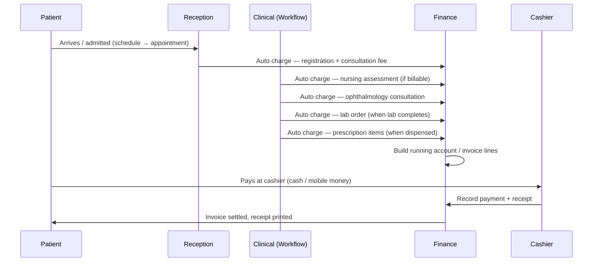

**Finance must not re-type charges.** Each line links to a clinical source: `appointment_id`, `workflow_log_id`, `prescription_id`, `pharmacy_prescription_id`, etc.

---

### Scenario B — Insurance split payment

**Bill:** ETB 1,000 | **Coverage:** 80% | **Co-pay:** 20%

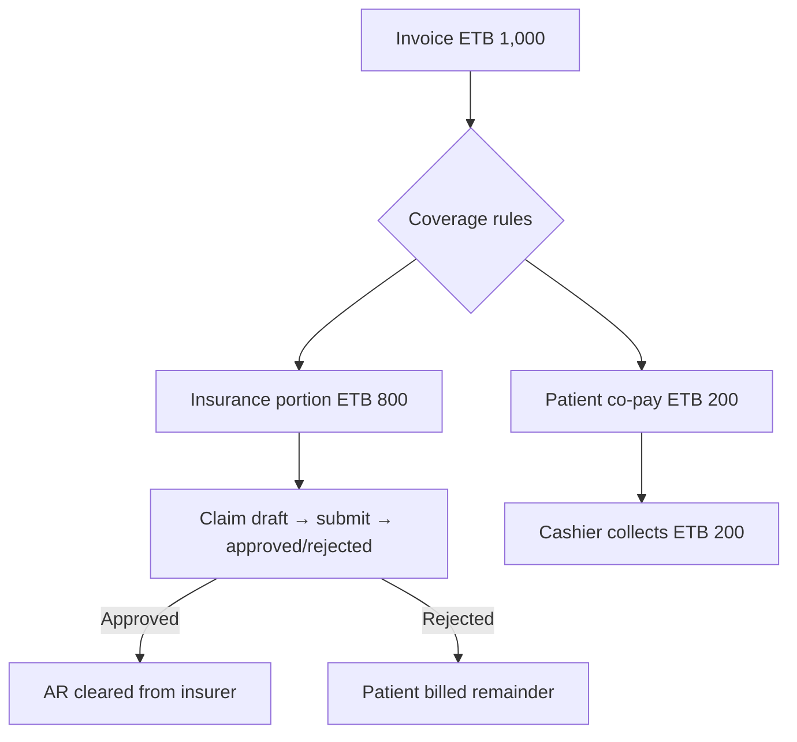

**Data already in NovaCure:** `patient_profiles.insurance_profile` (JSONB) — provider, policy number, coverage type. **Missing:** insurer master, benefit rules, pre-auth, claim lifecycle.

---

### Scenario C — Admission deposit

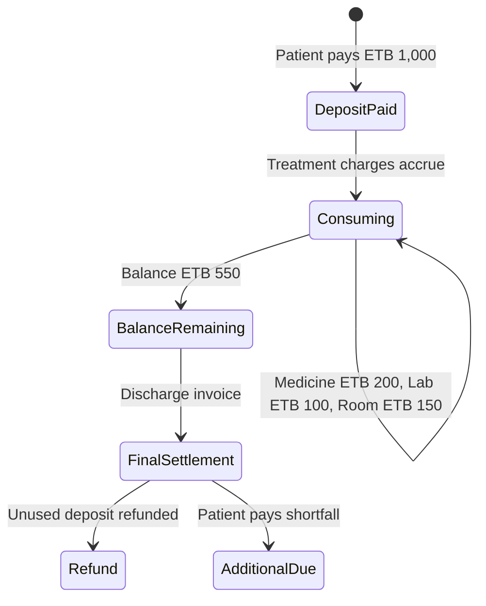

Deposits are a **wallet** on the patient account, consumed FIFO against new charges before asking for more payment.

---

### Scenario D — Mixed payment at cashier

| Method | Amount |
|--------|--------|
| Cash | ETB 200 |
| Insurance (allocated) | ETB 250 |
| Credit / patient account | ETB 50 |
| **Total** | **ETB 500** |

One payment session, multiple `payment_allocations` rows tied to one or more invoices.

---

## 3. Current NovaCure Platform — What Exists

### 3.1 Deployment topology (today)

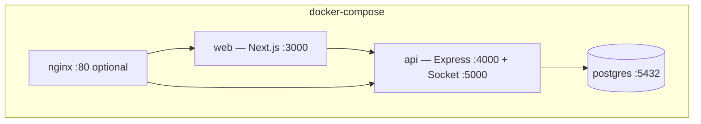

Single monolith API, single database, no message bus, no separate domain services.

### 3.2 Clinical domains (charge sources — live)

| Domain | Backend | Can generate charges today? |
|--------|---------|---------------------------|
| Scheduling / admission | `patientScheduleService`, `appointmentService` | No — visit context only |
| Medical workflow | `medicalWorkflowService` | No — actions logged, not priced |
| Diagnosis forms | `diagnosisRecordService` | No — clinical data only |
| Prescriptions | `prescriptionService` | No — items have no unit price |
| Pharmacy dispense | `pharmacyPrescriptionService` | No — fulfillment tracked, not billed |
| Lab | Not built (patient UI mock) | No |
| Radiology | Not built | No |
| Medical certificates | `medicalCertificateService` | No |

### 3.3 Finance-related artifacts (partial / mock)

| Artifact | Location | Status |
|----------|----------|--------|
| Patient insurance profile | `patient_profiles.insurance_profile` | **Live data** |
| Patient billing UI | `frontend/.../BillingPage.tsx` | **Mock** (`MOCK_INVOICES`) |
| Patient portal API | `/api/patient-portal/*` | No billing endpoints |
| Admin revenue charts | `mockHospitalOperationsData.ts` | **Mock** |
| Finance permissions / nav | — | **Missing** |
| Finance backend routes | — | **Missing** |

### 3.4 Established module pattern (reuse for finance)

NovaCure adds domains as **namespaced routes + services**, not separate deployables:

```
Pharmacy portal:  /api/pharmacy-portal/*  + account_type PHARMACY + (pharmacy) layout
Patient portal:   /api/patient-portal/*   + account_type PATIENT  + (patient) layout
Internal staff:   /api/*                  + RBAC permissions     + (private) layout
```

Finance should follow the same pattern initially:

```
/api/finance/*              — internal staff (cashier, billing clerk, finance admin)
/api/patient-portal/billing — patient-facing invoices & balance (extend existing portal)
```

---

## 4. Architectural Options

### Option A — Extend the monolith (recommended for Phase 1–3)

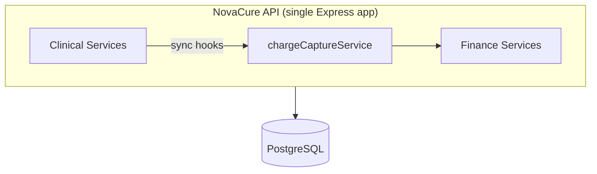

| Pros | Cons |
|------|------|
| Matches existing pharmacy/patient portal patterns | Finance grows large inside one repo |
| ACID transactions across clinical + billing | Team must enforce module boundaries in code |
| No new infra (queues, service mesh) | Scaling API is vertical until split |
| Fastest path to demo and production | |

**When to choose:** Single hospital or small chain, team size &lt; 15 engineers, one PostgreSQL instance, MVP through full RCM.

---

### Option B — Finance microservice (later, when triggers are met)

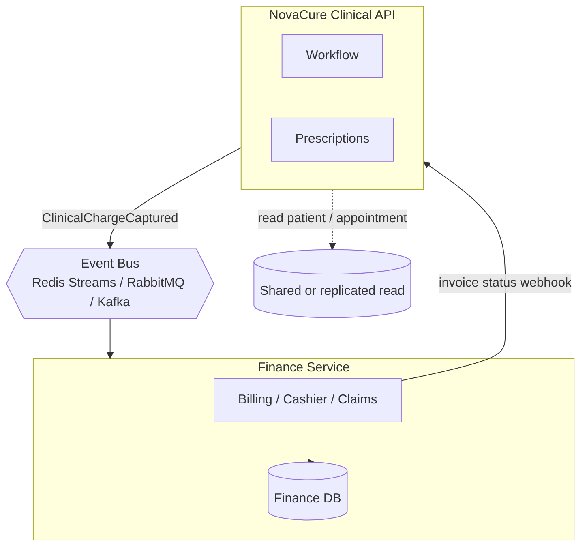

| Pros | Cons |
|------|------|
| Independent deploy & scale for cashier peaks | Distributed transactions (charge void, refund) |
| Finance team owns repo & release cycle | Duplicate auth, tenancy, audit patterns |
| Can swap ERP integration without touching clinical | Requires message bus + idempotency + DLQ |
| Regulatory isolation possible | Higher ops cost |

**When to choose:**

- Multiple hospitals with **separate finance SLAs**
- Finance team wants **independent releases** weekly
- Integration with **external ERP** (SAP, Odoo) is primary
- Cashier throughput &gt; 500 tx/min sustained
- **Compliance** mandates finance data isolation

---

### Option C — Hybrid (recommended long-term for NovaCure)

**Start monolith → extract finance when pain is measurable.**

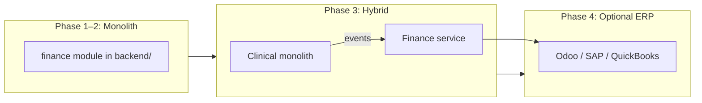

| Phase | Shape |
|-------|--------|
| 1–2 | Finance module inside monolith (`backend/services/finance/`, `backend/models/finance/`) |
| 3 | Extract **read-heavy reporting** or **payment gateway adapter** first |
| 4 | Full finance microservice + event contract versioned (`charge.captured.v1`) |
| 5 | GL posting to external ERP via journal export API |

This mirrors how real hospitals evolve: billing in HMIS first, accounting in ERP later.

---

## 5. Recommended Target Architecture (NovaCure)

### 5.1 Logical modules inside finance

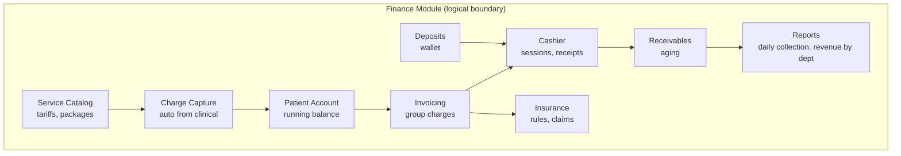

### 5.2 Charge capture — the critical integration layer

**Rule:** Clinical services emit **charge intents**; finance resolves price and persists immutable charge lines.

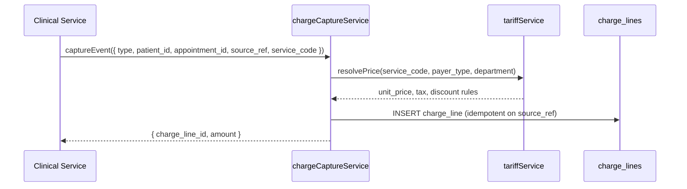

**Idempotency key:** `{source_type}:{source_id}:{service_code}` — prevents double-billing on workflow retry.

**Hook points in existing code (planned):**

| Event | Service file | Suggested trigger |
|-------|--------------|-------------------|
| Schedule admitted | `appointmentService.js` | Registration + consultation fee |
| Workflow completed | `medicalWorkflowService.js` | Visit closure / package billing |
| Prescription finalized | `prescriptionService.js` | Medication charges (estimate) |
| Pharmacy dispensed | `pharmacyPrescriptionService.js` | Actual dispense charge |
| Certificate issued | `medicalCertificateService.js` | Document fee |
| Lab completed | *future lab service* | Per-test tariff |

### 5.3 Proposed data model (Phase 1 core)

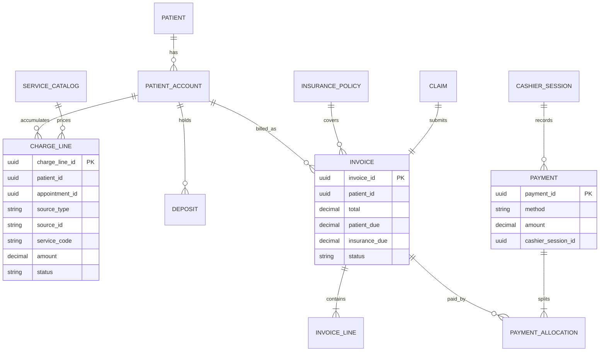

**Link to existing tables:** `patient_id` → `users.user_id`, `appointment_id` → `staff_appointments.appointment_id`, optional `prescription_id`, `pharmacy_prescription_id`.

### 5.4 API surface (aligned with current patterns)

| Audience | Base path | Auth |
|----------|-----------|------|
| Internal finance staff | `/api/finance/*` | JWT + `FINANCE:*` permissions |
| Cashier | `/api/finance/cashier/*` | JWT + `FINANCE:CASHIER` |
| Patient portal | `/api/patient-portal/invoices`, `/payments` | `requirePatientAccount` |
| Admin reports | `/api/finance/reports/*` | `FINANCE:REPORT` |

**Frontend (planned):**

| UI | Route group | Pattern |
|----|-------------|---------|
| Cashier desk | `(private)/finance/cashier` | Like staff appointments |
| Billing office | `(private)/finance/billing` | Invoice management |
| Tariff admin | `(private)/finance/catalog` | Admin config |
| Patient billing | `(patient)/patient/billing` | Replace mocks with RTK `financeApi` |

### 5.5 Permissions (new RBAC group)

```
FINANCE:VIEW          — read invoices, balances
FINANCE:CHARGE        — manual charge adjustment (supervisor)
FINANCE:INVOICE       — create / finalize invoices
FINANCE:CASHIER       — take payments, print receipts
FINANCE:REFUND        — process refunds
FINANCE:DEPOSIT       — record deposits
FINANCE:CLAIM         — insurance claims
FINANCE:REPORT        — financial reports
FINANCE:ADMIN         — tariffs, config
```

---

## 6. Phased Implementation Roadmap

### Phase F1 — Revenue foundation (MVP)

**Goal:** Auto-charges from clinical events, patient account, simple cashier.

| Deliverable | Description |
|-------------|-------------|
| Service catalog | Consultation, lab panel codes, common drugs — ETB prices |
| Charge capture hooks | Admission, workflow complete, pharmacy dispense |
| Patient account | Running balance per encounter |
| Invoice generation | Group charges by visit |
| Cashier | Cash + mobile money, receipt number, partial pay |
| Patient portal | Replace `BillingPage` mocks with live API |
| Audit | All payments logged via `auditService` |

**Out of scope:** Claims submission, GL, deposits.

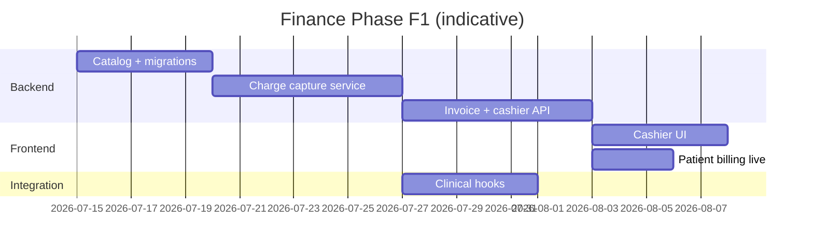

---

### Phase F2 — Deposits & insurance split

| Deliverable | Description |
|-------------|-------------|
| Deposit wallet | Pay on admission, auto-consume |
| Insurance master | Insurers, plans, coverage % |
| Invoice split | Patient vs insurer portions |
| Co-pay at cashier | Collect patient share only |
| Pre-auth placeholder | Manual flag before elective procedures |

---

### Phase F3 — Claims & revenue cycle

| Deliverable | Description |
|-------------|-------------|
| Claim builder | From invoice → insurer format |
| Claim status | Submitted / approved / rejected / resubmit |
| AR aging | 30/60/90 day reports |
| Denial workflow | Rebill to patient or appeal |
| Notifications | Billing alerts in patient portal |

---

### Phase F4 — ERP & optional microservice extraction

| Deliverable | Description |
|-------------|-------------|
| Journal export | Daily summary to Odoo/SAP |
| Finance service split | Only if ops metrics justify it |
| Payment gateway | Telebirr, Chapa, Stripe — adapter pattern |
| Multi-facility | Cost centers per `departments` |

---

## 7. Monolith vs Microservice — Decision Matrix

| Criterion | Monolith | Microservice |
|-----------|----------|--------------|
| Time to first invoice | **Weeks** | Months |
| Matches NovaCure today | **Yes** | No — new infra |
| Cross-module transactions | **Native ACID** | Saga / compensation |
| Team size 2–8 devs | **Ideal** | Overhead |
| Single hospital deploy | **Ideal** | Optional |
| 10+ hospitals, dedicated finance team | Good enough | **Better** |
| External ERP as system of record | Export from monolith | **Natural boundary** |

**Recommendation for NovaCure:** Implement **F1–F3 inside the monolith** with strict folder boundaries and an internal `financeEventBus` (in-process pub/sub). Extract to a microservice only when:

1. Finance deploy cadence conflicts with clinical, **or**
2. Payment/PCI scope requires network isolation, **or**
3. A second product (standalone billing SaaS) is a business goal.

---

## 8. Event Contract (future-proof for split)

Even in the monolith, use a **versioned event shape** so extraction is mechanical later:

```json
{
  "event": "charge.captured.v1",
  "occurred_at": "2026-07-06T14:00:00Z",
  "idempotency_key": "workflow:log_abc:CONSULT_OPHTH",
  "payload": {
    "patient_id": "uuid",
    "appointment_id": "uuid",
    "source_type": "medical_history_log",
    "source_id": "uuid",
    "service_code": "CONSULT_OPHTH",
    "quantity": 1,
    "department_id": "uuid",
    "performed_by": "uuid"
  }
}
```

**Phase 1 implementation:** `financeEventEmitter.emit()` in-process.  
**Phase 4:** Same payload published to Redis Streams / RabbitMQ; finance consumer is the extracted service.

---

## 9. Integration with Existing Patient Insurance Data

`patient_profiles.insurance_profile` (JSONB) today stores display fields. Finance Phase F2 should **normalize** without breaking the portal:

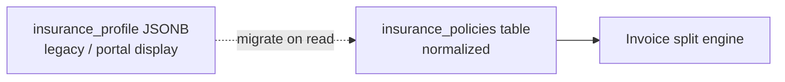

Keep portal `PUT /patient-portal/me` working; finance admin can link policy to insurer master.

---

## 10. Security & Compliance Notes

| Topic | Approach |
|-------|----------|
| Segregation of duties | Cashier cannot edit tariffs; supervisor approves voids/refunds |
| Audit trail | Extend `audit_logs` — payment_id, invoice_id, actor, before/after |
| Receipt integrity | Sequential receipt numbers per cashier session |
| PCI | No card PAN storage; use payment gateway tokenization |
| Ethiopia context | ETB default, mobile money (Telebirr) as first gateway adapter |

---

## 11. What We Build First (concrete next steps)

When implementation starts, order should be:

1. **Migrations** — `service_catalog`, `charge_lines`, `patient_accounts`, `invoices`, `payments`
2. **`chargeCaptureService`** — idempotent capture + tariff lookup
3. **Hooks** — admission in `appointmentService`, dispense in `pharmacyPrescriptionService`
4. **`/api/finance/cashier`** — post payment, print receipt payload
5. **`/api/patient-portal/invoices`** — patient read-only + balance
6. **Frontend** — cashier page + wire `BillingPage.tsx`
7. **Seeder** — ophthalmology tariff preset aligned with demo visit
8. **Docs** — extend `CLINICAL_DEMO.md` with cashier walkthrough

---

## 12. Summary

| Question | Answer |
|----------|--------|
| Is finance just payments? | No — it is charge capture → invoicing → collection → reporting |
| Does NovaCure have finance today? | UI mocks + patient insurance JSON only |
| Monolith or microservice? | **Monolith first**; microservice when scale or org structure demands it |
| How do charges appear? | Auto from clinical hooks — never re-typed at cashier |
| What matches our architecture? | Same pattern as pharmacy/patient portal: services + routes + RBAC |
| First production slice? | **F1:** catalog + charge capture + cashier + live patient billing |

---

## Related documents

- [CLINICAL_DEMO.md](./CLINICAL_DEMO.md) — current clinical demo path (charge sources for finance)
- `backend/services/appointmentService.js` — admission hook point
- `backend/services/pharmacyPrescriptionService.js` — dispense hook point
- `frontend/src/features/patient-portal/pages/BillingPage.tsx` — UI to replace
