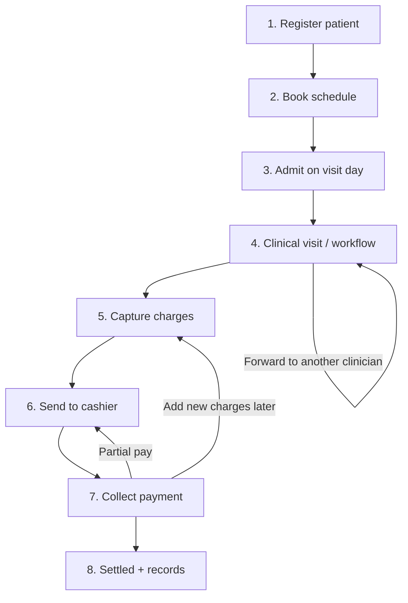
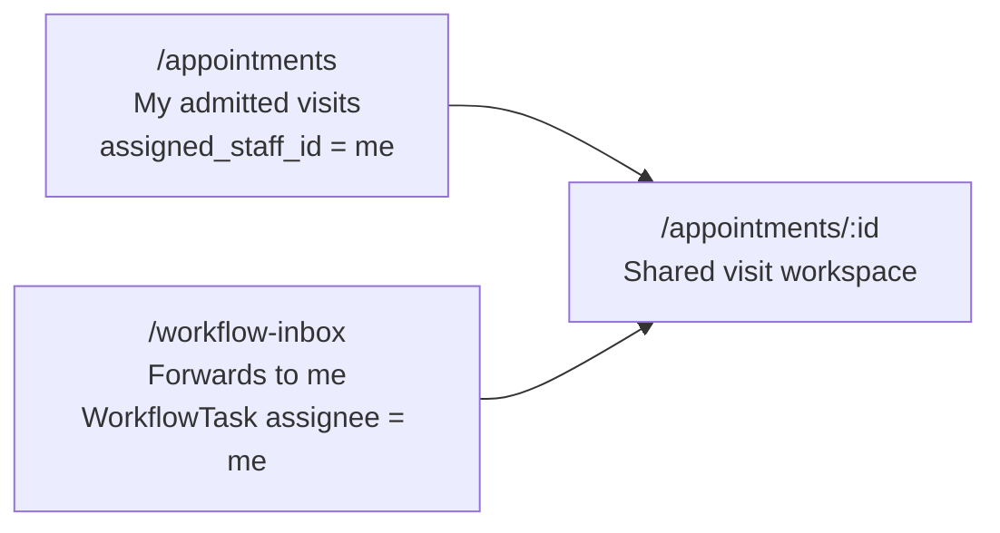

# Outpatient Workflow — Registration to Payment

This document describes the **end-to-end outpatient journey** in NovaCure as implemented today: from registering a patient through scheduling, admission, clinical care, billing, cashier collection, and admin reporting.

It reflects the live product (including Finance Phases 1–3: unlock rules, receipt templates, collection requests, cashier desk tabs, and workflow send-to-cashier).

---

## 1. Big picture



**Core objects**

| Object | Meaning |
|--------|---------|
| **Patient** (`User` + `PatientProfile`) | Registered person in the hospital |
| **PatientSchedule** | Booked slot (date, time, assigned clinician) |
| **StaffAppointment** | The live visit created when the schedule is **admitted** |
| **MedicalHistoryLog / WorkflowTask** | Clinical timeline entries and forward inbox items |
| **AppointmentBillingAccount** | One running bill per visit |
| **BillingCollectionRequest** | Each time staff sends the visit to the cashier |
| **CashierSession / CashierPayment** | Cashier shift + individual receipts |

Everything after admission hangs off **`appointment_id`**.

---

## 2. Who does what (permissions)

| Step | Typical role | Key permissions |
|------|----------------|-----------------|
| Register patient | Reception / Admin | `PATIENTS:CREATE`, `PATIENTS:READ` |
| Book / reschedule | Reception | `PATIENTS:SCHEDULE` |
| Be assigned as clinician | Doctor / Optometrist / Nurse | `PATIENTS:RECEIVE_APPOINTMENT` |
| Receive forwards / workflow inbox | Clinical staff | `PATIENTS:RECEIVE_PATIENT` + `WORKFLOW:READ` |
| Clinical actions | Assigned / forwarded staff | `WORKFLOW:SUBMIT`, `FORWARD`, `PRESCRIBE`, `COMPLETE`, … |
| Add bill lines | Clinical / billing clerk | `APPOINTMENT_BILLING:CREATE` |
| Send to cashier | Clinical / reception | `BILLING_COLLECTION:SEND` |
| Collect payment | Cashier / Reception | `CASHIER_SESSION:*`, `CASHIER_QUEUE:VIEW`, `CASHIER_PAYMENT:CREATE` |
| Void payment | Supervisor / Admin | `CASHIER_PAYMENT:VOID` |
| Daily collections report | Admin / Finance | `FINANCE_COLLECTIONS:VIEW` |
| Receipt templates | Admin | `RECEIPT_TEMPLATE:*` |

**Important split**

- **`receive_appointment`** → patient is booked **to you**; visit appears under **Appointments**.
- **`receive_patient`** → someone **forwards** the patient to you; task appears under **Workflow inbox**.

---

## 3. Step-by-step workflow

### Step 1 — Patient registration

| | |
|--|--|
| **Who** | Staff with patient create permission |
| **Where** | `/patients/list` → Register Patient |
| **API** | `POST /api/patients` |

**What happens**

1. Staff enters demographic / form-field data.
2. System creates an internal patient user + `PatientProfile` (including `patient_code`).
3. Patient appears in the patient list.

**Next:** Book a schedule for this patient.

---

### Step 2 — Schedule (book an appointment)

| | |
|--|--|
| **Who** | Staff with `PATIENTS:SCHEDULE` |
| **Where** | `/patients/list/[patientId]/schedule` |
| **API** | `POST /api/schedules`, `PATCH /api/schedules/:id` |

**What happens**

1. Staff picks date, time slot, and **assigned clinician** (must have `receive_appointment`).
2. A `PatientSchedule` row is created with status such as `scheduled`.
3. Slot rules, horizons, and overlap checks apply.

**Schedule statuses (common):** `scheduled`, `pending`, `updated`, `rescheduled`, `completed`, `cancelled`, **`admitted`**.

**Alternate path:** Patient portal booking (`/patient/appointments`) creates a schedule with status `scheduled` without staff admit yet.

**Next:** On the visit day, admit the schedule.

---

### Step 3 — Admission / check-in (creates the visit)

| | |
|--|--|
| **Who** | Reception / scheduling staff |
| **Where** | Same schedule page → mark slot **Admitted** |
| **API** | `PATCH /api/schedules/:id` with `{ status: "admitted" }` |

**What happens**

1. Admission is allowed **only on the appointment date (today)**.
2. System creates (or links) a **`StaffAppointment`**:
   - `status: admitted`
   - `workflow_status: active`
   - `admitted_at` / `admitted_by`
   - linked 1:1 to the schedule
3. Assigned clinician is notified.

**Next:** Visit appears in the clinician’s **Appointments** list.

---

### Step 4 — Clinical visit (workflow)

| | |
|--|--|
| **Who** | Assigned clinician, or staff who received a forward |
| **Where** | `/appointments` → `/appointments/[id]` |
| **Also** | `/workflow-inbox` for forwards |
| **API** | `/api/workflow/*` |

**What clinicians can do**

| Action | Permission | Effect |
|--------|------------|--------|
| Submit clinical form / note | `WORKFLOW:SUBMIT` | Timeline entry (`MedicalHistoryLog`) |
| Forward to another clinician | `WORKFLOW:FORWARD` | Creates pending `WorkflowTask` for receiver (inbox) |
| Return | `WORKFLOW:RETURN` | Return task to prior staff |
| Prescribe | `WORKFLOW:PRESCRIBE` | Prescription + workflow log |
| Complete workflow | `WORKFLOW:COMPLETE` | `workflow_status = completed`; pending tasks cancelled |

**Where the patient “lives” during treatment**



- **Appointments** = visits **originally assigned to you** at admission.
- **Workflow inbox** = patients **forwarded (or returned) to you**.
- Both open the same detail page for clinical work + billing.

**Next:** Capture billable services anytime during the visit.

---

### Step 5 — Billing charge capture

| | |
|--|--|
| **Who** | Staff with appointment billing create |
| **Where** | Billing card on `/appointments/[id]` |
| **API** | `/api/appointment-billing/:appointmentId` |

**What happens**

1. First charge auto-creates an **`AppointmentBillingAccount`** for the visit (`draft`).
2. Staff adds services from the billing catalog (department-scoped where applicable).
3. Totals recalculate: subtotal, tax, discounts, grand total, balance due.
4. Account status becomes `pending_payment` once there are charges and nothing (or not everything) is paid.

**Account statuses**

| Status | Meaning |
|--------|---------|
| `draft` | No active line items yet |
| `pending_payment` | Charges exist; nothing paid (or reopened after new charges) |
| `partially_paid` | Some money collected; balance remains |
| `paid` | Balance is zero |
| `cancelled` / `refunded` | Closed; no further charging |

**Unlock rule (Phase 1 — Option B)**

- New charges can be added while pending or partially paid, and even after full payment (to support later services).
- Only **`cancelled`** / **`refunded`** fully lock the bill.

**Next:** Send the patient to the cashier when collection is needed.

---

### Step 6 — Send to cashier

| | |
|--|--|
| **Who** | Staff with `BILLING_COLLECTION:SEND` |
| **Where** | Billing card **Send to cashier**, or Workflow **Forward → Cashier desk** |
| **API** | `POST /api/appointment-billing/:appointmentId/send-to-cashier` |

**What happens**

1. System validates: active line items exist and **balance due > 0**.
2. Creates a **`BillingCollectionRequest`** (`pending`) with amount snapshot.
3. Any previous open request for that visit becomes **`superseded`**.
4. Account is ensured `pending_payment` if it was still `draft`.
5. Cashiers with `CASHIER_QUEUE:VIEW` get a **Finance** notification.

**Collection request statuses**

| Status | Meaning |
|--------|---------|
| `pending` | Sent; waiting for collection |
| `partially_collected` | At least one partial payment since send |
| `collected` | Visit balance settled |
| `superseded` | Replaced by a newer send |
| `cancelled` | Cancelled |

**Multiple visits to the cashier same day**

Example:

1. Consultation charged → Send to cashier → patient pays half.
2. Lab added later → Send to cashier again (new request supersedes the old open one).
3. Cashier queue always shows the **current balance** for that visit (one queue row, not duplicates).

**Next:** Cashier opens desk and collects.

---

### Step 7 — Cashier collection

| | |
|--|--|
| **Who** | Cashier / Reception with cashier permissions |
| **Where** | `/finance/cashier` |
| **API** | `/api/finance/cashier/*` |

#### 7.1 Open session

1. Cashier opens a session (optional opening float).
2. Only one open session per cashier user.
3. Payments require an open session.

#### 7.2 Queue

Queue shows visits with account status:

- `pending_payment`
- `partially_paid`

Optional filters: visit date, name / MRN / phone search.

Items sent via collection request show a **Sent to cashier** badge.

Deep link from notifications: `/finance/cashier?account={accountId}`.

#### 7.3 Collect payment

1. Select patient → review line items, totals, prior payments.
2. Collect **full** or **partial** amount (cannot exceed balance due).
3. Split tenders supported: cash, mobile money, card, bank transfer, other.
4. System writes `CashierPayment` + `PaymentTender` rows.
5. Account becomes `partially_paid` or `paid`.
6. Collection request updates to `partially_collected` or `collected`.
7. Receipt number issued (`RCP-YYYY-######`) and HTML rendered from the **default receipt template**.

#### 7.4 Partial vs full vs leftover

| Case | Result |
|------|--------|
| Partial payment | Stays in queue with remaining balance + receipt shows previously paid / this payment / remaining |
| Full payment | Leaves queue; appears under **Paid today** |
| New charges after pay | Staff add lines → send again → returns to queue with new due amount |
| Already settled (0 due) | Send to cashier is rejected |

#### 7.5 Reprint & void

- **Reprint** from bill detail / Paid today / History (preview + print).
- **Void** requires `CASHIER_PAYMENT:VOID` and a reason (≥ 5 characters); reverses money on the account and updates statuses.

#### 7.6 Close session

Close dialog shows a **session summary**:

- Payment count / void count  
- Total collected  
- Totals by method  
- Expected cash in drawer (opening float + cash collected)  
- Variance vs counted cash  

---

### Step 8 — Where paid patients and money are recorded

| View | Who | Where | Contents |
|------|-----|-------|----------|
| **Paid today** | Cashier | Cashier desk tab | Today’s completed payments; reprint |
| **History** | Cashier | Cashier desk tab | Date-range payment search |
| **Daily collections** | Admin / Finance | `/finance/collections` | All cashiers; totals by cashier and method |
| **Visit billing card** | Clinical / billing | Appointment detail | Paid amounts, collection history |
| **Receipt templates** | Admin | `/finance/receipt-templates` | Configurable payment slip HTML |

Fully paid visits **do not stay** in the active cashier queue. They are recoverable from Paid today / History / Daily collections.

---

## 4. Appointments list vs Workflow inbox vs Cashier

| Surface | Shows | Does not show |
|---------|--------|----------------|
| **Appointments** `/appointments` | Visits assigned to me at admission | Forwards from other clinicians |
| **Workflow inbox** `/workflow-inbox` | Pending forwards/returns to me | My original assigned list only |
| **Cashier queue** `/finance/cashier` | Visits with unpaid / partial balance | Fully paid visits |

All three can open (or lead to) the same visit detail for clinical / billing context; cashier focuses on payment.

---

## 5. Status ladder (condensed)

```
Patient registered
  → PatientSchedule: scheduled
  → (visit day) PatientSchedule: admitted
  → StaffAppointment: admitted, workflow_status: active
  → Clinical logs / optional WorkflowTask (forward)
  → Billing account: draft → pending_payment
  → Collection request: pending
  → CashierPayment(s): partial or full
  → Account: partially_paid → paid
  → Collection request: partially_collected → collected
  → Optional: workflow_status: completed
```

---

## 6. Worked example (ophthalmology outpatient)

1. **Reception** registers Amanuel and books him with Dr. Sara for today at 10:00.
2. Amanuel arrives; reception **admits** the schedule → visit created for Dr. Sara.
3. Dr. Sara opens **Appointments**, examines the patient, submits a clinical note, adds **Consultation** billing.
4. She uses **Forward → Cashier desk**. Amanuel appears in the cashier queue (ETB 500 due). Finance notification reaches reception.
5. Cashier opens a session and collects **ETB 300** cash → receipt printed; account `partially_paid`.
6. Patient returns for refraction later. Dr. Sara adds **Refraction** (ETB 200). New balance ETB 400. She **sends to cashier** again.
7. Cashier collects remaining ETB 400 → account `paid`; collection request `collected`; visit leaves the queue.
8. End of day: cashier closes session with summary; admin reviews **Daily collections** across cashiers.

---

## 7. Route map

| Stage | Frontend route |
|-------|----------------|
| Patient registry | `/patients/list`, `/patients/list/[patientId]` |
| Schedule / admit | `/patients/list/[patientId]/schedule` |
| My visits | `/appointments`, `/appointments/[id]` |
| Forwards | `/workflow-inbox` |
| Billing catalog | `/billing/services` |
| Cashier desk | `/finance/cashier` |
| Admin collections | `/finance/collections` |
| Receipt templates | `/finance/receipt-templates` |
| Patient self-booking | `/patient/appointments` |

---

## 8. API map

| Domain | Prefix |
|--------|--------|
| Patients | `/api/patients` |
| Schedules | `/api/schedules` |
| Staff appointments | `/api/appointments` |
| Clinical workflow | `/api/workflow` |
| Visit billing | `/api/appointment-billing` |
| Cashier / collections | `/api/finance/cashier` |
| Receipt templates | `/api/finance/receipt-templates` |
| Billing catalog | `/api/billing-services` |
| Patient portal | `/api/patient-portal` |

---

## 9. Related docs

| Doc | Contents |
|-----|----------|
| [`FINANCE_MODULE_ARCHITECTURE.md`](./FINANCE_MODULE_ARCHITECTURE.md) | Broader finance roadmap (insurance, deposits, ERP) |
| [`CLINICAL_DEMO.md`](./CLINICAL_DEMO.md) | Demo seed / clinical walkthrough |
| [`../backend/docs/TEST_USERS.md`](../backend/docs/TEST_USERS.md) | Test accounts and permission groups |

---

## 10. Out of scope (not yet required for this journey)

These exist as architecture notes or later phases, but are **not** required for the workflow above:

- Insurance claim splits / co-pay automation  
- Patient deposits / wallet  
- Payment gateways (Telebirr, Chapa, etc.)  
- Automatic charge capture from lab/pharmacy dispense (charges are mostly manual today)  
- Full GL / ERP export  

---

*Last updated to match Finance Phases 1–3 (receipt templates, collection requests, cashier session summary, workflow send-to-cashier).*
