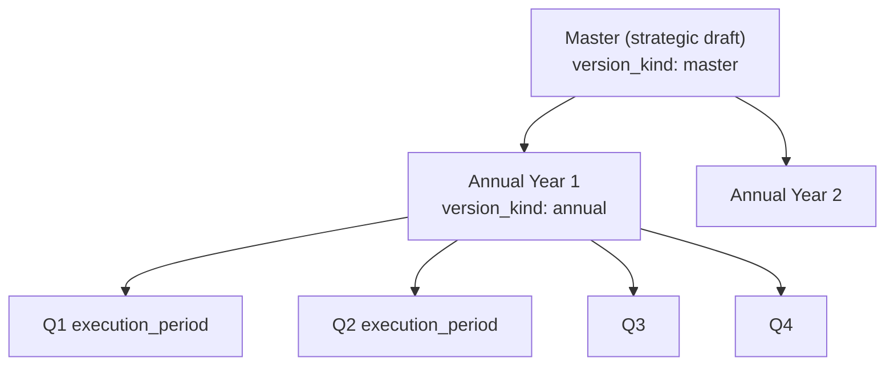
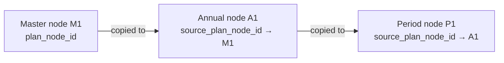
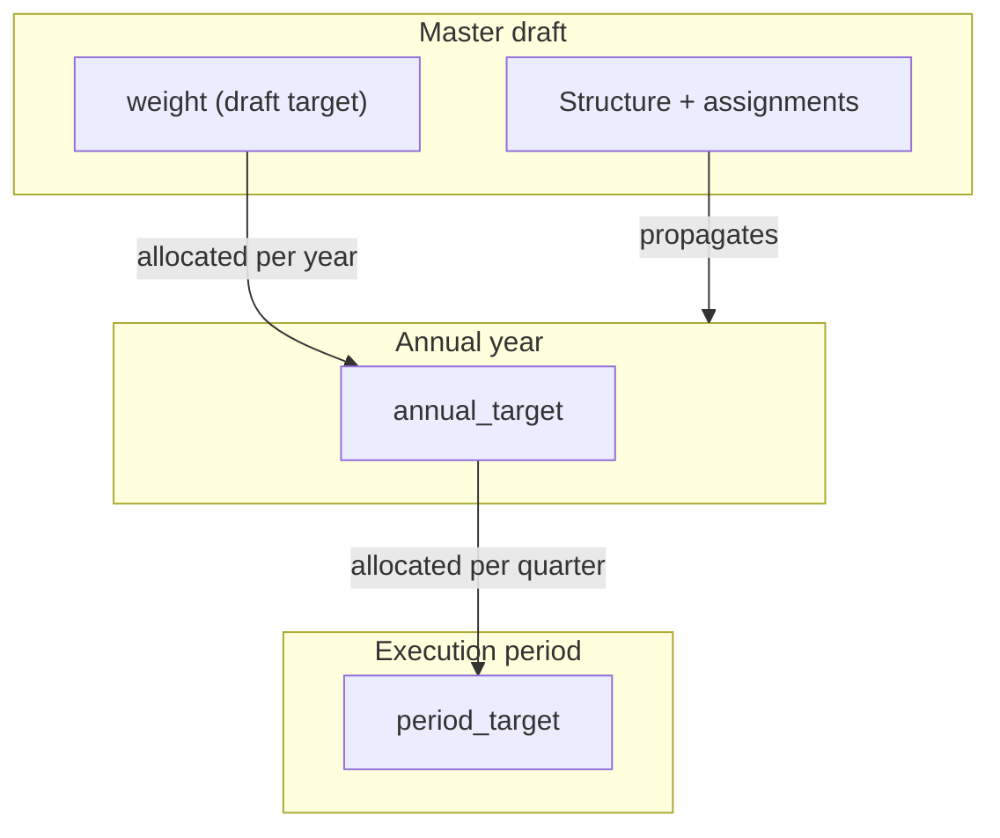
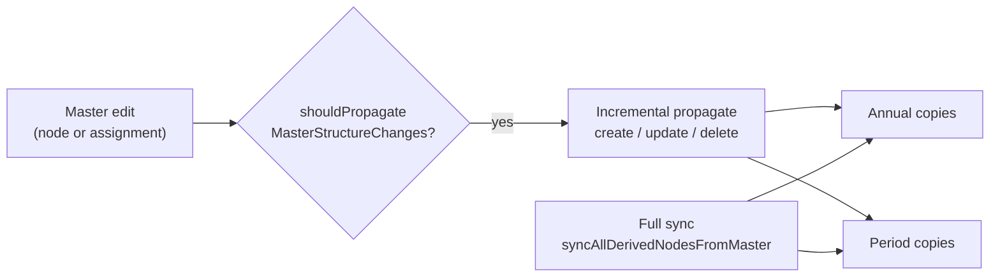
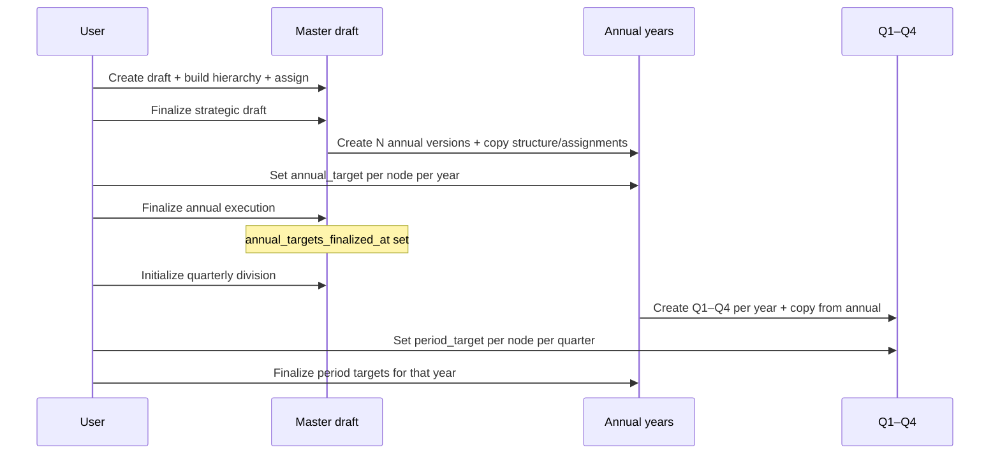

# Plan Version Lifecycle and Propagation

This document describes how strategic plan versions are structured, how they reference each other, which user actions create new versions, and how changes propagate from the master draft to annual years and execution periods (quarterly division).

---

## The three version layers

Every plan is a **tree of `PlanVersion` records**, each with a `version_kind`:

| Kind | What it is | Parent link |
|------|------------|-------------|
| `master` | Strategic draft (goals, KPIs, structure, assignments) | none |
| `annual` | One execution year (Year 1, Year 2, …) | `parent_plan_version_id` → master |
| `execution_period` | Subdivision inside a year (Q1–Q4, H1/H2, custom) | `parent_plan_version_id` → annual |

### Version tree



**Text view:**

```
Master (strategic draft)
├── Annual Year 1
│   ├── Q1 (execution_period)
│   ├── Q2
│   ├── Q3
│   └── Q4
├── Annual Year 2
│   └── …
└── …
```

---

## How nodes refer to each other

Each layer has its **own copy** of the hierarchy (`PlanNode` rows), linked by `source_plan_node_id`:



**Field mapping:**

```
Master node          Annual node                    Period node
───────────          ───────────                    ───────────
plan_node_id: M1  →  source_plan_node_id: M1   →   source_plan_node_id: A1
                     plan_version_id: annual        plan_version_id: Q1
```

**Rules:**

- **Annual nodes** point back to **master nodes** via `source_plan_node_id`.
- **Period nodes** point back to **annual nodes** (not directly to master).
- Within a version, parent/child is still `parent_id` (normal tree).
- Each version has **its own UUIDs** for nodes — they are copies, not shared rows.

---

## What each layer owns

| Data | Owned by | Propagated? |
|------|----------|-------------|
| Structure (title, type, level, order, weight as draft target) | **Master** | Yes → annual → period |
| Assignments (dept / user / sector) | **Master** | Yes → annual → period |
| `annual_target` | **Annual node** | No — set per year |
| `period_target` | **Period node** | No — set per quarter/period |

**Summary:**

- **Structure + assignments** flow **down** from the strategic draft.
- **Targets** are filled **down the chain**: draft weight → annual target → period target.

### Data ownership and flow



---

## Actions that create versions

### 1. Create strategic draft

**Action:** `POST /plan/versions`  
**Creates:** one `master` version (`status: draft`)

Optional: if `based_on_version_id` is set, nodes and assignments are carried forward from a previous master into the new draft (new master version, copied content).

### 2. Finalize strategic draft (first time)

**Action:** `POST /plan/versions/:id/finalize`  
**Creates:** one **annual version per planning year** (e.g. a 5-year plan → 5 annual versions)

For each annual year the system:

1. Creates `PlanVersion` (`version_kind: annual`, `parent_plan_version_id = master`)
2. Calls `copyNodesAndAssignments(master → annual)` — full copy of tree + assignments

The master becomes `status: finalized`.

### 3. Finalize strategic draft (re-finalize)

**Action:** same endpoint, but annual versions **already exist**

Does **not** create new annual versions. Instead:

- Sets master back to `finalized`
- Runs `syncAllDerivedNodesFromMaster` — reconciles all master nodes and assignments into existing annual/period copies

This is what happens after **re-open for edit → change structure → finalize again**.

### 4. Initialize execution periods (quarterly division)

**Action:** initialize execution periods (from the master Annual Execution tab)  
**Creates:** `execution_period` versions per annual year

For each year (e.g. quarterly → Q1, Q2, Q3, Q4):

1. Creates `PlanVersion` (`version_kind: execution_period`, `parent_plan_version_id = annual`)
2. Calls `copyNodesAndAssignments(annual → period)` — copies tree + assignments from that year

Also sets `period_subdivision_mode` on the master (`quarterly`, `semi_annual`, or `custom`).

**Prerequisite:** annual targets must already be finalized.

---

## Actions that do not create versions

These actions advance workflow state but do not create new `PlanVersion` rows:

| Action | What it does |
|--------|----------------|
| **Re-open for edit** | Master → `draft`; unlocks non-completed annual/periods; runs full sync from master |
| **Finalize annual execution** | Sets `annual_targets_finalized_at` on master; annual years ready for period setup |
| **Update annual target** | Writes `annual_target` on annual nodes only |
| **Finalize execution period targets** | Sets `period_targets_finalized_at` on that annual year |
| **Finalize global period targets** | Marks all years’ period targets done on master |
| **Complete annual / period** | Sets that version `status: completed` |
| **Start plan process** | Sets `process_started_at` on master |
| **Lock / unlock annual** | Status/lock flags only |

---

## How changes propagate (draft → annual → division)

Propagation is **not automatic on every save**. It runs when the master is **finalized**, or when the master is **draft but annual versions already exist** (re-edit scenario).

### Incremental propagation (as you edit the master)

| Master change | Propagation |
|---------------|-------------|
| Create node | `propagateMasterPlanNodeCreate` → upsert annual copies → upsert period copies |
| Update node | `propagateMasterPlanNodeUpdate` → same |
| Delete node | `propagateMasterPlanNodeDelete` → removes derived annual + period nodes |
| Create assignment | `propagateInternalAssignmentCreate` / `propagateExternalAssignmentCreate` → copies to annual + period nodes |

**Condition:** `shouldPropagateMasterStructureChanges` — true if the master is finalized **or** draft with existing annual versions.

### Full reconciliation (bulk sync)

`syncAllDerivedNodesFromMaster` runs on:

- **Re-open for edit**
- **Re-finalize strategic draft**

It:

1. Walks every master node (parents first)
2. Upserts matching annual + period nodes
3. Syncs assignments from master → annual → period
4. Deletes orphan derived nodes whose master source was removed

### Period initialization (one-time per year)

When quarterly division is first set, each new Q1–Q4 version gets a **full snapshot** from the annual year via `copyNodesAndAssignments`.

After that, further master edits propagate through the incremental and sync mechanisms above.

### Propagation flow



**Triggers for full sync:** re-open for edit, re-finalize strategic draft.

---

## Typical end-to-end lifecycle



**Steps:**

1. **Create draft** — build hierarchy and assignments on the master.
2. **Finalize strategic draft** — creates annual versions; copies structure and assignments.
3. **Set annual targets** — per node, per year (`annual_target` on annual nodes).
4. **Finalize annual execution** — locks in annual target distribution.
5. **Initialize execution periods** — creates Q1–Q4 (or semi-annual/custom) per year; copies from annual.
6. **Set period targets** — per node, per quarter (`period_target` on period nodes).
7. **Finalize period targets** — per year, then globally on the master when all years are done.

---

## Version reference fields

### Between versions (`PlanVersion`)

| Field | Purpose |
|-------|---------|
| `parent_plan_version_id` | Child → parent (annual → master, period → annual) |
| `based_on_version_id` | Optional: new master copied from an older master |
| `planning_year` | Calendar year for annual/period versions |
| `sequence_index` | Order within siblings (Year 1, Year 2, Q1, Q2, …) |
| `period_label` | Display label for execution periods (e.g. `Q1`) |
| `period_subdivision_mode` | `quarterly`, `semi_annual`, or `custom` (set on master and annual) |
| `annual_targets_finalized_at` | Master milestone: annual targets locked |
| `period_targets_finalized_at` | Master/annual milestone: period targets locked |
| `finalized_at` | Master strategic draft finalized |
| `process_started_at` | Execution process started |

### Between nodes (`PlanNode`)

| Field | Purpose |
|-------|---------|
| `plan_version_id` | Which version this node belongs to |
| `parent_id` | Hierarchy within that version |
| `source_plan_node_id` | Lineage link to the node it was copied from in the parent layer |
| `annual_target` | Target for this node in an annual version |
| `period_target` | Target for this node in an execution period version |
| `weight` | Draft/strategic target on the master |

### Assignments

- Each version has its **own** assignment rows (`plan_node_id` points to that version’s node).
- Branch assignments (`branch_external_assignment_id`, `branch_internal_assignment_id`) are remapped to the matching assignment in the derived version when propagated.

---

## Mental model

1. **Master** = source of truth for **what** the plan is and **who** owns each KPI.
2. **Annual** = **how much** per year (`annual_target`).
3. **Execution period** = **how much** per quarter/period (`period_target`).
4. Versions are **not regenerated** on every edit — they are **created at milestones** (finalize draft, initialize periods) and then **kept in sync** when the master changes.
5. After re-editing a finalized plan, annual and period versions **remain**; their copies of nodes and assignments are updated via propagation and sync.

---

## Related code

| Area | Location |
|------|----------|
| Version model | `backend/models/plan/PlanVersion.js` |
| Node model | `backend/models/plan/planNode.js` |
| Lifecycle (finalize, periods, reopen) | `backend/services/planVersionLifecycleService.js` |
| Master → annual/period propagation | `backend/services/planMasterEditService.js` |
| Copy nodes + assignments | `copyNodesAndAssignments()` in `planVersionLifecycleService.js` |
| Assignment propagation trigger | `backend/controllers/plan/planAssignmentController.js` |
| Node CRUD propagation trigger | `backend/controllers/plan/planController.js` |
