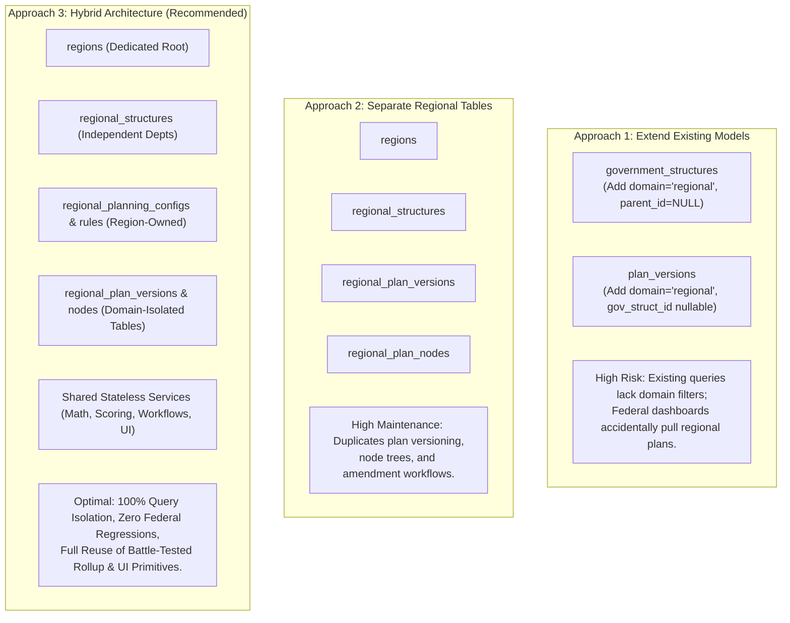
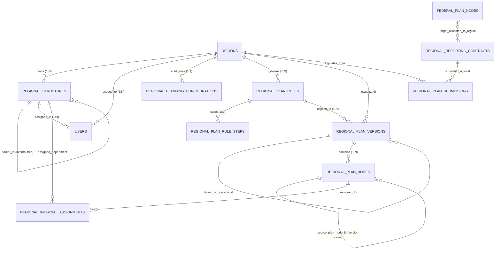
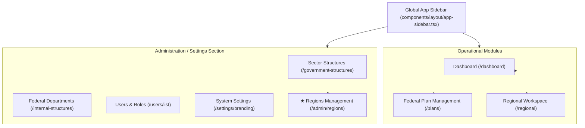
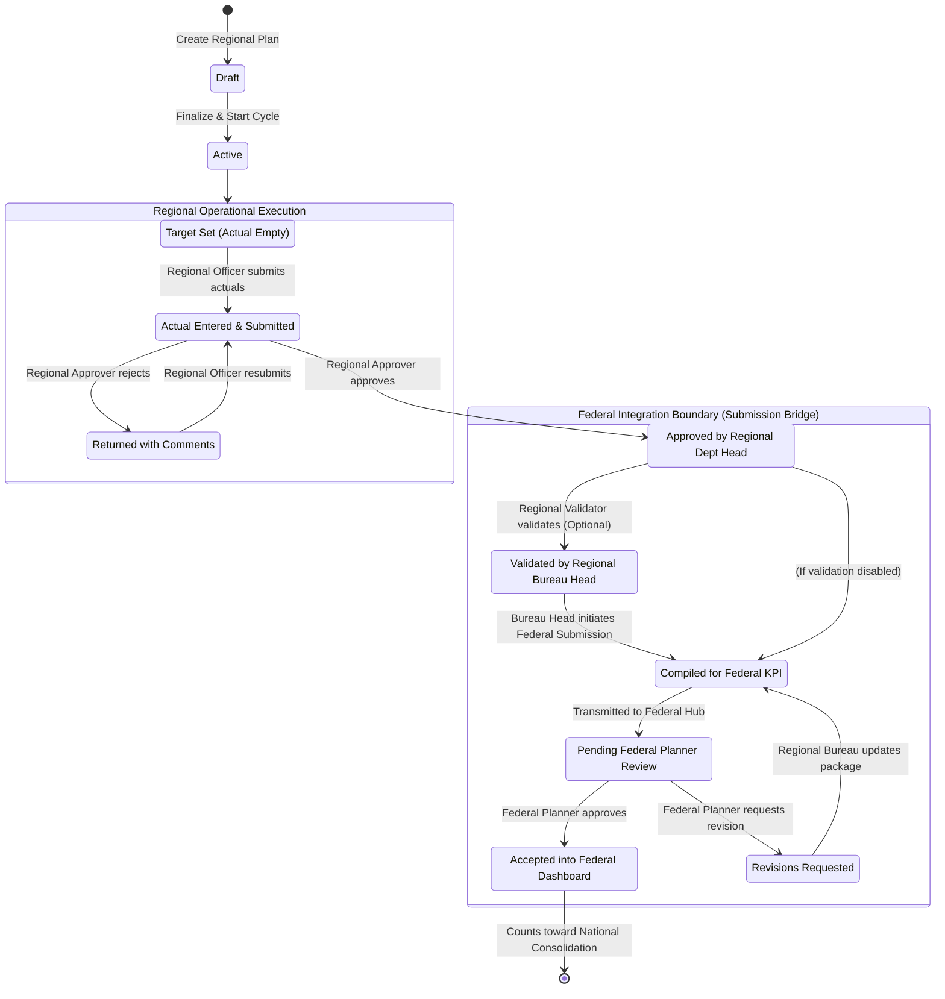
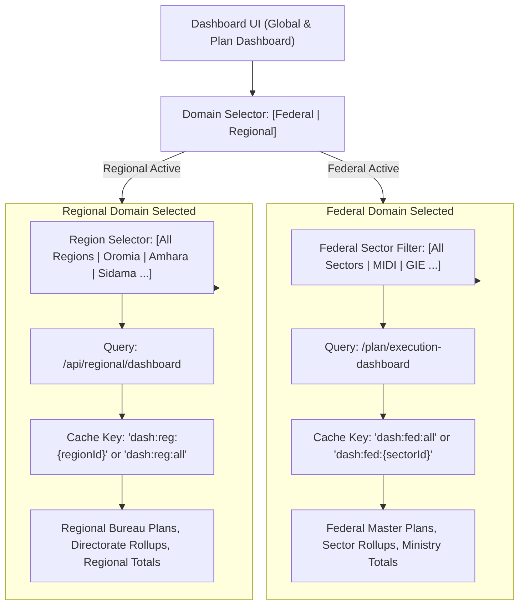
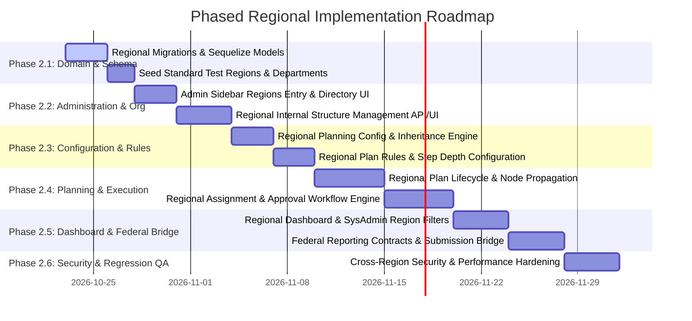

# Phase 2 — Independent Regional Planning Architecture and Federal Reporting Integration Design

**Project:** Ministry of Mines Plan Management System  
**Repository:** `MoM/projects/plan-management-system`  
**Phase:** 2 — Regional Domain Model, Independent Configuration, Planning Lifecycle, Permissions, and Dashboard Integration  
**Mode:** Architecture & Technical Specification Only (Strict Read-Only Design — No Implementation / Code Modifications Applied)  
**Date:** October 2026  
**Status:** Architecture and Design Complete  

---

## Table of Contents

1. [A. Verified Current-State Architecture](#a-verified-current-state-architecture)
2. [B. Proposed Domain and Ownership Model](#b-proposed-domain-and-ownership-model)
3. [C. Sidebar and Navigation Design](#c-sidebar-and-navigation-design)
4. [D. Regional Configuration Design](#d-regional-configuration-design)
5. [E. Planning and Approval Workflow](#e-planning-and-approval-workflow)
6. [F. API and Permission Design](#f-api-and-permission-design)
7. [G. Dashboard and Reporting Design](#g-dashboard-and-reporting-design)
8. [H. Database and Migration Strategy](#h-database-and-migration-strategy)
9. [I. Security, Integrity, and Regression Risks](#i-security-integrity-and-regression-risks)
10. [J. Phased Implementation Plan](#j-phased-implementation-plan)

---

## A. Verified Current-State Architecture

This section documents the actual, verified state of the repository following direct inspection of backend models, routers, controllers, services, database migrations, and frontend components.

### 1. Verified Repository Facts

| Domain Layer | File / Symbol | Verified Implementation Detail |
|---|---|---|
| **Organizational Tree** | [`backend/models/structure/governmentStructure.js`](file:///c:/Users/Amanuel%20Daniel/Desktop/MoM/projects/plan-management-system/backend/models/structure/governmentStructure.js#L8-L31) | Self-referencing recursive hierarchy on `parent_id`. Level 1 represents Federal Ministry of Mines; Level 2 represents Federal Sectors/Institutes (MIDI, GIE). Model has unique index on `["parent_id", "name"]`. |
| **Internal Organization** | [`backend/models/structure/internalStructure.js`](file:///c:/Users/Amanuel%20Daniel/Desktop/MoM/projects/plan-management-system/backend/models/structure/internalStructure.js#L8-L36) | Enforces `government_structure_id` NOT NULL. Internal departments/directorates have optional self-referencing `parent_id`. Controller enforces that each `government_structure_id` has exactly one root internal structure (`parent_id: null`). |
| **User Scoping** | [`backend/models/user/user.js`](file:///c:/Users/Amanuel%20Daniel/Desktop/MoM/projects/plan-management-system/backend/models/user/user.js#L23-L32) | Users associate with `government_structure_id` and `internal_structure_id`. Roles associate via `UserRoles` join table. |
| **Role Scoping** | [`backend/models/user/role.js`](file:///c:/Users/Amanuel%20Daniel/Desktop/MoM/projects/plan-management-system/backend/models/user/role.js#L42-L50) | Roles contain `scope: ENUM('structure', 'global', 'private')` and nullable `government_structure_id`. |
| **Plan Versioning** | [`backend/models/plan/PlanVersion.js`](file:///c:/Users/Amanuel%20Daniel/Desktop/MoM/projects/plan-management-system/backend/models/plan/PlanVersion.js#L77-L101) | Mandatory `government_structure_id`. Tracks `version_kind: ENUM('master', 'annual', 'execution_period')`, `parent_plan_version_id`, `review_snapshot_*`, and `execution_snapshot_*`. |
| **Plan Nodes** | [`backend/models/plan/planNode.js`](file:///c:/Users/Amanuel%20Daniel/Desktop/MoM/projects/plan-management-system/backend/models/plan/planNode.js#L54-L141) | Belongs to `plan_version_id`. Hierarchical tree on `parent_id`. Cloned across versions using `source_plan_node_id`. Unique index on `["parent_id", "title", "plan_version_id"]`. |
| **Planning Config** | [`backend/models/plan/PlanningConfiguration.js`](file:///c:/Users/Amanuel%20Daniel/Desktop/MoM/projects/plan-management-system/backend/models/plan/PlanningConfiguration.js#L36-L92) | Global default record has `government_structure_id = null`. Sector overrides have `government_structure_id = sectorId`. Configures duration, target units, and breakdown mode (`quarterly`, `semi_annual`, `monthly`, `custom`). |
| **Plan Rules** | [`backend/models/plan/PlanRule.js`](file:///c:/Users/Amanuel%20Daniel/Desktop/MoM/projects/plan-management-system/backend/models/plan/PlanRule.js#L46-L90) | Configures hierarchy levels via `PlanRuleStep` (`strategic` $\to$ `goal` $\to$ `kpi` $\to$ `task`), `performance_scoring_policy: ENUM('CAP_100', 'ALLOW_OVER_ACHIEVEMENT')`, and amendment policies. |
| **Execution Rollup** | [`backend/services/planExecutionRollupService.js`](file:///c:/Users/Amanuel%20Daniel/Desktop/MoM/projects/plan-management-system/backend/services/planExecutionRollupService.js#L65-L260) | Depth-agnostic recursive rollup. Leaf score is $(actual / target) \times 100$. Parent nodes compute weighted average if children have `contribution_weight > 0`, otherwise equal average. |
| **Execution Dashboard** | [`backend/services/planExecutionDashboardService.js`](file:///c:/Users/Amanuel%20Daniel/Desktop/MoM/projects/plan-management-system/backend/services/planExecutionDashboardService.js#L557-L596) | Fetches master plans where `version_kind = 'master'`. Uses in-memory context caching for rollup snapshots and timelines. |
| **Frontend Sidebar** | [`frontend/src/navigation.config.ts`](file:///c:/Users/Amanuel%20Daniel/Desktop/MoM/projects/plan-management-system/frontend/src/navigation.config.ts#L32-L217) | Defines navigation items: Dashboard, Sector Structures, Departments, Plan Management, Documents, Issue Management, Users, and Settings. |
| **Frontend Dashboard API** | [`frontend/src/redux/api/planApi.ts`](file:///c:/Users/Amanuel%20Daniel/Desktop/MoM/projects/plan-management-system/frontend/src/redux/api/planApi.ts#L88-L195) | Defines `getPlanExecutionDashboard`, `getPlanExecutionDashboardOverview`, `getPlanExecutionDashboardProgressTree`, and `getPlanExecutionDashboardDepartmentUser` with tag `PlanExecutionDashboard`. |

### 2. Findings from Phase 1 Audit Verified Against Active Code
- **Sector Isolation Pattern Exists:** The existing codebase already implements a boundary gate mechanism (`PlanSectorAggregationPublish` and `isUnpublishedSectorPublishBoundary` in [`planAchievementRollupUtils.js`](file:///c:/Users/Amanuel%20Daniel/Desktop/MoM/projects/plan-management-system/backend/utils/planAchievementRollupUtils.js#L95-L110)), verifying that isolating subordinate progress until authorized publication is an established pattern in this repository.
- **Tree-Walking Scoping:** Functions in [`structureScopeUtils.js`](file:///c:/Users/Amanuel%20Daniel/Desktop/MoM/projects/plan-management-system/backend/utils/structureScopeUtils.js#L26-L61) assume a single federal ministry root when computing ancestor/descendant sets. Inserting regions as `GovernmentStructure` root records without parents would cause tree traversals to fail or leak between roots.

### 3. New Architecture Directives Confirmed in Phase 2
- Regions are **independent root entities**, completely separated from the federal organizational tree.
- Regions have **no parent-child relationship with each other** and no parent in the federal hierarchy.
- **No zones or woredas** in this initial release.
- System Administrators must be able to administer regions and view region-filtered reporting.

---

## B. Proposed Domain and Ownership Model

### 1. Comparative Analysis of Domain Architectures

We evaluated three potential domain modeling approaches:



| Evaluation Criteria | Approach 1: Extend Existing Tables | Approach 2: Complete Duplication | Approach 3: Hybrid Architecture (Recommended) |
|---|---|---|---|
| **Organizational Isolation** | **Weak.** Regions in `government_structures` break single-root tree assumptions (`buildVisibleGovernmentStructureIdSet`). | **Complete.** Independent tables. | **Complete.** Dedicated `regions` and `regional_structures` tables. |
| **Data Integrity & FKs** | **Compromised.** Requires making `government_structure_id` nullable in `plan_versions`, weakening constraints. | **Strong.** Foreign keys strictly reference regional parents. | **Strong.** Dedicated foreign keys (`region_id NOT NULL REFERENCES regions(region_id)`). |
| **Configuration Independence** | **Poor.** Risk of regions overriding global settings or inheriting unintended federal settings. | **Complete.** Independent configuration models. | **Complete.** Independent regional configuration models referencing global defaults via fallback. |
| **Workflow Reuse** | Reuses same code paths, but risks privilege escalation. | Requires re-implementing workflow state machines. | **Reuses core stateless workflow and math engines** while passing explicit regional domain context. |
| **Federal Backward Compatibility** | **High Regression Risk.** Any query missing `WHERE domain = 'federal'` leaks regional data into federal views. | **100% Safe.** Zero modifications to federal tables or queries. | **100% Safe.** Federal tables, constraints, queries, and caches remain completely untouched. |
| **Dashboard Performance** | Risk of massive table scans across all federal and regional records. | Separate queries; requires manual federation. | **Cleanly partitioned queries.** Federal queries hit federal tables; regional queries hit regional tables. |
| **Migration Risk** | High; alters existing NOT NULL constraints and unique indexes. | High initial schema footprint. | **Low & Non-Breaking.** Purely additive migrations. |

**Architectural Decision:** We recommend **Approach 3 (Hybrid Architecture)**. It provides absolute physical table isolation for organizational entities, configurations, and plan versions, while reusing the proven, deterministic calculation, scoring, and UI primitives of the platform.

---

### 2. Conceptual Entity-Relationship Diagram



### 3. Detailed Entity Specifications

#### Entity 1: `Region` (`regions`)
- **Purpose:** First-class root entity representing an independent administrative regional bureau.
- **Attributes:**
  - `region_id`: UUID (Primary Key, default `gen_random_uuid()`)
  - `name`: VARCHAR(255) NOT NULL UNIQUE (e.g., "Oromia", "Amhara", "Afar", "Sidama")
  - `code`: VARCHAR(50) NOT NULL UNIQUE (e.g., "OR", "AM", "AF", "SD")
  - `description`: TEXT NULL
  - `logo_path`: VARCHAR(500) NULL
  - `is_active`: BOOLEAN NOT NULL DEFAULT true
  - `created_at`, `updated_at`, `deleted_at`: TIMESTAMP (Paranoid soft delete)
- **Rules:**
  - **No `parent_id` column.** A region cannot have a parent region or belong to a federal sector.
  - Deactivating a region soft-deactivates its user access without corrupting historical reports.

#### Entity 2: `RegionalStructure` (`regional_structures`)
- **Purpose:** Internal organizational units (directorates, departments, offices) within a specific region.
- **Attributes:**
  - `regional_structure_id`: UUID (Primary Key)
  - `region_id`: UUID NOT NULL REFERENCES `regions(region_id)` ON DELETE CASCADE
  - `parent_id`: UUID NULL REFERENCES `regional_structures(regional_structure_id)` ON DELETE CASCADE
  - `name`: VARCHAR(255) NOT NULL
  - `level`: INTEGER NOT NULL DEFAULT 1
  - `is_active`: BOOLEAN NOT NULL DEFAULT true
  - `created_at`, `updated_at`, `deleted_at`: TIMESTAMP
- **Rules:**
  - Unique constraint on `["region_id", "parent_id", "name"]`.
  - Every unit belongs to exactly one region. Regional departments cannot reference federal sectors.
  - Supports self-referential sub-department hierarchies within that region.

#### Entity 3: `RegionalPlanningConfiguration` (`regional_planning_configurations`)
- **Purpose:** Independent planning cycle and period settings owned by a region.
- **Attributes:**
  - `regional_planning_config_id`: UUID (Primary Key)
  - `region_id`: UUID NOT NULL UNIQUE REFERENCES `regions(region_id)` ON DELETE CASCADE
  - `min_duration_years`: INTEGER NOT NULL DEFAULT 1
  - `max_duration_years`: INTEGER NOT NULL DEFAULT 10
  - `draft_entity_label_singular`: VARCHAR(100) NOT NULL DEFAULT 'Regional Plan Draft'
  - `draft_entity_label_plural`: VARCHAR(100) NOT NULL DEFAULT 'Regional Plan Drafts'
  - `create_action_label`: VARCHAR(120) NOT NULL DEFAULT 'Create Regional Plan'
  - `planning_period_label`: VARCHAR(100) NOT NULL DEFAULT 'Regional Planning Period'
  - `duration_label`: VARCHAR(100) NOT NULL DEFAULT 'Duration'
  - `start_year_label`: VARCHAR(100) NOT NULL DEFAULT 'Start Date'
  - `end_year_label`: VARCHAR(100) NOT NULL DEFAULT 'End Date'
  - `target_units`: JSONB NOT NULL DEFAULT '[]'
  - `breakdown_mode`: VARCHAR(50) NOT NULL DEFAULT 'quarterly'
  - `custom_periods`: JSONB NOT NULL DEFAULT '[]'
  - `created_at`, `updated_at`: TIMESTAMP

#### Entity 4: `RegionalPlanRule` & `RegionalPlanRuleStep` (`regional_plan_rules`, `regional_plan_rule_steps`)
- **Purpose:** Regional plan structure depth, weight rules, and scoring policies.
- **Attributes:**
  - `regional_plan_rule_id`: UUID (Primary Key)
  - `region_id`: UUID NOT NULL REFERENCES `regions(region_id)` ON DELETE CASCADE
  - `name`: VARCHAR(255) NOT NULL
  - `is_active`: BOOLEAN NOT NULL DEFAULT true
  - `performance_scoring_policy`: ENUM('CAP_100', 'ALLOW_OVER_ACHIEVEMENT') NOT NULL DEFAULT 'CAP_100'
  - `created_at`, `updated_at`: TIMESTAMP
- **Steps:** Ordered rows defining node types (e.g., Level 1 = Strategic Priority, Level 2 = Regional Goal, Level 3 = Regional KPI, Level 4 = Operational Activity).

#### Entity 5: `RegionalPlanVersion` & `RegionalPlanNode` (`regional_plan_versions`, `regional_plan_nodes`)
- **Purpose:** Full planning tree and execution actuals storage for regional plans.
- **Attributes on `RegionalPlanVersion`:**
  - `regional_plan_version_id`: UUID (Primary Key)
  - `region_id`: UUID NOT NULL REFERENCES `regions(region_id)` ON DELETE CASCADE
  - `version_kind`: ENUM('master', 'annual', 'execution_period') NOT NULL DEFAULT 'master'
  - `status`: ENUM('draft', 'active', 'completed', 'finalized', 'locked') NOT NULL DEFAULT 'draft'
  - `planning_year`: INTEGER NULL
  - `sequence_index`: INTEGER NULL
  - `draft_name`: VARCHAR(255) NOT NULL
  - `start_year`, `end_year`: INTEGER NOT NULL
  - `process_started_at`, `finalized_at`: TIMESTAMP NULL
  - `review_status`, `execution_status`: VARCHAR(50) NULL
  - `active_execution_snapshot_id`: UUID NULL
- **Attributes on `RegionalPlanNode`:**
  - Mirroring `plan_nodes` schema (type, title, description, weight, contribution_weight, annual_target, period_target, period_actual, status, validation, narration).
  - Foreign key: `regional_plan_version_id NOT NULL REFERENCES regional_plan_versions(regional_plan_version_id)`.
  - Self-referencing: `parent_id` within the same regional version.
  - Clone tracking: `source_regional_plan_node_id` pointing to the regional master node.

#### Entity 6: `RegionalReportingContract` & `RegionalPlanSubmission` (Federal Integration Bridge)
- **Purpose:** Gated reporting contract enabling regional achievements to contribute to federal KPIs without cross-domain table mutation.
- **`RegionalReportingContract`:**
  - `contract_id`: UUID (Primary Key)
  - `federal_plan_node_id`: UUID NOT NULL REFERENCES `plan_nodes(plan_node_id)`
  - `region_id`: UUID NOT NULL REFERENCES `regions(region_id)`
  - `target_quota`: FLOAT NOT NULL
  - `reporting_frequency`: ENUM('quarterly', 'semi_annual', 'annual') NOT NULL DEFAULT 'quarterly'
  - `is_active`: BOOLEAN NOT NULL DEFAULT true
- **`RegionalPlanSubmission`:**
  - `submission_id`: UUID (Primary Key)
  - `contract_id`: UUID NOT NULL REFERENCES `regional_reporting_contracts(contract_id)`
  - `regional_plan_version_id`: UUID NOT NULL REFERENCES `regional_plan_versions(regional_plan_version_id)`
  - `period_label`: VARCHAR(50) NOT NULL
  - `reported_actual`: FLOAT NOT NULL
  - `narration`: TEXT NULL
  - `evidence_attachment_ids`: JSONB DEFAULT '[]'
  - `status`: ENUM('pending_federal_review', 'approved', 'corrections_requested') NOT NULL DEFAULT 'pending_federal_review'
  - `submitted_by`: UUID NOT NULL REFERENCES `users(user_id)`
  - `submitted_at`: TIMESTAMP NOT NULL
  - `reviewed_by`: UUID NULL REFERENCES `users(user_id)`
  - `reviewed_at`: TIMESTAMP NULL
  - `review_comments`: TEXT NULL

---

## C. Sidebar and Navigation Design

### 1. Navigation Architecture

The application layout must support two distinct entry paths:
1. **Administrative Management of Regions (Central Administrator View):** Located within the Administration section of the sidebar, used by System Administrators to configure regions and inspect regional metadata.
2. **Regional Operational Workspace (Regional Planner / Bureau View):** Dedicated workspace used by regional planners, officers, and bureau leaders to manage their local plans and execution.



### 2. Implementation in `navigation.config.ts`

The Administration section in [`frontend/src/navigation.config.ts`](file:///c:/Users/Amanuel%20Daniel/Desktop/MoM/projects/plan-management-system/frontend/src/navigation.config.ts#L188-L216) will be augmented with the new entry:

```typescript
// Proposed addition to NAVIGATION array in navigation.config.ts
{
  title: "Regions",
  url: "/admin/regions",
  icon: MapPin, // or Globe2 / Landmark from lucide-react
  anyPermissions: ["REGIONS:READ", "REGIONS:MANAGE"],
  children: [
    {
      title: "Registered Regions",
      url: "/admin/regions",
      icon: MapPin,
      allPermissions: ["REGIONS:READ"],
    },
    {
      title: "Regional Configurations",
      url: "/admin/regions/configuration",
      icon: Settings,
      allPermissions: ["REGIONS:MANAGE"],
    },
    {
      title: "Reporting Contracts",
      url: "/admin/regions/contracts",
      icon: FileCheck,
      allPermissions: ["REGIONS:MANAGE"],
    },
  ],
}
```

### 3. Screen Specifications for Administration → Regions

#### Screen 1: Regions Directory Table (`/admin/regions`)
- **Layout:** Standard PMS table pattern with search input, active/inactive status filter, and "+ Register Region" action button.
- **Columns:**
  - Region Name (with Logo icon)
  - Short Code (Badge)
  - Internal Departments Count
  - Active Plans Count
  - Status (Active / Inactive Switch / Chip)
  - Actions dropdown:
    - *View Regional Details*
    - *Manage Regional Structure (Departments)*
    - *Planning Configuration*
    - *Edit Metadata*
    - *Deactivate Region* (with confirmation dialog)
- **Permissions:** Guarded by `PermissionGuard` checking `REGIONS:READ` and `REGIONS:MANAGE`.

#### Screen 2: Region Detail & Internal Structure Hub (`/admin/regions/[regionId]`)
- **Tabs:**
  1. **Overview:** Region profile, short code, administrator contact, summary statistics.
  2. **Internal Structure:** Tree/Table view of that region's internal departments, directorates, and units. Allows creating/editing regional departments without federal confusion.
  3. **Planning Configuration:** Regional breakdown modes, target units, and plan duration settings.
  4. **Active Plans:** Read-only listing of plans formulated within this region.
  5. **Federal Reporting Contracts:** Table of federal KPIs allocated to this region.

#### Screen 3: Regional Operational Workspace (`/regional`)
- **Access Rule:** Non-administrative regional users log in and navigate to `/regional/dashboard` and `/regional/plans`.
- **Context Isolation:** The sidebar automatically highlights `/regional` and suppresses federal sector management screens.

### 4. Localization and UI Conventions
- Preserves `next-intl` localization with keys in `frontend/messages/en.json` and `am.json`:
  ```json
  "RegionsManagement": {
    "title": "Regional Administration",
    "registerRegion": "Register New Region",
    "regionName": "Region Name",
    "shortCode": "Regional Code",
    "internalDepartments": "Regional Directorates & Departments",
    "status": "Operational Status",
    "contracts": "Federal Reporting Commitments"
  }
  ```

---

## D. Regional Configuration Design

### 1. Configuration Inheritance & Precedence Matrix

Every region must be able to configure its planning environment independently. The configuration engine applies a deterministic **3-tier resolution hierarchy**:

$$\text{Effective Configuration} = \text{Regional Override} \succ \text{Global Default} \succ \text{System Hardcoded Constants}$$

| Configuration Category | Existing Federal Model | Regional Scope & Ownership | Inheritance & Override Rule | Precedence & Fallback |
|---|---|---|---|---|
| **Planning Duration** (`min_duration_years`, `max_duration_years`) | `PlanningConfiguration` | Region-owned in `regional_planning_configurations`. | Region may set custom limits (e.g., 1–5 years). | Regional record $\to$ Fallback to Global `PlanningConfiguration(gov_struct_id IS NULL)`. |
| **Period Breakdown Mode** (`quarterly`, `semi_annual`, `monthly`, `custom`) | `PlanningConfiguration.breakdown_mode` | Region-owned. | Region selects its operational reporting cadence independently. | Regional record $\to$ Fallback to Global breakdown mode. |
| **Custom Period Labels** (`custom_periods`) | `PlanningConfiguration.custom_periods` | Region-owned. | Region defines custom periods (e.g., Meskerem–Tahir). | Regional custom periods $\to$ Fallback to Global default labels. |
| **Target Units** (`target_units`) | `PlanningConfiguration.target_units` | Hybrid: Global Shared Reference + Regional Local Units. | Region inherits all global units (e.g., Person, Ton, Birr) and may define region-specific units (e.g., Local mining licenses). | $\text{Effective Units} = \text{Global Units} \cup \text{Regional Units}$. Regional units cannot duplicate global IDs. |
| **Plan Hierarchy Steps** (`node_type`, `label`, `requires_weight`) | `PlanRule` & `PlanRuleStep` | Region-owned in `regional_plan_rules`. | Region defines its plan hierarchy depth (e.g., 3-level or 4-level). | Regional Plan Rule $\to$ System Standard 4-level step template. |
| **Performance Scoring Policy** (`CAP_100` vs `ALLOW_OVER_ACHIEVEMENT`) | `PlanRule.performance_scoring_policy` | Region-owned in `regional_plan_rules`. | Region sets whether local over-achievement is capped at 100%. | Regional Rule setting $\to$ Default: `CAP_100`. |
| **Achievement Narration & Evidence Policy** | `PlanRule.amendment_policy` | Region-owned. | Region specifies whether execution entries require mandatory evidence attachments. | Regional setting $\to$ Default: Optional attachments. |

### 2. Validation & Isolation Guarantees
- **Immutability of Global Records:** Editing a regional configuration will **never** execute an `UPDATE` statement on global `planning_configurations` or federal `plan_rules`.
- **Region-to-Region Isolation:** Configuration queries strictly filter by `WHERE region_id = :regionId`. Region A cannot see or override Region B's settings.
- **Version Snapshot Locking:** When a regional plan is finalized (`process_started_at IS NOT NULL`), the active configuration and rule steps are snapshotted onto the plan version, preventing mid-cycle configuration changes from invalidating ongoing plans.

---

## E. Planning and Approval Workflow

### 1. Current Federal Workflow vs Regional Workflow

In the federal workflow, achievements progress through a 4-state lifecycle (`empty` $\to$ `submitted` $\to$ `approved` $\to$ `validated`) verified in [`backend/services/planAchievementWorkflowService.js`](file:///c:/Users/Amanuel%20Daniel/Desktop/MoM/projects/plan-management-system/backend/services/planAchievementWorkflowService.js#L20-L30).

The regional planning lifecycle adopts this identical, battle-tested operational state machine, but executes **strictly within the regional boundary**:



### 2. Regional Workflow Roles and Authorities

| Workflow Stage | Federal Role Equivalent | Regional Authorized Actor | Authority Resolution |
|---|---|---|---|
| **Regional Plan Creation** | Federal Planner / Admin | `Regional Planning Officer` | Must possess `REGIONAL_PLANS:CREATE` and match `req.user.region_id = plan.region_id`. |
| **Internal Plan Assignment** | Federal Sector Head | `Regional Director / Bureau Head` | Assigns regional nodes to regional internal departments or officers. |
| **Actuals Data Entry** | Leaf Executor | `Regional Department Officer` | Assigned to leaf node via `RegionalInternalAssignment`. |
| **Regional Approval** | Sector Approver | `Regional Department Head` | Must possess `REGIONAL_PLAN:APPROVE` and hold supervisory assignment on parent node in regional structure. |
| **Regional Validation** | Sector Validator | `Regional Bureau General Director` | Possesses `REGIONAL_PLAN:VALIDATE` scoped to the region. |
| **Federal Submission** | Sector Aggregation Publisher | `Regional Bureau Head` | Only the authorized regional bureau head can transmit the compiled regional package to the Federal Ministry. |
| **Federal Review & Acceptance** | N/A (Federal Destination) | `Federal Planning Directorate Reviewer` | Possesses `REGIONAL_SUBMISSION:REVIEW` on federal side. Can approve or return with revision comments. |

### 3. Independence Guarantees
- **No Cross-Domain Approvals:** A federal planner has **no authority** to approve internal regional leaf actuals. Conversely, regional approvers have zero authority over federal plan nodes.
- **Rejection Safety:** If a federal reviewer returns a regional submission (`FederalReturned`), internal regional actuals remain approved in the region; only the federal submission package status transitions to `corrections_requested`.

---

## F. API and Permission Design

All regional endpoints are grouped under distinct, dedicated namespaces:
- `/api/admin/regions/*` (Central administrative management of regions)
- `/api/regional/*` (Regional workspace, planning, internal structures, and execution)
- `/api/regional/submissions/*` (Federal reporting bridge)

### API Specification Matrix

| Method | Endpoint | Primary Responsibility | Required Permission | Scope & Authorization Validation |
|---|---|---|---|---|
| **GET** | `/api/admin/regions` | List all registered regions with metadata. | `REGIONS:READ` | System Administrator or Regional Admin with global read. |
| **POST** | `/api/admin/regions` | Register a new region. | `REGIONS:CREATE` | System Administrator only. Validates unique name and code. |
| **GET** | `/api/admin/regions/:id` | Get details of a single region. | `REGIONS:READ` | System Admin, or Regional user where `req.user.region_id === :id`. |
| **PUT** | `/api/admin/regions/:id` | Update region name, code, logo. | `REGIONS:UPDATE` | System Administrator only. |
| **PATCH**| `/api/admin/regions/:id/status` | Activate or deactivate a region. | `REGIONS:UPDATE` | System Administrator only. |
| **GET** | `/api/regional/structures` | Get internal departments for region. | `REGIONAL_STRUCTURES:READ` | Scoped: `req.user.region_id` must match target region. |
| **POST** | `/api/regional/structures` | Create internal department in region. | `REGIONAL_STRUCTURES:CREATE`| Scoped: `req.user.region_id` must match. Enforces unique name under parent. |
| **GET** | `/api/regional/configurations` | Get regional planning configuration. | `REGIONAL_CONFIG:READ` | Scoped to user's region. Returns regional config with global fallback. |
| **PUT** | `/api/regional/configurations` | Update regional planning configuration. | `REGIONAL_CONFIG:UPDATE` | Regional Bureau Admin or System Admin for that region. |
| **GET** | `/api/regional/plans/versions` | List plan versions for region. | `REGIONAL_PLANS:READ` | Scoped: Returns plans where `region_id = req.user.region_id`. |
| **POST** | `/api/regional/plans/versions` | Create a regional plan draft. | `REGIONAL_PLANS:CREATE` | Scoped: Attaches `region_id = req.user.region_id`. |
| **GET** | `/api/regional/plans/versions/:id` | Get regional plan version details & tree. | `REGIONAL_PLANS:READ` | Scoped: Verifies `plan.region_id === req.user.region_id`. |
| **POST** | `/api/regional/execution/actual` | Submit achievement for leaf node. | `REGIONAL_PLAN:EXECUTE` | Scoped: User must be assigned to target node in regional tree. |
| **POST** | `/api/regional/execution/approve` | Approve submitted leaf achievement. | `REGIONAL_PLAN:APPROVE` | Scoped: User must be regional approver for branch. |
| **POST** | `/api/regional/submissions` | Submit regional package to Federal Hub. | `REGIONAL_SUBMISSION:CREATE`| Regional Bureau Head only. Validates active reporting contract. |
| **GET** | `/api/regional/submissions` | List regional submissions and status. | `REGIONAL_SUBMISSION:READ` | Regional users see their region; Federal planners see all submissions. |
| **POST** | `/api/regional/submissions/:id/review` | Federal review (Approve / Return). | `REGIONAL_SUBMISSION:REVIEW`| Federal Planning Directorate only. Mutates submission status. |

---

## G. Dashboard and Reporting Design

### 1. System Administrator Reporting Integration

The System Administrator requires the ability to inspect both federal and regional performance without data corruption or double counting.



### 2. Multi-Region Comparison vs Aggregation Rules

Not all regional metrics can be mathematically summed. The reporting engine enforces strict metric interpretation rules:

1. **Comparable & Additive Metrics (Absolute Volumes):**
   - Quantitative measures with identical target units (e.g., *Mining licenses issued (Count)*, *Ounces of gold delivered to central bank (Weight)*).
   - The dashboard can compute national aggregate sums: $\text{National Total} = \sum \text{Regional Actuals}$.
2. **Normalized Percentage Metrics (Execution Progress):**
   - Each region has its own plan structure and KPI counts.
   - Progress cannot be summed. The dashboard displays:
     - **Region-by-Region Comparison Bar Chart:** Displaying each region's weighted execution progress side-by-side (e.g., Oromia: 84%, Amhara: 76%, Sidama: 91%).
     - **Normalized Regional Average:**
       $$\text{National Regional Average} = \frac{\sum_{i=1}^{N} \text{Regional Progress}_i}{N}$$
3. **Discrete Regional Hierarchy Preservation:**
   - When a System Administrator selects an individual region, the dashboard loads that region's authentic strategic hierarchy (`regional_plan_nodes`), never attempting to force regional activities into an artificial federal tree structure.

### 3. Performance Protection & Cache Strategy
- **Query Scoping:** The backend executes indexed queries on `regional_plan_versions` filtering by `WHERE region_id = :regionId AND version_kind = 'master'`.
- **Pre-computed Snapshot Rollups:** Regional execution rollups are computed from active execution snapshots using the memory-cached rollup pattern from [`planExecutionDashboardService.js`](file:///c:/Users/Amanuel%20Daniel/Desktop/MoM/projects/plan-management-system/backend/services/planExecutionDashboardService.js#L80-L98).
- **Cache Partitioning:**
  - Federal Cache Key: `dashboard:execution:federal:{govStructureId || 'all'}:{periodId}`
  - Regional Single-Region Cache Key: `dashboard:execution:regional:{regionId}:{periodId}`
  - Multi-Region Aggregate Cache Key: `dashboard:execution:regional:summary:{periodId}`
- **Cache Invalidation:**
  - An achievement update in Oromia invalidates `dashboard:execution:regional:OR:*` and the multi-region summary.
  - It **never** invalidates the federal execution dashboard cache!

---

## H. Database and Migration Strategy

### 1. Existing Tables: Untouched & Unaltered
To preserve 100% backward compatibility and eliminate regression risks, the following existing production tables remain completely unchanged:
- `government_structures`
- `internal_structures`
- `plan_versions`
- `plan_nodes`
- `external_assignments`
- `internal_assignments`
- `plan_sector_aggregation_publishes`
- `planning_configurations`
- `plan_rules` & `plan_rule_steps`

### 2. New Regional Domain Tables (Additive Migration Sequence)
All new tables will be introduced via cleanly versioned Sequelize migrations:

1. **Migration 1: `regions` Table**
   - Primary key `region_id UUID PRIMARY KEY DEFAULT gen_random_uuid()`.
   - Columns: `name VARCHAR(255) UNIQUE`, `code VARCHAR(50) UNIQUE`, `description TEXT`, `logo_path VARCHAR(500)`, `is_active BOOLEAN DEFAULT true`, timestamps.
2. **Migration 2: `regional_structures` Table**
   - `regional_structure_id UUID PRIMARY KEY`, `region_id UUID REFERENCES regions(region_id) ON DELETE CASCADE`, `parent_id UUID REFERENCES regional_structures(regional_structure_id)`, `name VARCHAR(255)`, `level INTEGER`, `is_active BOOLEAN`.
   - Unique index: `["region_id", "parent_id", "name"]`.
3. **Migration 3: User Scope Extension**
   - Non-breaking additive columns to `users`:
     ```sql
     ALTER TABLE users ADD COLUMN region_id UUID NULL REFERENCES regions(region_id) ON DELETE SET NULL;
     ALTER TABLE users ADD COLUMN regional_structure_id UUID NULL REFERENCES regional_structures(regional_structure_id) ON DELETE SET NULL;
     CREATE INDEX idx_users_region_id ON users(region_id);
     ```
   - Check constraint: `CHECK ((government_structure_id IS NULL) OR (region_id IS NULL))` ensures a user is either federal or regional, preventing ambiguous authority.
4. **Migration 4: `regional_planning_configurations` & `regional_plan_rules`**
   - Dedicated configuration tables owned by `region_id`.
5. **Migration 5: `regional_plan_versions` & `regional_plan_nodes`**
   - Dedicated planning tables owned by `region_id`.
   - Indexes on `["region_id", "version_kind", "status"]` for instant dashboard loading.
6. **Migration 6: `regional_reporting_contracts` & `regional_plan_submissions`**
   - Bridge tables establishing federal-to-regional KPI allocation and submission tracking.

### 3. Rollback Safety
Because every migration is purely additive, down migrations simply execute `DROP TABLE IF EXISTS` on new regional tables in reverse dependency order, with zero impact on historical federal planning records.

---

## I. Security, Integrity, and Regression Risks

| Risk ID | Threat Scenario | Architectural Mitigation | Automated Verification Test |
|---|---|---|---|
| **SEC-01** | **Cross-Region Data Leakage:** Regional user in Region A manipulates API parameters to view Region B's plan nodes. | API middleware verifies `req.user.region_id === targetPlan.region_id`. Sequelize queries enforce `WHERE region_id = req.user.region_id`. | Integration test: Authenticate as Region A user; issue `GET /api/regional/plans/:regionBPlanId`; assert `403 Forbidden`. |
| **SEC-02** | **Federal Baseline Mutation:** Regional submission modifies or inflates federal KPI target values. | Federal `plan_nodes.period_target` is strictly read-only to all regional endpoints. Regional actuals reside in `regional_plan_submissions`. | Schema test: Ensure regional database role has no `UPDATE` grants on `plan_nodes`. |
| **SEC-03** | **Unauthorized Regional Approvals:** Regional officer approves a plan node belonging to another department or region. | Approver verification checks `RegionalInternalAssignment` on ancestor nodes within that specific region's structure. | Workflow test: Officer in Department X attempts to approve KPI assigned to Department Y; assert `403 Access Denied`. |
| **PERF-01**| **Dashboard Computation Explosion:** Multi-region dashboard recalculates thousands of regional sub-nodes synchronously. | Multi-region view queries pre-aggregated snapshot summaries; detailed node trees load progressively only upon expanding an individual region. | Concurrency benchmark: Verify median latency $\le 300\text{ ms}$ with 15 regions and 100 concurrent requests. |
| **CACHE-01**| **Cache Pollution:** Invalidation of regional data clears federal dashboard caches or vice versa. | Partitioned cache key namespaces (`dash:fed:*` vs `dash:reg:{regionId}:*`). | Unit test: Mutate regional actual; assert `dashboard:execution:federal:*` cache remains warm. |
| **INTEG-01**| **Accidental Regional Descendants in Federal Tree:** Tree-walking algorithms treat regions as federal children. | `regions` is an independent model outside `government_structures`. Tree queries on `government_structures` physically cannot return regional rows. | Regression test: Run `structureScopeUtils.collectDescendantIds()` on Ministry root; assert zero regional IDs returned. |

---

## J. Phased Implementation Plan



### Detailed Phase Breakdown

#### Phase 2.1: Domain Models and Database Migrations
- **Prerequisites:** Architecture sign-off from user.
- **Affected Areas:** `backend/migrations/`, `backend/models/`.
- **Deliverables:** Migrations for `regions`, `regional_structures`, `regional_planning_configurations`, `regional_plan_rules`, `regional_plan_versions`, `regional_plan_nodes`, `regional_reporting_contracts`, `regional_plan_submissions`.
- **Acceptance Criteria:** Migrations run cleanly up and down. All foreign keys and unique indexes verified.
- **Tests:** Database integration test suite verifying table creation and constraints.

#### Phase 2.2: Region Administration and Organizational Structure
- **Prerequisites:** Phase 2.1 complete.
- **Affected Areas:** `backend/routers/structure/`, `frontend/src/navigation.config.ts`, `frontend/src/app/[locale]/(private)/admin/regions/`.
- **Deliverables:** Administration → Regions CRUD pages, Regional department tree editor, region status toggle.
- **Acceptance Criteria:** System Administrator can register regions, create regional departments, and view regional metadata.
- **Tests:** E2E tests for region registration and department hierarchy CRUD.

#### Phase 2.3: Independent Regional Configuration & Planning Rules
- **Prerequisites:** Phase 2.2 complete.
- **Affected Areas:** `backend/services/planningConfigurationService.js`, `backend/services/regionalConfigService.js`.
- **Deliverables:** Regional configuration management UI and inheritance fallback logic.
- **Acceptance Criteria:** A region can override target units or breakdown modes without modifying global defaults.
- **Tests:** Unit tests verifying resolution precedence and fallback behavior.

#### Phase 2.4: Regional Planning, Assignments, and Approval Workflows
- **Prerequisites:** Phase 2.3 complete.
- **Affected Areas:** `backend/routers/plan/`, `backend/services/regionalPlanService.js`, `frontend/src/features/regional-management/`.
- **Deliverables:** Regional plan creation wizard, tree/table view, internal assignments, leaf execution entry, and regional approval workflow.
- **Acceptance Criteria:** Regional officers submit actuals; regional heads approve actuals; rollups compute accurately within the region.
- **Tests:** Workflow state machine integration tests covering submission, approval, and rejection.

#### Phase 2.5: System Administrator Dashboard and Federal Reporting Bridge
- **Prerequisites:** Phase 2.4 complete.
- **Affected Areas:** `backend/services/planExecutionDashboardService.js`, `frontend/src/features/dashboard/`.
- **Deliverables:** Domain selector (Federal vs Regional), Region filter dropdown, multi-region comparison charts, and federal submission review queue.
- **Acceptance Criteria:** System Admin can filter dashboard by region; regional submissions are reviewed and fed into federal rollup slots.
- **Tests:** Performance benchmark verifying sub-300 ms dashboard latency with multi-region caches.

#### Phase 2.6: Security, Performance, and Regression Hardening
- **Prerequisites:** Phase 2.5 complete.
- **Affected Areas:** Entire application test suite.
- **Deliverables:** Automated security audit verifying cross-region authorization barriers and zero federal regressions.
- **Acceptance Criteria:** All existing federal tests pass 100%. Cross-region penetration tests return 403 Forbidden.

---

*Report compiled under Phase 2 strict non-modification directives. No application code, database schemas, migrations, or permissions were modified.*
