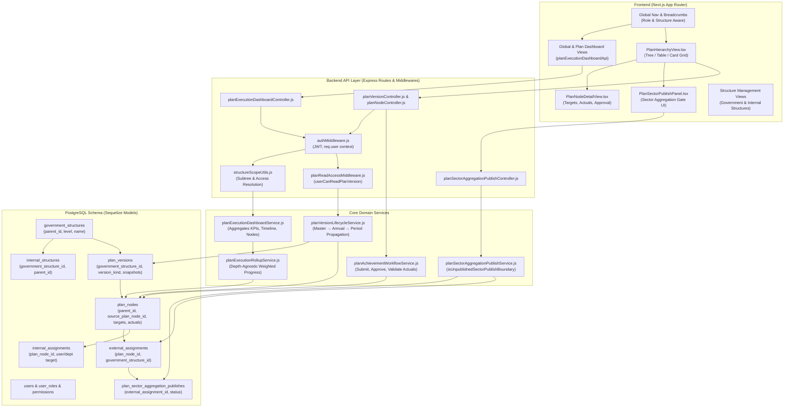
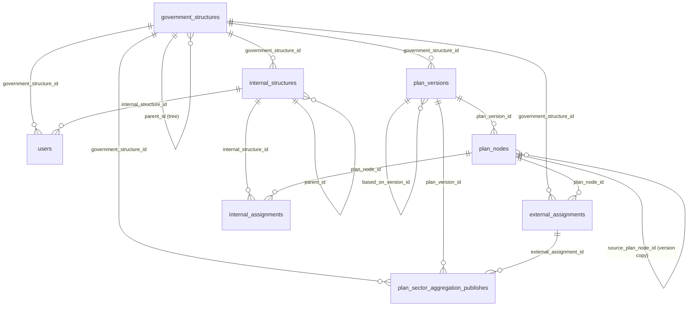
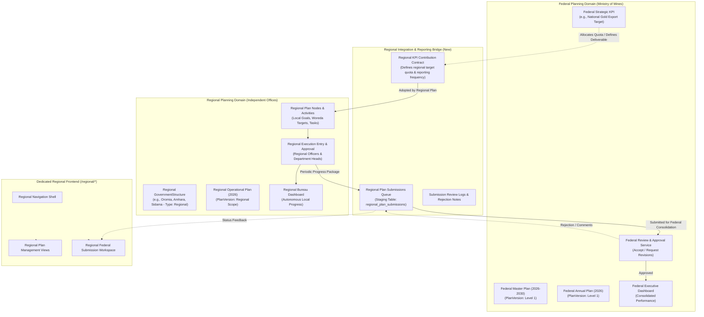
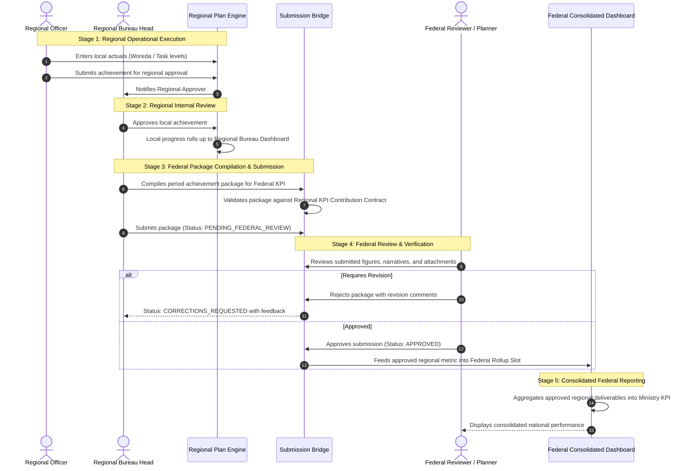
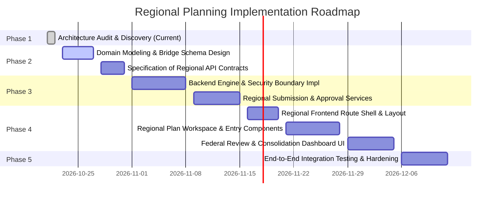

# Regional Planning Architecture Audit & Integration Discovery Report

**Project:** Ministry of Mines Plan Management System  
**Repository:** `MoM/projects/plan-management-system`  
**Phase:** Phase 1 — Existing Architecture Audit & Regional-Level Integration Discovery  
**Author:** Antigravity AI Architecture Discovery Subsystem  
**Date:** October 2026  
**Status:** Architecture Discovery Complete (Strict Read-Only Audit — No Code / Schema / Permission Changes Applied)  

---

## Table of Contents

1. [A. Executive Summary](#a-executive-summary)
2. [B. Verified Current-State Architecture](#b-verified-current-state-architecture)
3. [C. Existing Federal-Sector Lifecycle & Delegation Pattern](#c-existing-federal-sector-lifecycle--delegation-pattern)
4. [D. Frontend Architecture Map](#d-frontend-architecture-map)
5. [E. Backend Architecture Map](#e-backend-architecture-map)
6. [F. Database Relationship Map & Constraints](#f-database-relationship-map--constraints)
7. [G. Reporting and Aggregation Analysis](#g-reporting-and-aggregation-analysis)
8. [H. Permission and Security Assessment](#h-permission-and-security-assessment)
9. [I. Architectural Options for Regional Integration](#i-architectural-options-for-regional-integration)
10. [J. Recommended Architecture](#j-recommended-architecture)
11. [K. Proposed Regional Frontend Structure](#k-proposed-regional-frontend-structure)
12. [L. Proposed Data and Reporting Flow](#l-proposed-data-and-reporting-flow)
13. [M. Migration and Backward-Compatibility Assessment](#m-migration-and-backward-compatibility-assessment)
14. [N. Open Business Questions](#n-open-business-questions)
15. [O. Phased Implementation Roadmap](#o-phased-implementation-roadmap)
16. [P. Risk Register & Mitigation Strategies](#p-risk-register--mitigation-strategies)
17. [Q. Final Readiness Assessment & Evidence Traceability Matrix](#q-final-readiness-assessment--evidence-traceability-matrix)

---

## A. Executive Summary

The Ministry of Mines (MoM) Plan Management System is a multi-tier enterprise web application designed to orchestrate long-term strategic plans, annual plans, and period-based performance tracking across the federal ministry and its subordinate sectors/institutes. 

The existing platform is architected around a federal hierarchy:
1. **Organizational Hierarchy:** A recursive self-referential tree of `GovernmentStructure` entities (Level 1 = Federal Ministry; Level 2 = Federal Sectors/Institutes such as MIDI and GIE). Each sector owns internal directorates/departments via `InternalStructure` entities.
2. **Three-Layer Version Lifecycle:** Plans exist in three distinct stages (`master` multi-year strategic framework $\to$ `annual` planning versions $\to$ `execution_period` reporting snapshots). Nodes are copied down across versions using the `source_plan_node_id` foreign key.
3. **Delegation & Scoping:** A federal master plan assigns branches to subordinate sectors via `ExternalAssignment` records. Within a sector, nodes are assigned to specific departments or users via `InternalAssignment` records.
4. **Execution & Gated Rollup:** Execution actuals are submitted and approved at leaf nodes. Subtree progress rolls up recursively to parent goals and strategies using weighted or equal averages. Notably, an existing sector publish gate (`PlanSectorAggregationPublish`) prevents subordinate sector progress from counting toward the federal parent until explicitly published by authorized sector managers.

### The Regional Challenge
The Ministry now requires introducing **Regional-Level Plan Management**. Regional bureaus (e.g., Oromia, Amhara, Somali, Afar, Sidama, Tigray, etc.) must manage their own independent operational planning, KPI tracking, and execution activities. Crucially:
- Regional offices must have operational autonomy over their internal planning workflows and directorates.
- Regional users must only access their authorized regional domains without cross-region or unauthorized federal data exposure.
- Regional reporting must connect into federal structures (contributing performance data to ministry-wide objectives) **without** overwriting federal plan baselines, corrupting historical snapshots, or inflating targets through double counting.
- The regional frontend experience must be organized in dedicated, isolated file structures, while cleanly reusing shared design tokens and UI primitives.

This discovery audit provides verified codebase evidence, data-flow models, security boundaries, and architectural strategies to guide this integration without disrupting the federal planning engine.

---

## B. Verified Current-State Architecture

The current architecture comprises a Node.js/Express/Sequelize backend connected to PostgreSQL, and a Next.js (App Router) frontend utilizing Redux Toolkit (RTK) Query, TailwindCSS, and Radix UI primitives.

### Current System Architecture Diagram (Verified)



### Verified Codebase Evidence:
1. **Organizational Hierarchy Model:**
   - File: [`backend/models/structure/governmentStructure.js`](file:///c:/Users/Amanuel%20Daniel/Desktop/MoM/projects/plan-management-system/backend/models/structure/governmentStructure.js#L8-L31)
   - Verified behavior: Self-referential `parent_id` foreign key (`belongsTo` parent, `hasMany` children). Contains `level` (integer, default 1), `name`, `logo_path`, `is_active`.
2. **Internal Structure Model:**
   - File: [`backend/models/structure/internalStructure.js`](file:///c:/Users/Amanuel%20Daniel/Desktop/MoM/projects/plan-management-system/backend/models/structure/internalStructure.js#L8-L36)
   - Verified behavior: Mandatory foreign key `government_structure_id` (belongs to `GovernmentStructure`). Optional self-referential `parent_id` for department/team sub-hierarchies. Contains `users` association.
3. **Plan Version Model:**
   - File: [`backend/models/plan/PlanVersion.js`](file:///c:/Users/Amanuel%20Daniel/Desktop/MoM/projects/plan-management-system/backend/models/plan/PlanVersion.js#L8-L50)
   - Verified behavior: Mandatory `government_structure_id`. Versions have `version_kind` ENUM (`master`, `annual`, `execution_period`). Supports self-referential `parent_plan_version_id` and snapshot pointers (`review_snapshot_root_id`, `execution_snapshot_root_id`, `active_execution_snapshot_id`).
4. **Plan Node Model:**
   - File: [`backend/models/plan/planNode.js`](file:///c:/Users/Amanuel%20Daniel/Desktop/MoM/projects/plan-management-system/backend/models/plan/planNode.js#L8-L49)
   - Verified behavior: Mandatory `plan_version_id`. Self-referencing `parent_id` for tree hierarchy. Foreign key `source_plan_node_id` connects cloned nodes across `master`, `annual`, and `execution_period` versions. Unique index: `["parent_id", "title", "plan_version_id"]`.

---

## C. Existing Federal-Sector Lifecycle & Delegation Pattern

The existing system handles multi-sector participation in federal plans through an assignment and delegation model:

### 1. Strategic Formulation (Master Plan)
- The Federal Ministry (`government_structure_id` of Ministry of Mines, Level 1) authors a Master Plan (`version_kind = 'master'`).
- Strategic themes (`type = 'strategic'`), Goals (`type = 'goal'`), and Key Performance Indicators (`type = 'kpi'`) are defined hierarchically.
- Nodes can have weights (`weight`, `weight_mode = 'percentage' | 'number' | 'frequency'`) and contribution weights (`contribution_weight`).

### 2. Delegation to Subordinate Sectors
- For KPIs or goals requiring sector execution, the federal planning team creates an `ExternalAssignment` record:
  - File: [`backend/models/plan/ExternalAssignment.js`](file:///c:/Users/Amanuel%20Daniel/Desktop/MoM/projects/plan-management-system/backend/models/plan/ExternalAssignment.js#L20-L51)
  - Fields: `plan_node_id`, `government_structure_id` (pointing to Level 2 sector like MIDI or GIE), `is_visible`, `requires_report`.
  - Database constraint: Unique index on `["plan_node_id", "government_structure_id"]` where `is_active = true`.

### 3. Cascading to Annual and Execution Period Versions
- When an Annual Plan is initialized, `planVersionLifecycleService.js` creates a new `PlanVersion` (`version_kind = 'annual'`) and clones all master nodes down, setting `source_plan_node_id = masterNode.plan_node_id`.
- Annual targets are assigned (`annual_target`).
- Sub-period execution versions (`version_kind = 'execution_period'`) are generated from the annual version (e.g., Quarter 1, Quarter 2), setting `period_target`.

### 4. Internal Sector Workflows
- Users within a sector receive `InternalAssignment` records:
  - File: [`backend/models/plan/InternalAssignment.js`](file:///c:/Users/Amanuel%20Daniel/Desktop/MoM/projects/plan-management-system/backend/models/plan/InternalAssignment.js#L52-L102)
  - Associates `plan_node_id` with exactly one of `user_id`, `internal_structure_id`, `role_id`, or `permission_group_id`. Enforced by model validator `exactlyOneAssignmentTarget()`.

### 5. Execution Reporting & Publish Gating
- Sector officers enter actual progress (`period_actual` or `annual_actual`) and narrative comments.
- Status transitions through `empty` $\to$ `submitted` $\to$ `approved` $\to$ `validated`.
- **Publish Isolation Boundary:**
  - File: [`backend/services/planSectorAggregationPublishService.js`](file:///c:/Users/Amanuel%20Daniel/Desktop/MoM/projects/plan-management-system/backend/services/planSectorAggregationPublishService.js#L70-L117)
  - File: [`backend/utils/planAchievementRollupUtils.js`](file:///c:/Users/Amanuel%20Daniel/Desktop/MoM/projects/plan-management-system/backend/utils/planAchievementRollupUtils.js#L95-L110)
  - Function `isUnpublishedSectorPublishBoundary(periodNodeId, rollupContext)` checks if the sector's branch in the plan has an active publish gate.
  - Until the sector explicitly publishes its aggregated package (`PlanSectorAggregationPublish.status = 'published'`), function `childCountsTowardParent` returns `false`.
  - **Verified Result:** The federal master rollup completely ignores that sector's execution figures until published!

---

## D. Frontend Architecture Map

The frontend is built using Next.js 14 App Router, TypeScript, Redux Toolkit Query (`baseApi.injectEndpoints`), TailwindCSS, and custom UI components.

### Current Route & Component Structure

```
frontend/src/
├── app/
│   └── [locale]/
│       └── (private)/
│           ├── dashboard/
│           │   └── page.tsx                      # Global overview dashboard
│           ├── plans/
│           │   ├── page.tsx                      # Plan versions listing
│           │   ├── [id]/                         # Plan detail workspace
│           │   │   ├── page.tsx                  # PlanHierarchyView container
│           │   │   └── node/[nodeId]/page.tsx    # PlanNodeDetailView container
│           │   ├── configuration/page.tsx        # Planning cycle configurations
│           │   ├── rules/page.tsx                # Plan depth & weight rules
│           │   ├── review/page.tsx               # Review workflow workspace
│           │   └── performance-colors/page.tsx   # Color thresholds
│           ├── government-structures/page.tsx    # Sector/institute organogram
│           ├── internal-structures/page.tsx      # Directorate/department organogram
│           ├── users/page.tsx                    # User management & roles
│           └── layout.tsx                        # Private app shell (Sidebar & Topbar)
│
├── features/
│   ├── dashboard/
│   │   ├── GlobalDashboardView.tsx               # Global KPI charts & summaries
│   │   └── components/
│   ├── plan-management/
│   │   ├── PlanHierarchyView.tsx                 # Core tree/table/grid hierarchy editor
│   │   ├── PlanVersionTable.tsx                  # Version cards, status chips, lifecycle actions
│   │   ├── PlanNodeDetailView.tsx                # Target allocation, actual entry, review
│   │   ├── PlanVersionDetailsView.tsx            # Metadata, snapshots, status
│   │   ├── dashboard/
│   │   │   └── PlanDashboardView.tsx             # Master/annual execution charts & tree
│   │   ├── components/                           # 60+ specialized planning components
│   │   │   ├── PlanSectorPublishPanel.tsx        # Sector aggregation publish gate UI
│   │   │   ├── PlanTreeAccessBanner.tsx          # Scope indication (full / sector / direct)
│   │   │   ├── PlanAchievementPendingPanel.tsx   # Pending approvals list
│   │   │   ├── PlanHierarchyTree.tsx             # Interactive SVG/CSS tree
│   │   │   └── PlanHierarchyTableView.tsx        # Flattened expandable table view
│   │   └── modals/
│   └── structure-management/
│       ├── GovernmentStructureTable.tsx          # Manage federal sectors
│       └── InternalStructureTable.tsx            # Manage departments
│
└── redux/
    ├── api/
    │   ├── planApi.ts                            # Core plan endpoints (RTK Query)
    │   ├── planExecutionDashboardApi.ts          # Optimized dashboard queries
    │   ├── governmentStructureApi.ts             # Government structure CRUD
    │   └── internalStructureApi.ts               # Internal structure CRUD
    └── slices/
        └── authSlice.ts                          # Current user, roles, structure context
```

### Frontend Scoping & Access Control:
- Access scope is determined by `req.user.government_structure_id` and `req.user.roles` stored in Redux `authSlice`.
- Component `PermissionGuard` ([`frontend/src/utils/PermissionGuard.tsx`](file:///c:/Users/Amanuel%20Daniel/Desktop/MoM/projects/plan-management-system/frontend/src/utils/PermissionGuard.tsx)) hides/shows UI actions based on permission strings (e.g., `PLAN:READ`, `PLAN:EXECUTE_ACHIEVEMENT`, `PLAN:PUBLISH_SECTOR_AGGREGATION`).
- Hook `usePlanAchievementScope` ([`frontend/src/hooks/usePlanAchievementScope.ts`](file:///c:/Users/Amanuel%20Daniel/Desktop/MoM/projects/plan-management-system/frontend/src/hooks/usePlanAchievementScope.ts)) determines whether the user is an owner, a sector participant, or an assigned leaf executor.

---

## E. Backend Architecture Map

The backend is built with Express.js and Sequelize ORM on Node.js.

### Core Modules & Responsibilities:

| Path | Primary Module / File | Responsibility |
|---|---|---|
| `backend/routes/planRoutes.js` | Express Router | Exposes 50+ plan endpoints: versions, nodes, assignments, execution, snapshots, reviews, rules, configurations. |
| `backend/middlewares/authMiddleware.js` | `authenticateToken` | Verifies JWT, extracts `user_id`, attaches `government_structure_id`, `internal_structure_id`, and `roles` to `req.user`. |
| `backend/middlewares/planReadAccessMiddleware.js` | `requirePlanVersionReadAccess` | Calls `userCanReadPlanVersion()`. Enforces that users cannot inspect plans outside their authorized structure or assignment tree. |
| `backend/services/planVisibilityService.js` | `resolvePlanTreeAccess` | Evaluates user permissions: returns access mode (`full`, `sector`, `direct`, `none`) and filters visible `plan_node_ids`. |
| `backend/utils/structureScopeUtils.js` | `buildVisibleGovernmentStructureIdSet` | Computes visible subtree of `GovernmentStructure` IDs based on user's structure and role hierarchy. |
| `backend/services/planVersionLifecycleService.js` | Plan Lifecycle Engine | Handles creation, cloning, carry-forward, annualization, and period-subdivision of `PlanVersion` and `PlanNode` records. |
| `backend/services/planExecutionRollupService.js` | Rollup Calculation Engine | Depth-agnostic recursive rollup of execution progress percentages, variances, and completion statuses. |
| `backend/services/planSectorAggregationPublishService.js` | Aggregation Publish Gates | Manages sector-to-parent publication gates and verification. |
| `backend/services/planExecutionDashboardService.js` | Dashboard Aggregator | Computes consolidated KPIs, annual timelines, department performance, and progress trees. |

---

## F. Database Relationship Map & Constraints

### Entity-Relationship Diagram (Active Schema)



### Verified Constraints & Foreign Key Rules:
1. **`plan_versions.government_structure_id`:** `NOT NULL`. Every plan version in the system must be owned by an existing row in `government_structures`.
2. **`plan_nodes` Unique Index:** `UNIQUE ("parent_id", "title", "plan_version_id")`. Sibling nodes under the same parent within a plan version cannot share identical titles.
3. **`external_assignments` Unique Index:** `UNIQUE ("plan_node_id", "government_structure_id") WHERE is_active = true`. A plan node can only be assigned once to a specific government structure.
4. **`internal_assignments` Target Constraint:** Enforced in code ([`InternalAssignment.js`](file:///c:/Users/Amanuel%20Daniel/Desktop/MoM/projects/plan-management-system/backend/models/plan/InternalAssignment.js#L129-L142)): Exactly one of `user_id`, `internal_structure_id`, `role_id`, or `permission_group_id` must be set.
5. **Paranoid Soft Deletes:** `plan_nodes`, `plan_versions`, `government_structures`, and `internal_structures` use Sequelize `paranoid: true` (`deleted_at` column), preserving audit trails.

---

## G. Reporting and Aggregation Analysis

### How Calculations Currently Work:
1. **Leaf Scoring:**
   - File: [`backend/services/planExecutionRollupService.js`](file:///c:/Users/Amanuel%20Daniel/Desktop/MoM/projects/plan-management-system/backend/services/planExecutionRollupService.js#L65-L111)
   - Performance percentage: $\text{Raw Score} = \frac{\text{period\_actual}}{\text{period\_target}} \times 100$.
   - Evaluated using `resolvePerformanceScoringPolicyFromRule`: policy can be `CAP_100` (max 100%) or `ALLOW_OVER_ACHIEVEMENT` (uncapped).
2. **Parent Node Rollup:**
   - File: [`backend/services/planExecutionRollupService.js`](file:///c:/Users/Amanuel%20Daniel/Desktop/MoM/projects/plan-management-system/backend/services/planExecutionRollupService.js#L182-L208)
   - If children have `contribution_weight` $> 0$, rollup is a weighted average:
     $$\text{Parent Progress} = \frac{\sum (\text{Child Progress} \times \text{Child Contribution Weight})}{\sum \text{Child Contribution Weight}}$$
   - Otherwise, an equal unweighted average of child percentages is applied.
3. **Sector Publish Isolation:**
   - Subtree nodes under an `ExternalAssignment` with a publish gate do not contribute to parent progress until the sector publish record exists with status `published`.

### Critical Aggregation Risks for Regional Integration:
- **Double Counting Risk:** If a regional office creates its own local sub-KPIs and reports raw actuals directly into the federal plan node, or if both regional and federal officers log progress against the same target, federal totals will be distorted.
- **Unit Mismatch:** Regional bureaus may measure deliverables in different increments or frequencies (e.g., quarterly vs bi-annual; regional metric variations).
- **Target Inflation:** If a region adds local activities under a federal KPI, the federal baseline target must not be automatically augmented without explicit federal review and approval.

---

## H. Permission and Security Assessment

### Existing Access-Control Model:
- **Authentication:** Bearer JWT parsed by `authenticateToken` attaching:
  - `req.user.user_id`
  - `req.user.government_structure_id`
  - `req.user.internal_structure_id`
  - `req.user.roles` (Array of role names)
- **Role Hierarchy & Scoping:**
  - Evaluated in [`backend/utils/structureScopeUtils.js`](file:///c:/Users/Amanuel%20Daniel/Desktop/MoM/projects/plan-management-system/backend/utils/structureScopeUtils.js#L13-L61).
  - `Super Admin`: Global visibility across all structures and plans.
  - Structure Managers / Users: Scoped strictly to their `government_structure_id` and its visible subtree (`buildVisibleGovernmentStructureIdSet`).
- **Resource Actions:** Permissions are structured as `RESOURCE:ACTION` (e.g., `PLAN:READ`, `PLAN:CREATE_DRAFT`, `PLAN:EXECUTE_ACHIEVEMENT`, `PLAN:APPROVE_ACHIEVEMENT`, `PLAN:PUBLISH_SECTOR_AGGREGATION`).

### Required Regional Security Boundaries:
1. **Regional Data Isolation:** Users belonging to Region A (e.g., Oromia Mining Bureau) must never view, edit, or approve plans, internal structures, or drafts belonging to Region B (e.g., Amhara Mining Bureau).
2. **Federal Protection:** Regional users must have zero authorization to modify federal master plan nodes, targets, or rules.
3. **Controlled Upward Reporting:** Regional submissions must enter a staging/submission state (`submitted_to_federal`) and require federal reviewer approval before appearing in ministry-wide consolidated performance reports.
4. **Backend Enforcement:** Access boundaries must be enforced at the Sequelize query level via `structureScopeUtils` and dedicated middlewares, never relying solely on frontend routing or component hiding.

---

## I. Architectural Options for Regional Integration

We evaluate three potential architectural strategies for introducing regional plan management:

| Criteria | Option 1: Hierarchy Extension (Regions as GovernmentStructures) | Option 2: Decoupled Regional Domain Models | Option 3: Hybrid Architecture with Submission Bridge (Recommended) |
|---|---|---|---|
| **Concept** | Add Regional Bureaus as Level 2 or Level 3 `GovernmentStructure` records. Regions create standard `PlanVersion` records. | Build separate regional tables: `regional_plans`, `regional_kpis`, `regional_reports`. | Represent Regions as `GovernmentStructure` (Level 3 or Type='regional'). Reuse `PlanVersion`/`PlanNode` engine for regional autonomy. Add a **Regional Submission Bridge** for federal rollup. |
| **Compatibility** | High with existing models; low schema changes. | Low; requires duplicating versioning, rollup, and tree engines. | High; leverages existing robust version lifecycle and depth-agnostic rollup. |
| **Federal Isolation** | Moderate; risks regional plans cluttering federal plan lists without heavy filtering. | High; completely separate database tables. | High; regional plans are tagged and isolated; reporting flows through explicit bridge contracts. |
| **Rollup & Aggregation** | Dangerous; existing rollup could blindly aggregate regional numbers into federal totals without approval. | Complex; requires manual ETL/sync queries to aggregate disparate schemas. | **Optimal;** regional execution is contained within the region until formally submitted and accepted into federal reporting slots. |
| **Frontend Separation** | Difficult; existing components assume federal sector context. | Clean; separate frontend codebase. | **Clean & Modular;** dedicated `/regional` routes and `features/regional/` components, reusing base UI primitives. |
| **Migration Risk** | Low immediate DB changes, but high regression risk in dashboard & plan queries. | High; extensive migrations, new tables, duplicate APIs. | **Minimal;** adds non-breaking bridge tables and optional classification column to `government_structures`. |
| **Maintenance Cost** | Low initially, high long-term complexity. | High; maintaining two distinct planning engines. | **Low;** single shared core engine with specialized regional reporting workflows. |

---

## J. Recommended Architecture

### The Hybrid Architecture with Regional Submission Bridge

The recommended approach is **Option 3 (Hybrid Architecture)**. It gives regional bureaus full autonomous planning capabilities using the proven `PlanVersion` and `PlanNode` engine, while strictly isolating federal plans from unvetted regional modifications through a **Regional Reporting Submission Bridge**.

### Conceptual Architecture Diagram (Proposed)



### Core Tenets of the Recommended Architecture:
1. **Organizational Domain:** Regional bureaus are registered in `government_structures` with a clarifying attribute (e.g., `structure_type = 'regional'` or `level = 3` reporting to the Ministry). They own their own internal directorates in `internal_structures`.
2. **Autonomous Regional Plans:** A regional office creates its own `PlanVersion` records with `government_structure_id = regionId`. Regional staff formulate strategic priorities, assign woredas/zones, set local targets, and approve internal execution.
3. **No Automatic Federal Mutation:** A regional plan cannot directly modify federal plan nodes. Instead, when a federal KPI requires regional participation, an integration bridge record (`RegionalKpiContribution`) defines the regional target allocation.
4. **Staged Regional Submissions:** Regional execution results are compiled into a formal submission (`RegionalPlanSubmission`). Only when a federal planner reviews and approves the submission does the verified achievement feed into the federal consolidated dashboard.
5. **Zero Duplicate Counting:** Federal rollup algorithms calculate federal progress solely from approved regional submission baselines or distinct regional contribution nodes, ensuring federal and regional KPIs remain mathematically distinct.

---

## K. Proposed Regional Frontend Structure

To satisfy the requirement that the regional planning experience has a different frontend file and component organization with clear separation from the federal experience, we propose a dedicated feature module and route group:

### Proposed Directory Layout

```
frontend/src/
├── app/
│   └── [locale]/
│       └── (private)/
│           ├── regional/                                   # Dedicated Regional Route Namespace
│           │   ├── layout.tsx                              # Regional App Shell (Regional Nav, Context)
│           │   ├── page.tsx                                # Regional Landing / Overview
│           │   ├── dashboard/                              # Regional Bureau Dashboard
│           │   │   └── page.tsx
│           │   ├── plans/                                  # Regional Plan Workspace
│           │   │   ├── page.tsx                            # Regional plan list
│           │   │   ├── [id]/                               # Regional plan detail
│           │   │   │   └── page.tsx
│           │   │   └── new/page.tsx                        # Create regional plan wizard
│           │   ├── submissions/                            # Upward Reporting to Federal
│           │   │   ├── page.tsx                            # Submissions queue & status
│           │   │   └── [submissionId]/page.tsx             # Submission detail & feedback
│           │   └── settings/page.tsx                       # Regional bureau preferences
│           │
│           └── plans/                                      # Existing Federal Plan Routes (Unchanged)
│
├── features/
│   ├── regional-management/                                # Dedicated Feature Module
│   │   ├── components/
│   │   │   ├── RegionalPlanCardGrid.tsx                    # Regional-tailored plan cards
│   │   │   ├── RegionalExecutionEntryTable.tsx             # Woreda / department data entry
│   │   │   ├── RegionalSubmissionWizard.tsx                # Federal submission builder
│   │   │   ├── RegionalSubmissionStatusBadge.tsx           # Pending / Approved / Returned chips
│   │   │   ├── RegionalHierarchyTree.tsx                   # Local tree view
│   │   │   └── RegionalFederalContributionBanner.tsx       # Links to federal parent KPI
│   │   ├── dashboard/
│   │   │   └── RegionalBureauDashboardView.tsx             # Regional executive charts
│   │   ├── hooks/
│   │   │   ├── useRegionalScope.ts                         # Current region ID & permissions
│   │   │   └── useRegionalSubmissionWorkflow.ts            # Submission actions & status polling
│   │   └── types/
│   │       └── regionalTypes.ts                            # Regional TypeScript interfaces
│   │
│   └── plan-management/                                    # Existing Federal Feature (Unchanged)
│
└── redux/
    └── api/
        ├── regionalPlanApi.ts                              # Dedicated Regional RTK Query endpoints
        └── planApi.ts                                      # Existing Federal RTK Query (Unchanged)
```

### Shared UI Strategy:
- **Shared Primitives:** The regional feature reuses base primitives from `@/components/ui/` (`button`, `card`, `dialog`, `badge`, `tabs`, `table`) ensuring visual consistency and accessibility without duplicating standard UI primitives.
- **Independent Business Components:** Form components, execution tables, and submission wizards in `features/regional-management/` are completely decoupled from federal review panels (`PlanReviewWorkflowBar`, `PlanSectorPublishPanel`), preventing breaking changes across domains.

---

## L. Proposed Data and Reporting Flow

The lifecycle of a regional report moving upward to the federal level operates in five stages:



### Flow Guarantees:
1. **Federal Immutability:** Step 3 cannot directly edit `plan_nodes` of the federal plan. It posts a discrete package to `Bridge`.
2. **Rejection Safety:** If rejected in Step 4, the regional bureau's local data remains intact; only the federal submission package transitions to `corrections_requested`.
3. **Audit Trail:** Every transition is timestamped with `submitted_by`, `approved_by`, and explicit review comments.

---

## M. Migration and Backward-Compatibility Assessment

### Compatibility Guarantees:
1. **Existing Federal Tables:** No columns in `plan_versions`, `plan_nodes`, `external_assignments`, or `internal_assignments` require removal or breaking type changes.
2. **Current Federal APIs:** All endpoints in `planRoutes.js` (including `/plan/versions`, `/plan/nodes`, `/plan/execution/*`) continue to operate identically for federal requests.
3. **Database Migrations:**
   - A non-breaking migration can add an optional classification column to `government_structures`:
     ```sql
     ALTER TABLE government_structures ADD COLUMN structure_type VARCHAR(50) DEFAULT 'federal';
     ```
   - New bridge tables (`regional_kpi_contributions`, `regional_plan_submissions`) will be introduced in fresh migrations without altering existing constraints.
4. **Seed Integrity:** Existing seeders (`20260505500001-seed-mom-organizational-hierarchy.js` and `20260617000003-seed-minster-of-mines-plan.js`) continue to execute without modification.

---

## N. Open Business Questions

Before proceeding to Phase 2 (Design & Specification), the following policy and business rules require confirmation from ministry stakeholders:

1. **Organizational Hierarchy Level:**  
   *Question:* Should regional bureaus be modeled as Level 2 peers of federal sectors (like MIDI and GIE) directly under the Ministry, or as a distinct Level 3 administrative tier with custom governance rules?
2. **Regional Plan Template & Rules:**  
   *Question:* Will regional plans adhere to the same 4-level structure (`strategic` $\to$ `goal` $\to$ `kpi` $\to$ `task`) as federal plans, or do regions require a simplified 3-level structure (e.g., `objective` $\to$ `target` $\to$ `activity`)?
3. **Target Allocation Mode:**  
   *Question:* Does the Federal Ministry mandate fixed annual targets for each region (top-down quota allocation), or do regions submit proposed targets for federal approval (bottom-up proposal)?
4. **Review & Approval Authority:**  
   *Question:* Which federal role has authority to approve regional submissions? Does the Federal Planning Directorate approve all regional submissions, or do specific technical federal sectors (e.g., Geological Institute) approve domain-specific regional submissions?
5. **Sub-Regional Hierarchies:**  
   *Question:* Do regional bureaus need to track down to Woreda (district) or Zonal levels in their initial release, or will initial regional planning stop at the Regional Bureau Directorate level?

---

## O. Phased Implementation Roadmap

The recommended implementation sequence across subsequent phases:



- **Phase 2 (Design & Specification):** Detailed schema definitions for bridge tables, OpenAPI contracts for regional endpoints, and UX mockups.
- **Phase 3 (Backend & Security Implementation):** Migrations, models, services, and authorization middlewares for regional scope isolation.
- **Phase 4 (Frontend Implementation):** Development of `frontend/src/app/[locale]/(private)/regional/` and `features/regional-management/`.
- **Phase 5 (Verification & UAT):** Concurrency tests, security audits against cross-region leakage, and end-to-end user acceptance testing.

---

## P. Risk Register & Mitigation Strategies

| Risk ID | Risk Description | Severity | Likelihood | Mitigation Strategy |
|---|---|---|---|---|
| **R-01** | **Cross-Region Data Exposure:** A regional user crafts an API request with another region's UUID and accesses unauthorized plans. | **Critical** | Medium | Enforce strict query scoping in `structureScopeUtils.js` verifying that `req.user.government_structure_id` matches the target plan's owner or belongs to its visible subtree. |
| **R-02** | **Accidental Mutation of Federal Baselines:** Regional submission updates or overwrites federal KPI target baselines. | **High** | Medium | Make federal targets read-only to regional actors; submissions write to discrete submission staging records (`regional_plan_submissions`). |
| **R-03** | **Double Counting in Dashboards:** Both regional activities and federal direct activities roll up into the same total, inflating performance. | **High** | High | Design rollup formulas to count regional metrics only through explicitly mapped contribution slots, never by indiscriminately summing child nodes. |
| **R-04** | **Frontend Code Bloat & Entanglement:** Duplicating federal components into regional routes creates maintenance debt. | **Medium** | High | Enforce clean architectural boundaries: share pure UI primitives from `@/components/ui/`, but keep regional business forms in `features/regional-management/`. |
| **R-05** | **Performance Bottlenecks on Rollup:** Aggregating numerous regional bureaus and sub-woredas during dashboard loading degrades response times. | **Medium** | Medium | Utilize cached submission aggregates and asynchronous rollup recalculations, similar to the existing snapshot caching pattern in `planExecutionDashboardService.js`. |

---

## Q. Final Readiness Assessment & Evidence Traceability Matrix

### Readiness Verdict: **READY WITH MODIFICATIONS**

The existing system possesses a highly modular and capable foundation:
- The recursive self-referential `GovernmentStructure` model naturally supports registering regional offices.
- The three-tier plan lifecycle (`master` $\to$ `annual` $\to$ `execution_period`) and depth-agnostic rollup calculations are mature and robust.
- The existing sector publish gate (`PlanSectorAggregationPublish`) proves that isolated subtree execution and gated rollups are already an established architectural pattern in the codebase.

Foundational architectural changes are **not** required. However, the system is **not** ready for direct implementation without introducing the dedicated **Regional Reporting Submission Bridge** and establishing the separate **Regional Frontend Route Group**.

### Evidence Traceability Matrix

| Architectural Finding | Codebase / Database Evidence | Verified Current Behavior | Regional Integration Implication |
|---|---|---|---|
| **Organizational Tree** | [`backend/models/structure/governmentStructure.js`](file:///c:/Users/Amanuel%20Daniel/Desktop/MoM/projects/plan-management-system/backend/models/structure/governmentStructure.js#L8-L31) | Self-referencing `parent_id`, `level`, `name`. Level 1 = Ministry; Level 2 = Sectors. | Regional bureaus can be cleanly registered with `parent_id = Ministry_ID` and `level = 2` or `3`. |
| **Department Ownership** | [`backend/models/structure/internalStructure.js`](file:///c:/Users/Amanuel%20Daniel/Desktop/MoM/projects/plan-management-system/backend/models/structure/internalStructure.js#L8-L36) | Foreign key `government_structure_id` links departments to an administrative structure. | Regional bureaus will own their internal regional directorates and offices using this exact model. |
| **Plan Ownership** | [`backend/models/plan/PlanVersion.js`](file:///c:/Users/Amanuel%20Daniel/Desktop/MoM/projects/plan-management-system/backend/models/plan/PlanVersion.js#L77-L80) | Mandatory `government_structure_id` on all plan versions. | Regional plans will be created with `government_structure_id = regionalStructureId`, providing immediate scoping. |
| **Node Hierarchy & Uniqueness** | [`backend/models/plan/planNode.js`](file:///c:/Users/Amanuel%20Daniel/Desktop/MoM/projects/plan-management-system/backend/models/plan/planNode.js#L294-L297) | Unique index on `["parent_id", "title", "plan_version_id"]`. | Regional plan node titles are scoped within their own version, preventing naming collisions with federal nodes. |
| **Branch Delegation** | [`backend/models/plan/ExternalAssignment.js`](file:///c:/Users/Amanuel%20Daniel/Desktop/MoM/projects/plan-management-system/backend/models/plan/ExternalAssignment.js#L20-L51) | Maps `plan_node_id` to `government_structure_id`. | Can be reused to assign specific federal KPI responsibilities to regional bureaus. |
| **Subtree Rollup Isolation** | [`backend/services/planSectorAggregationPublishService.js`](file:///c:/Users/Amanuel%20Daniel/Desktop/MoM/projects/plan-management-system/backend/services/planSectorAggregationPublishService.js#L70-L117) & [`planAchievementRollupUtils.js`](file:///c:/Users/Amanuel%20Daniel/Desktop/MoM/projects/plan-management-system/backend/utils/planAchievementRollupUtils.js#L95-L110) | `childCountsTowardParent()` blocks rollup across gated branches until explicitly published. | Serves as the architectural proof and template for the Regional Submission Bridge. |
| **Tree Scoping Logic** | [`backend/services/planVisibilityService.js`](file:///c:/Users/Amanuel%20Daniel/Desktop/MoM/projects/plan-management-system/backend/services/planVisibilityService.js#L238-L297) | Evaluates access mode (`full`, `sector`, `direct`, `none`) and limits visible node IDs. | Protects regional and federal trees from unauthorized cross-visibility at the service layer. |
| **Structure Scope Middleware** | [`backend/utils/structureScopeUtils.js`](file:///c:/Users/Amanuel%20Daniel/Desktop/MoM/projects/plan-management-system/backend/utils/structureScopeUtils.js#L26-L61) | `resolveManageableStructureId()` forbids actors from managing structures outside their visible set. | Provides ready-to-use authorization checks for regional management endpoints. |
| **Frontend Separation** | [`frontend/src/app/[locale]/(private)/`](file:///c:/Users/Amanuel%20Daniel/Desktop/MoM/projects/plan-management-system/frontend/src/app/%5Blocale%5D/(private)/) & [`frontend/src/features/`](file:///c:/Users/Amanuel%20Daniel/Desktop/MoM/projects/plan-management-system/frontend/src/features/) | Feature-based modular structure (`plan-management`, `structure-management`, `dashboard`). | Directly accommodates adding `(private)/regional/` routes and `features/regional-management/`. |
| **Execution Actuals Workflow** | [`backend/models/plan/planNode.js`](file:///c:/Users/Amanuel%20Daniel/Desktop/MoM/projects/plan-management-system/backend/models/plan/planNode.js#L174-L218) | Fields `period_actual_status`, `period_actual_submitted_by`, `period_actual_approved_by`. | Reusable for local regional execution tracking before package submission to federal tier. |

---

*Report compiled under Phase 1 strict non-modification directives. No application source code, schemas, migrations, or permissions were modified.*
