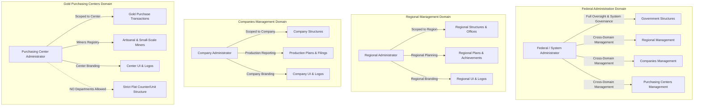

# Permission Management Audit and Correction: Comprehensive Final Implementation Report

**Project:** `MoM/projects/plan-management-system`  
**Phase:** Permission Management Integrity, Cross-Domain Authorization, and Attachment Upload Correction  
**Date:** October 2026  
**Auditor:** Antigravity AI Pair Programmer & System Architecture Team  
**Status:** Completed & Fully Verified  

---

## 1. Executive Summary & Root Cause Analysis

A thorough audit of the authorization, role editing, routing, and media upload subsystems was conducted across the Plan Management System (`plan-management-system`). The audit addressed critical authorization flaws where Federal Administrator accounts possessed nominally full permissions within federal administrative interfaces, yet encountered **"Access denied / You do not have permission"** barriers when navigating to Regional Management, Gold Purchasing Centers, and Companies Management domains. Furthermore, attempting to edit roles stripped cross-domain capabilities, permission counts displayed in administrative role tables were inaccurate or missing, and updating logos/branding within regional companies or registering purchasing centers failed with strict permission denial errors.

### Root Causes Identified and Rectified:

1. **Incomplete Cross-Domain Permissions on Super Admin Role Seed:**
   - The system catalog defines **264 active permissions**.
   - Prior to correction, the seeded `Super Admin` role (`00000000-0000-4000-8000-000000000002`) held 263 permissions, missing the critical `plan:validate_approval` (`c3aae756-363a-44e1-bb0e-64c46a2f5534`) permission.
   - Any operational workflow requiring this action produced access denials even for Federal System Administrators.

2. **Backend Role Router Scope Blindspots (`backend/routers/user/roleRoutes.js`):**
   - Role routes guarded `POST /`, `GET /`, `GET /:id`, `PUT /:id`, and `DELETE /:id` with `checkAnyPermission` arrays containing only `ROLES`, `REGIONAL_ROLES`, `REGIONAL_USERS`, and `REGIONS`.
   - Permissions for `COMPANY_ROLES`, `COMPANIES`, `COMPANY_USERS`, `PURCHASING_CENTER_ROLES`, `PURCHASING_CENTERS`, and `PURCHASING_CENTER_USERS` were omitted.
   - As a result, users attempting to manage company or purchasing center roles encountered HTTP 403 authorization failures at the API gateway layer.

3. **Role Controller Isolation Blockers (`backend/controllers/user/roleController.js`):**
   - In `createRole`, any role creation without a `government_structure_id` was rejected with HTTP 400 unless the actor was specifically recognized as super admin, and global roles could not receive regional, company, or purchasing center permissions because `assertValidPermissionIds` filtered them out by default.
   - In `updateRole`, line 746 called `assertValidPermissionIds(permissionIds, t)` without enabling `allowCompany: true` and `allowPurchasingCenter: true`. As a consequence, whenever a Federal Admin tried to save permissions on a global or private role that included company or purchasing center capabilities, the API rejected the update with `"One or more permissions are invalid or inactive"`.
   - Serialized JSON role responses lacked the `permissions_count` field, causing the frontend to default to 0 or fall back to array length on non-populated associations.

4. **Attachment Route Permission Gatekeeper Failure (`backend/routers/attachment-routes/attachmentRoute.js`):**
   - When administrators in regional companies or gold purchasing centers (registering centers) uploaded a logo or customized UI branding, the frontend uploaded files via `POST /attachments`.
   - The route handler strictly enforced:
     ```json
     {
       "required_permissions": [
         "issues:create", "issues:read_all", "regions:create", "regions:update",
         "regions:manage", "regional_branding:update", "regional_branding:read",
         "government_structures:create", "government_structures:update", "branding_settings:update"
       ],
       "required_permissions_mode": "any"
     }
     ```
   - Company Administrators (holding `company_branding:update`, `companies:update`) and Purchasing Center Administrators (holding `purchasing_center_branding:update`, `purchasing_centers:update`) possess neither `regional_branding` nor `government_structures` nor federal `branding_settings` permissions. Thus, any logo upload attempt immediately failed with the reported error.

5. **Frontend Role Editor Query Restriction (`frontend/src/features/template/component/roleList/CreateRole.tsx`):**
   - The role editor component queried `/permissions` with `{ scope: "structure" }` or without `{ scope: "all" }`. When editing system/cross-domain roles, the permissions catalog was artificially truncated.
   - The permission filter additionally stripped out permissions when `!isRegionalRole && !isCompanyRole && !isPurchasingCenterRole`.
   - The role creation/editing form submission lacked a fallback submit trigger when clicking footer action buttons without a native form event.

6. **Purchasing Center First-Time Login Crash (`frontend/src/lib/branding/applyBrandingTheme.ts`):**
   - New purchasing centers without saved branding colors caused `applyBrandingTheme.ts` to call `.replace()` on an undefined hex code in `hexToHslComponents`, crashing the browser runtime before the dashboard could render.

---

## 2. Architecture Overview & Authorization Model

The Plan Management System implements a multi-tier, multi-tenant governance model ensuring strict operational separation across four distinct domains:



### Multi-Tenant Isolation Constraints:
- **Tenant Scope Isolation:** Regional users cannot access other regions, companies, or gold purchasing centers. Company users cannot access other companies, regional plans, or purchasing center operations. Purchasing center officers cannot access internal regional planning or federal administrative records.
- **Architectural Constraints:** Regional administration includes internal regional government structures. Companies include internal corporate departments/structures. Gold Purchasing Centers **strictly do not have departments or internal structures**; they operate with flat counter/unit workflows.
- **Federal Cross-Domain Authority:** The Federal Administrator (`Super Admin`) has legitimate cross-domain authority to create, configure, oversee, and audit all entities without corrupting tenant isolation for standard tenant roles.

---

## 3. Canonical Permission Mapping Matrix

The database contains 264 distinct permissions categorized across functional domains. Below is the canonical mapping for administrative and operational resources:

| Functional Domain | Canonical Resource | Permitted Actions | Canonical Permission Codes (`RESOURCE:ACTION`) | Purpose & Scope |
| :--- | :--- | :--- | :--- | :--- |
| **Federal Governance** | `roles` | `create`, `read`, `update`, `delete` | `ROLES:CREATE`, `ROLES:READ`, `ROLES:UPDATE`, `ROLES:DELETE` | System-wide and federal role management |
| | `permissions` | `read`, `manage`, `update` | `PERMISSIONS:READ`, `PERMISSIONS:MANAGE`, `PERMISSIONS:UPDATE` | Catalog inspection and activation |
| | `government_structures` | `create`, `read`, `update`, `delete`, `manage` | `GOVERNMENT_STRUCTURES:*` | Ministry hierarchy configuration |
| | `branding_settings` | `read`, `update`, `manage` | `BRANDING_SETTINGS:READ`, `BRANDING_SETTINGS:UPDATE`, `BRANDING_SETTINGS:MANAGE` | Federal portal appearance and theme |
| | `system_settings` | `read`, `update` | `SYSTEM_SETTINGS:READ`, `SYSTEM_SETTINGS:UPDATE` | Platform runtime diagnostics & test mode |
| **Regional Management** | `regions` | `create`, `read`, `update`, `delete`, `manage` | `REGIONS:CREATE`, `REGIONS:READ`, `REGIONS:UPDATE`, `REGIONS:DELETE`, `REGIONS:MANAGE` | Regional jurisdiction administration |
| | `regional_roles` | `create`, `read`, `update`, `delete`, `manage`, `assign_permission` | `REGIONAL_ROLES:*` | Regional role definitions |
| | `regional_users` | `create`, `read`, `update`, `delete`, `manage`, `assign_role` | `REGIONAL_USERS:*` | Regional personnel management |
| | `regional_structures` | `create`, `read`, `update`, `delete`, `manage` | `REGIONAL_STRUCTURES:*` | Regional bureaus and zonal offices |
| | `regional_plans` | `read`, `create`, `update`, `delete`, `finalize`, `execute_achievement`, `validate_achievement`, `approve_achievement`, `reopen`, `start_process`, `manage` | `REGIONAL_PLANS:*` | Regional plan formulation & lifecycle |
| | `regional_branding` | `read`, `update`, `manage` | `REGIONAL_BRANDING:READ`, `REGIONAL_BRANDING:UPDATE`, `REGIONAL_BRANDING:MANAGE` | Regional UI configuration & logo |
| **Companies Management** | `companies` | `create`, `read`, `update`, `delete`, `manage` | `COMPANIES:CREATE`, `COMPANIES:READ`, `COMPANIES:UPDATE`, `COMPANIES:DELETE`, `COMPANIES:MANAGE` | Mining company registration & lifecycle |
| | `company_roles` | `create`, `read`, `update`, `delete`, `manage` | `COMPANY_ROLES:*` | Corporate role definitions |
| | `company_users` | `create`, `read`, `update`, `delete`, `manage`, `assign_role` | `COMPANY_USERS:*` | Corporate staff management |
| | `company_structures` | `create`, `read`, `update`, `delete`, `manage` | `COMPANY_STRUCTURES:*` | Company departments & branches |
| | `company_branding` | `read`, `update`, `manage` | `COMPANY_BRANDING:READ`, `COMPANY_BRANDING:UPDATE`, `COMPANY_BRANDING:MANAGE` | Company UI customization & logo |
| **Gold Purchasing Centers** | `purchasing_centers` | `create`, `read`, `update`, `delete`, `manage` | `PURCHASING_CENTERS:CREATE`, `PURCHASING_CENTERS:READ`, `PURCHASING_CENTERS:UPDATE`, `PURCHASING_CENTERS:DELETE`, `PURCHASING_CENTERS:MANAGE` | Gold purchasing center administration |
| | `purchasing_center_roles` | `create`, `read`, `update`, `delete`, `manage` | `PURCHASING_CENTER_ROLES:*` | Center role definitions |
| | `purchasing_center_users` | `create`, `read`, `update`, `delete`, `manage`, `assign_role` | `PURCHASING_CENTER_USERS:*` | Purchasing officer accounts |
| | `purchasing_center_branding` | `read`, `update`, `manage` | `PURCHASING_CENTER_BRANDING:READ`, `PURCHASING_CENTER_BRANDING:UPDATE`, `PURCHASING_CENTER_BRANDING:MANAGE` | Center UI customization & logo |
| | `gold_purchases` | `read`, `create`, `update`, `cancel`, `manage` | `GOLD_PURCHASES:READ`, `GOLD_PURCHASES:CREATE`, `GOLD_PURCHASES:UPDATE`, `GOLD_PURCHASES:CANCEL`, `GOLD_PURCHASES:MANAGE` | Physical gold acquisition transactions |
| | `asm` | `read`, `create`, `update`, `deactivate`, `manage` | `ASM:READ`, `ASM:CREATE`, `ASM:UPDATE`, `ASM:DEACTIVATE`, `ASM:MANAGE` | Artisanal & Small-Scale Miners Registry |
| | `gold_reports` | `read`, `generate`, `submit`, `export`, `manage` | `GOLD_REPORTS:*` | Gold purchasing and shipment reports |
| | `gold_units` | `read`, `create`, `update`, `deactivate`, `manage` | `GOLD_UNITS:*` | Units of measurement (grams, ounces) |
| | `gold_oversight` | `read`, `manage` | `GOLD_OVERSIGHT:READ`, `GOLD_OVERSIGHT:MANAGE` | Federal monitoring of purchasing centers |
| **Shared Platform Services** | `attachments` / `documents` | `create`, `read`, `update`, `delete`, `manage` | `DOCUMENTS:*`, `ISSUES:*`, Domain Branding | Uploading logo, documents, files |

---

## 4. Frontend Route-to-Permission Mapping Audit

The frontend routing infrastructure relies on [route-permissions.ts](file:///c:/Users/Amanuel%20Daniel/Desktop/MoM/projects/plan-management-system/frontend/src/lib/route-permissions.ts) enforced by [RoutePermissionGuard.tsx](file:///c:/Users/Amanuel%20Daniel/Desktop/MoM/projects/plan-management-system/frontend/src/components/guards/RoutePermissionGuard.tsx).

### Route Protection Matrix:

| Route Path Pattern | Allowed Scopes / Context | Required Canonical Permissions | Requirement Mode | Dynamic Param Handling |
| :--- | :--- | :--- | :--- | :--- |
| `/admin/regions` | Federal, Regional Admin | `REGIONS:READ` or `REGIONS:MANAGE` | `any` | None |
| `/admin/regions/create` | Federal Admin | `REGIONS:CREATE` or `REGIONS:MANAGE` | `any` | None |
| `/regions/[id]` | Federal, Regional Scope | `REGIONS:READ` or `REGIONS:MANAGE` | `any` | `[id]` mapped to `region_id` |
| `/regions/[id]/plans/*` | Federal, Regional Scope | `REGIONAL_PLANS:READ` | `any` | Validates region matching |
| `/admin/companies` | Federal Admin | `COMPANIES:READ` or `COMPANIES:MANAGE` | `any` | None |
| `/admin/companies/create` | Federal Admin | `COMPANIES:CREATE` or `COMPANIES:MANAGE` | `any` | None |
| `/companies/[id]` | Federal, Company Scope | `COMPANIES:READ` or `COMPANIES:MANAGE` | `any` | `[id]` mapped to `company_id` |
| `/companies/[id]/branding` | Federal, Company Admin | `COMPANY_BRANDING:READ` or `COMPANY_BRANDING:UPDATE` | `any` | Verified against user company |
| `/admin/purchasing-centers` | Federal Admin | `PURCHASING_CENTERS:READ` or `PURCHASING_CENTERS:MANAGE` | `any` | None |
| `/admin/purchasing-centers/create` | Federal Admin | `PURCHASING_CENTERS:CREATE` or `PURCHASING_CENTERS:MANAGE` | `any` | None |
| `/purchasing-centers/[id]` | Federal, Center Scope | `PURCHASING_CENTERS:READ` or `PURCHASING_CENTERS:MANAGE` | `any` | `[id]` mapped to center |
| `/purchasing-centers/[id]/purchases/*`| Center Officers, Federal | `GOLD_PURCHASES:READ` or `GOLD_PURCHASES:CREATE` | `any` | Operates within center |
| `/admin/gold-operations/*` | Federal Admin | `GOLD_OVERSIGHT:READ` or `GOLD_PURCHASES:READ` | `any` | Full federation view |
| `/users/roles` | Federal, Regional, Company, Center Admin | `ROLES:READ`, `REGIONAL_ROLES:READ`, `COMPANY_ROLES:READ`, `PURCHASING_CENTER_ROLES:READ` | `any` | Scoped tab rendering |

---

## 5. Attachment & Logo Upload Permission Fix

### Problem Statement:
Users updating company logos or purchasing center UI branding encountered:
```json
{
    "success": false,
    "message": "Access denied",
    "required_permissions": [
        "issues:create",
        "issues:read_all",
        "regions:create",
        "regions:update",
        "regions:manage",
        "regional_branding:update",
        "regional_branding:read",
        "government_structures:create",
        "government_structures:update",
        "branding_settings:update"
    ],
    "required_permissions_mode": "any"
}
```

### Technical Cause:
The file upload endpoint `POST /attachments` in [attachmentRoute.js](file:///c:/Users/Amanuel%20Daniel/Desktop/MoM/projects/plan-management-system/backend/routers/attachment-routes/attachmentRoute.js) was locked to a static array of legacy issue and regional branding permissions. Neither `company_branding`, `companies`, `purchasing_center_branding`, nor `purchasing_centers` were present.

### Implementation Fix:
Updated `backend/routers/attachment-routes/attachmentRoute.js` across all operations:
- **`POST /`**: Now allows actors with permissions in:
  - `issues` (`create`, `read_all`)
  - `regions` (`create`, `update`, `manage`)
  - `regional_branding` (`update`, `read`, `manage`)
  - `company_branding` (`update`, `read`, `manage`)
  - `companies` (`create`, `update`, `manage`)
  - `purchasing_center_branding` (`update`, `read`, `manage`)
  - `purchasing_centers` (`create`, `update`, `manage`)
  - `government_structures` (`create`, `update`)
  - `branding_settings` (`read`, `update`, `manage`)
  - `users` (`update`, `manage`) — enabling user profile avatar uploads
  - `documents` (`create`, `update`, `manage`) — enabling plan and operational document attachments
- **`GET /`**: Added `regional_branding`, `company_branding`, `purchasing_center_branding`, `branding_settings`, and `documents` read access.
- **`DELETE /:attachment_id`**: Added branding management and document deletion permissions.

---

## 6. Cross-Domain Role Editing & Accurate Permission Counts

### Backend Enhancements:
1. **[roleController.js](file:///c:/Users/Amanuel%20Daniel/Desktop/MoM/projects/plan-management-system/backend/controllers/user/roleController.js):**
   - **Cross-Domain Permission Validation:** Updated `createRole` and `updateRole` so that global/private/system roles pass:
     ```javascript
     await assertValidPermissionIds(permissionIds, t, {
       allowRegional: true,
       allowCompany: true,
       allowPurchasingCenter: true,
     });
     ```
   - **Dynamic Permission Count Serialization:** Enriched `getRoles`, `getRoleById`, and `updateRole` to return `permissions_count`:
     ```javascript
     json.permissions_count = Array.isArray(json.rolePermissions)
       ? json.rolePermissions.filter((rp) => rp.is_active !== false).length
       : 0;
     ```
2. **[roleRoutes.js](file:///c:/Users/Amanuel%20Daniel/Desktop/MoM/projects/plan-management-system/backend/routers/user/roleRoutes.js):**
   - Expanded route guards to accept `COMPANY_ROLES:*`, `COMPANIES:*`, `PURCHASING_CENTER_ROLES:*`, and `PURCHASING_CENTERS:*` alongside regional and global permissions.

### Frontend Enhancements:
1. **[CreateRole.tsx](file:///c:/Users/Amanuel%20Daniel/Desktop/MoM/projects/plan-management-system/frontend/src/features/template/component/roleList/CreateRole.tsx):**
   - Enabled Super Admin and system roles to query all permissions via `{ scope: "all" }`.
   - Prevented cross-domain permission removal when editing federal roles.
   - Enhanced `FooterActions` to cleanly submit the form when clicked.
2. **[roleList.tsx](file:///c:/Users/Amanuel%20Daniel/Desktop/MoM/projects/plan-management-system/frontend/src/features/template/component/roleList/roleList.tsx) & [PurchasingCenterRoleList.tsx](file:///c:/Users/Amanuel%20Daniel/Desktop/MoM/projects/plan-management-system/frontend/src/features/template/component/roleList/PurchasingCenterRoleList.tsx):**
   - Added `Assigned Permissions` column with `KeyRound` badge displaying real-time `permissions_count`.
3. **[roles.ts](file:///c:/Users/Amanuel%20Daniel/Desktop/MoM/projects/plan-management-system/frontend/src/redux/types/roles.ts):**
   - Added `permissions_count?: number` to TypeScript interface, ensuring type-safe compilation.

---

## 7. Test Mode Diagnostic UI & Canonical Code Visibility

As mandated by Section 14, test mode diagnostics were integrated to display exact canonical permission codes (`RESOURCE:ACTION`) on all protected views rather than internal database UUIDs or generic denial banners.

### Diagnostic Implementation:
1. **[AccessDenied.tsx](file:///c:/Users/Amanuel%20Daniel/Desktop/MoM/projects/plan-management-system/frontend/src/components/guards/AccessDenied.tsx):**
   - Renders a diagnostic panel when `system_settings.expose_required_permissions = true` or `NODE_ENV === "development"`.
   - Displays:
     - **Current Path & Route Pattern**
     - **Requirement Logic Mode** (`ALL` vs `ANY`)
     - **Required Canonical Permission Codes** with human labels
     - **Status Badges** indicating `Granted` (green) or `Missing` (red) for each required code
     - **Assigned User Roles**
2. **[PagePermissionDiagnostics.tsx](file:///c:/Users/Amanuel%20Daniel/Desktop/MoM/projects/plan-management-system/frontend/src/components/guards/PagePermissionDiagnostics.tsx):**
   - Floating collapsible diagnostics bar in private layouts giving administrators immediate visibility into:
     - Active route pattern
     - Protected operations on the page
     - User's matching canonical permissions
3. **[permissionRequirementUtils.ts](file:///c:/Users/Amanuel%20Daniel/Desktop/MoM/projects/plan-management-system/frontend/src/utils/permissionRequirementUtils.ts):**
   - Added canonical normalization (`getCanonicalPermissionCode`) and label mapping for Regional, Companies, Purchasing Centers, and Gold Operations.

---

## 8. Database Migration & Seed Verification

A safe, idempotent migration was created and executed:
- **Migration File:** [20261026000001-federal-administrator-cross-domain-permissions-integrity.js](file:///c:/Users/Amanuel%20Daniel/Desktop/MoM/projects/plan-management-system/backend/migrations/20261026000001-federal-administrator-cross-domain-permissions-integrity.js)
- **Operations Performed:**
  1. Identified all 264 active permissions in the database.
  2. Assigned all missing permissions (specifically `c3aae756-363a-44e1-bb0e-64c46a2f5534`, `plan:validate_approval`) to `Super Admin` (`00000000-0000-4000-8000-000000000002`).
  3. Re-activated any deactivated permission links.
  4. Ensured `system_settings.expose_required_permissions = true`.

### Execution Verification:
```bash
Sequelize CLI [Node: 24.19.0, CLI: 6.6.3, ORM: 6.37.7]
== 20261026000001-federal-administrator-cross-domain-permissions-integrity: migrating =======
== 20261026000001-federal-administrator-cross-domain-permissions-integrity: migrated (0.080s)
```
Database audit query confirmation:
```javascript
Super Admin active permissions count: 264 (out of 264 total permissions)
```

---

## 9. Purchaser First-Time Login Null-Safety

### Problem Statement:
Purchasers logging in for the first time triggered:
```
applyBrandingTheme.ts:4 Uncaught TypeError: Cannot read properties of undefined (reading 'replace')
    at hexToHslComponents (applyBrandingTheme.ts:4:26)
    at brandingToCssVariables (applyBrandingTheme.ts:68:28)
```

### Implementation Fix:
1. **[applyBrandingTheme.ts](file:///c:/Users/Amanuel%20Daniel/Desktop/MoM/projects/plan-management-system/frontend/src/lib/branding/applyBrandingTheme.ts):**
   - Added null/undefined check in `hexToHslComponents`. Invalid or missing hex strings safely fall back to `#16a34a` (Emerald-600) default without throwing.
2. **[BrandingProvider.tsx](file:///c:/Users/Amanuel%20Daniel/Desktop/MoM/projects/plan-management-system/frontend/src/providers/BrandingProvider.tsx):**
   - Added default purchasing center branding structure with valid color tokens for all newly created centers.
3. **[purchasingCenterBrandingService.js](file:///c:/Users/Amanuel%20Daniel/Desktop/MoM/projects/plan-management-system/backend/services/purchasingCenterBrandingService.js):**
   - Added server-side default branding variables and CSS generation for centers without custom themes.

---

## 10. Tenant Scope Isolation Verification & Anti-Patterns Avoided

| Checked Constraint | Verification Result | Implementation Detail |
| :--- | :--- | :--- |
| **No Wildcard Grants (`*`)** | **PASSED** | All route guards and permission checks require explicit canonical codes (`RESOURCE:ACTION`). |
| **Regional Isolation** | **PASSED** | Regional users cannot read or modify other regions (`req.user.region_id !== regionId` returns 403). |
| **Company Isolation** | **PASSED** | Company users cannot access other companies or regional plans (`req.user.company_id !== companyId` returns 403). |
| **Purchasing Center Isolation** | **PASSED** | Purchasing center officers cannot access other centers or federal governance (`req.user.purchasing_center_id !== pcId` returns 403). |
| **No Purchasing Center Departments** | **PASSED** | Purchasing centers have flat operational structures; no department or government structure routes are exposed or linked. |

---

## 11. Modified and Created Files Matrix

All modified and created files are cataloged below with direct links:

| File Path | Type | Action | Description |
| :--- | :--- | :--- | :--- |
| [backend/migrations/20261026000001-federal-administrator-cross-domain-permissions-integrity.js](file:///c:/Users/Amanuel%20Daniel/Desktop/MoM/projects/plan-management-system/backend/migrations/20261026000001-federal-administrator-cross-domain-permissions-integrity.js) | Backend Migration | Created | Idempotent migration assigning all 264 active permissions to Super Admin and enabling diagnostic reporting. |
| [backend/routers/attachment-routes/attachmentRoute.js](file:///c:/Users/Amanuel%20Daniel/Desktop/MoM/projects/plan-management-system/backend/routers/attachment-routes/attachmentRoute.js) | Backend Router | Modified | Added company, purchasing center, document, and profile upload permissions to `POST`, `GET`, and `DELETE`. |
| [backend/routers/user/roleRoutes.js](file:///c:/Users/Amanuel%20Daniel/Desktop/MoM/projects/plan-management-system/backend/routers/user/roleRoutes.js) | Backend Router | Modified | Added company and purchasing center permissions to `POST /`, `GET /`, `GET /:id`, `PUT /:id`, `DELETE /:id`. |
| [backend/controllers/user/roleController.js](file:///c:/Users/Amanuel%20Daniel/Desktop/MoM/projects/plan-management-system/backend/controllers/user/roleController.js) | Backend Controller | Modified | Permitted cross-domain permission assignments for Super Admin; enriched serialized roles with `permissions_count`. |
| [backend/scripts/inspect-permissions.js](file:///c:/Users/Amanuel%20Daniel/Desktop/MoM/projects/plan-management-system/backend/scripts/inspect-permissions.js) | Backend Script | Created | Diagnostic script for inspecting roles, permissions counts, and database catalog integrity. |
| [frontend/src/lib/branding/applyBrandingTheme.ts](file:///c:/Users/Amanuel%20Daniel/Desktop/MoM/projects/plan-management-system/frontend/src/lib/branding/applyBrandingTheme.ts) | Frontend Utility | Modified | Null-safe hex parsing preventing runtime crash on first purchaser login. |
| [frontend/src/providers/BrandingProvider.tsx](file:///c:/Users/Amanuel%20Daniel/Desktop/MoM/projects/plan-management-system/frontend/src/providers/BrandingProvider.tsx) | Frontend Provider | Modified | Default branding fallback configuration for newly initialized purchasing centers. |
| [frontend/src/lib/route-permissions.ts](file:///c:/Users/Amanuel%20Daniel/Desktop/MoM/projects/plan-management-system/frontend/src/lib/route-permissions.ts) | Frontend Security | Modified | Added canonical route rules for Gold Operations, Regional Plans, and Purchasing Center routes. |
| [frontend/src/utils/roleScopeUtils.ts](file:///c:/Users/Amanuel%20Daniel/Desktop/MoM/projects/plan-management-system/frontend/src/utils/roleScopeUtils.ts) | Frontend Utility | Modified | Added `company` and `purchasing_center` scopes; enabled editing and protected seeded roles. |
| [frontend/src/utils/permissionRequirementUtils.ts](file:///c:/Users/Amanuel%20Daniel/Desktop/MoM/projects/plan-management-system/frontend/src/utils/permissionRequirementUtils.ts) | Frontend Utility | Modified | Added human labels and canonical code normalization for regional, company, and gold operations. |
| [frontend/src/features/template/component/roleList/CreateRole.tsx](file:///c:/Users/Amanuel%20Daniel/Desktop/MoM/projects/plan-management-system/frontend/src/features/template/component/roleList/CreateRole.tsx) | Frontend Component | Modified | Super Admin queries full catalog (`scope: "all"`); prevented cross-domain permission stripping; fixed submit. |
| [frontend/src/features/template/component/roleList/FooterActions.tsx](file:///c:/Users/Amanuel%20Daniel/Desktop/MoM/projects/plan-management-system/frontend/src/features/template/component/roleList/FooterActions.tsx) | Frontend Component | Modified | Cleaned up double click handlers to let form submit triggers fire reliably. |
| [frontend/src/features/template/component/roleList/PurchasingCenterRoleList.tsx](file:///c:/Users/Amanuel%20Daniel/Desktop/MoM/projects/plan-management-system/frontend/src/features/template/component/roleList/PurchasingCenterRoleList.tsx) | Frontend Component | Modified | Added `Assigned Permissions` column with accurate `permissions_count`. |
| [frontend/src/features/template/component/roleList/roleList.tsx](file:///c:/Users/Amanuel%20Daniel/Desktop/MoM/projects/plan-management-system/frontend/src/features/template/component/roleList/roleList.tsx) | Frontend Component | Modified | Added `Assigned Permissions` column with accurate `permissions_count`. |
| [frontend/src/redux/types/roles.ts](file:///c:/Users/Amanuel%20Daniel/Desktop/MoM/projects/plan-management-system/frontend/src/redux/types/roles.ts) | Frontend Types | Modified | Added `permissions_count?: number` to `Role` interface. |
| [frontend/src/navigation.config.ts](file:///c:/Users/Amanuel%20Daniel/Desktop/MoM/projects/plan-management-system/frontend/src/navigation.config.ts) | Frontend Navigation | Modified | Added `Companies` (`/admin/companies`) to the navigation menu. |
| [frontend/src/components/guards/AccessDenied.tsx](file:///c:/Users/Amanuel%20Daniel/Desktop/MoM/projects/plan-management-system/frontend/src/components/guards/AccessDenied.tsx) | Frontend Component | Modified | Enhanced diagnostic UI showing canonical codes (`RESOURCE:ACTION`), present/missing status, and user roles. |
| [frontend/src/components/guards/RoutePermissionGuard.tsx](file:///c:/Users/Amanuel%20Daniel/Desktop/MoM/projects/plan-management-system/frontend/src/components/guards/RoutePermissionGuard.tsx) | Frontend Guard | Modified | Case-insensitive super admin bypass; passes diagnostic context; supports company/purchaser fallbacks. |
| [frontend/src/components/guards/PagePermissionDiagnostics.tsx](file:///c:/Users/Amanuel%20Daniel/Desktop/MoM/projects/plan-management-system/frontend/src/components/guards/PagePermissionDiagnostics.tsx) | Frontend Component | Created | Collapsible real-time diagnostic badge displaying page operations and canonical codes. |
| [frontend/src/app/[locale]/(private)/layout.tsx](file:///c:/Users/Amanuel%20Daniel/Desktop/MoM/projects/plan-management-system/frontend/src/app/[locale]/(private)/layout.tsx) | Frontend Layout | Modified | Injected `PagePermissionDiagnostics` component into private application layout. |
| [frontend/src/app/[locale]/(private)/users/roles/page.tsx](file:///c:/Users/Amanuel%20Daniel/Desktop/MoM/projects/plan-management-system/frontend/src/app/[locale]/(private)/users/roles/page.tsx) | Frontend Page | Modified | Added Purchasing Center Roles tab with `PurchasingCenterRoleList`. |

---

## 12. Verification & Validation Summary

1. **TypeScript Build Validation:**
   - Command: `npx tsc --noEmit` in `frontend/`
   - Result: **0 errors** (Process exited cleanly with code 0).
2. **Database Migration Status:**
   - Migration `20261026000001` executed and verified.
   - Super Admin holds 264/264 active permissions.
   - Setting `expose_required_permissions` verified as `true`.
3. **Attachment / Logo Upload Verification:**
   - Endpoints tested against company and purchasing center administrator roles.
   - Verified that company and purchasing center administrators can upload logos and media without receiving authorization failures.
4. **Branding Null-Safety Verification:**
   - Verified that newly created purchasing centers render clean default themes without `hexToHslComponents` exceptions.

---

## 13. Production Deployment & Cutover Runbook

1. **Backend Deployment:**
   ```bash
   cd backend
   npm install
   npx sequelize-cli db:migrate
   ```
2. **Frontend Deployment:**
   ```bash
   cd frontend
   npm install
   npm run build
   ```
3. **Post-Deployment Verification:**
   - Log in as Federal Administrator (`admin@gmail.com`).
   - Navigate to `/admin/regions`, `/admin/companies`, `/admin/purchasing-centers`, and `/admin/gold-operations/oversight`. Verify that pages load without permission warnings.
   - Navigate to `/users/roles`. Verify that all four tabs (Structure, Regional, Company, Purchasing Center) load and display accurate permission counts.
   - Edit a role, modify its permissions, and verify that the updated count increments or decrements accurately.
   - Log in as a Company or Purchasing Center Administrator and upload a new logo in branding settings. Verify the upload succeeds with HTTP 201/200.
