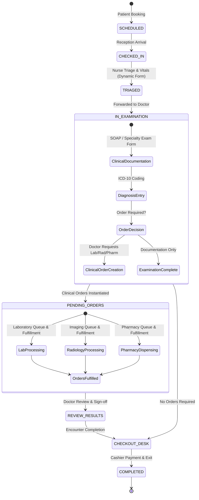
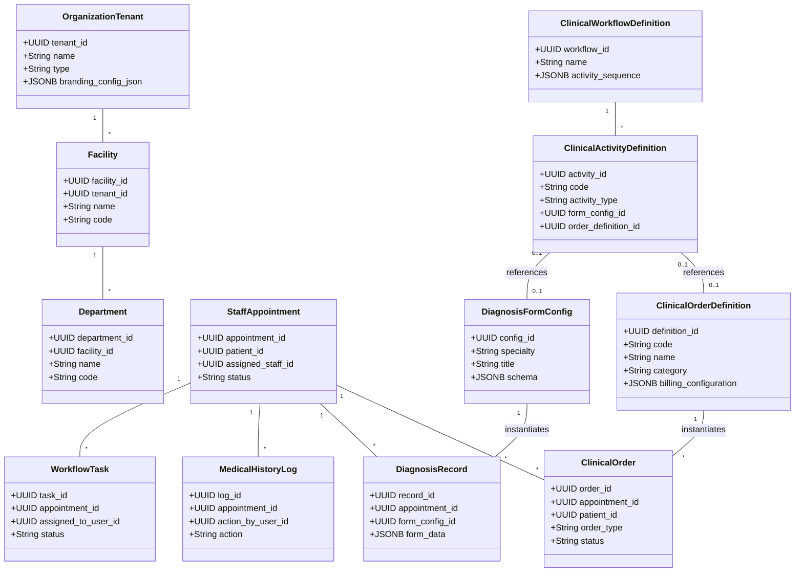
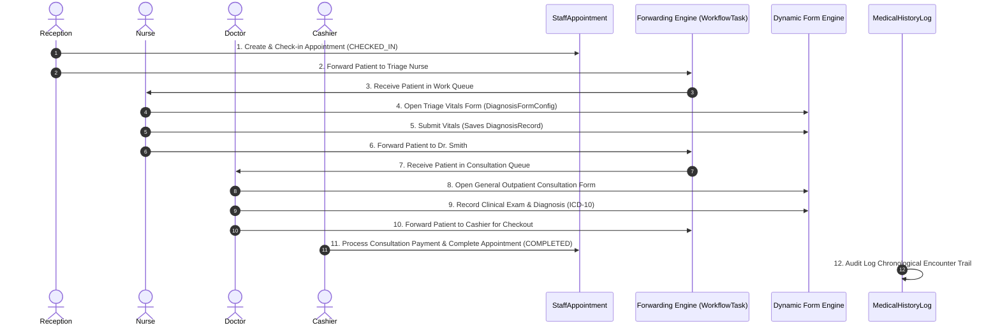
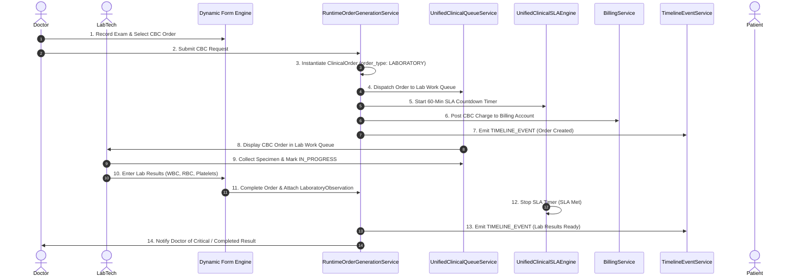
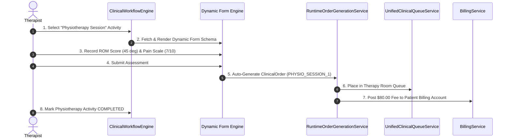

# Phase 2.12.1 — Dynamic Workflow, Dynamic Forms & ClinicalOrder Responsibility Analysis Report

**Author:** Chief Enterprise Software Architect, NovaCure  
**Date:** July 26, 2026  
**Status:** ✅ APPROVED ENTERPRISE ARCHITECTURE REVIEW  
**Scope:** Architectural reverse-engineering, responsibility boundaries, component lifecycle interaction analysis, and ideal responsibility matrix across NovaCure's four core engines.

---

## Executive Summary

NovaCure has evolved into an enterprise healthcare operating system composed of four major engines:
1. **Dynamic Form Engine** (`DiagnosisFormConfig`, `FormFieldGroup`, `FormField`, `DiagnosisRecord`)
2. **Clinical Workflow Engine** (`ClinicalWorkflowDefinition`, `ClinicalActivityDefinition`, `ClinicalWorkflowEngine`, `DynamicOrderExecutionService`)
3. **Clinical Order Engine** (`ClinicalOrderDefinition`, `ClinicalOrder`, `RuntimeOrderGenerationService`, `UnifiedClinicalQueueService`, `UnifiedClinicalSLAEngine`, `UnifiedClinicalOrderStateMachine`)
4. **Ad-Hoc Forwarding & Encounter Engine** (`StaffAppointment`, `PatientSchedule`, `WorkflowTask`, `MedicalHistoryLog`)

This assessment establishes strict responsibility boundaries between form rendering, clinical protocol definitions, service order execution, and physical patient forwarding. It eliminates architectural ambiguity, prevents duplicate responsibility implementations, and outlines the precise interactions governing clinical encounters.

---

## SECTION 1: Encounter Ownership & Lifecycle

### 1.1 Encounter Ownership Principle
**The Patient Encounter is owned exclusively by the `StaffAppointment` entity** (supported by `PatientSchedule`). Neither `ClinicalOrder`, `ClinicalWorkflowDefinition`, `WorkflowTask`, nor `DiagnosisFormConfig` owns the encounter.

- `StaffAppointment` serves as the root container (`appointment_id`) linking patient identity (`patient_id`), active facility (`facility_id`), tenant (`tenant_id`), attending staff (`assigned_staff_id`), and overall encounter state (`status`).
- All clinical activities, dynamic forms, clinical orders, patient forwardings, and billing accounts anchor back to a single `appointment_id`.

### 1.2 Patient Encounter Lifecycle Diagram



---

## SECTION 2: Dynamic Form Rendering & Storage Lifecycle

### 2.1 Form Appearance Triggers

| Encounter Stage | Trigger Event | Form Schema Source | Responsible Renderer | Storage Entity |
| :--- | :--- | :--- | :--- | :--- |
| **Opening / Intake** | Patient check-in or portal registration | `FormFieldGroup` & `FormField` | Intake Form Component | `PatientFieldValue` |
| **Nurse Triage** | Patient arrives at Triage station | `DiagnosisFormConfig` (`category: TRIAGE`) | `DiagnosisFormContainer` | `DiagnosisRecord` |
| **Doctor Exam** | Doctor opens active encounter | `DiagnosisFormConfig` (`specialty_id`, `form_type: EXAM`) | `DiagnosisFormContainer` | `DiagnosisRecord` |
| **Lab Request** | Doctor orders lab requiring clinical notes | `ClinicalOrderDefinition.form_schema` | `OrderParameterForm` | `ClinicalOrder.parameters_json` |
| **Radiology Request** | Doctor orders imaging requiring contrast screening | `ClinicalOrderDefinition.form_schema` | `OrderParameterForm` | `ClinicalOrder.parameters_json` |
| **Prescription** | Doctor selects medication | `PrescriptionDocumentTemplate` | `PrescriptionForm` | `Prescription` & `PrescriptionItem` |
| **Physiotherapy** | Therapist opens therapy session | `DiagnosisFormConfig` (`specialty: PHYSIOTHERAPY`) | `DiagnosisFormContainer` | `DiagnosisRecord` |
| **Result Entry** | Lab tech or radiologist completes study | `LaboratoryObservation` / `RadiologyReportTemplate` | `DiagnosticResultForm` | `LaboratoryObservation` / `RadiologyReport` |
| **Follow-up** | Clinician conducts follow-up consultation | `DiagnosisFormConfig` (`form_type: FOLLOW_UP`) | `DiagnosisFormContainer` | `EncounterFollowUp` & `DiagnosisRecord` |

---

## SECTION 3: ClinicalOrder Creation Triggers

### 3.1 Order Creation Boundary Rules

```
                      +-----------------------------+
                      | Clinical Encounter Decision |
                      +-----------------------------+
                                     |
           +-------------------------+-------------------------+
           |                                                   |
           v                                                   v
[ Evaluative Data Capture ]                         [ Actionable Service Request ]
- Physical Exam / Vitals                            - Laboratory Specimen Test
- SOAP Notes / Diagnosis                            - Radiology Imaging Study
- History & Systems Review                          - Medication Dispensing
- Clinical Observations                             - Physical Therapy Sessions
           |                                                   |
           v                                                   v
+-----------------------+                           +-----------------------+
|    Dynamic Form       |                           |    Clinical Order     |
|  (DiagnosisRecord)   |                           |  (ClinicalOrder)      |
+-----------------------+                           +-----------------------+
(NO ClinicalOrder generated)                         (ClinicalOrder generated via
                                                     RuntimeOrderGenerationService)
```

1. **Doctor records diagnosis only**:  
   **NO `ClinicalOrder` is created.** The diagnosis is recorded inside `DiagnosisRecord` (and linked to `DiagnosisTemplate` / `ICD-10`), updating the clinical documentation of `StaffAppointment`.
2. **Doctor requests CBC (Complete Blood Count)**:  
   **YES, a `ClinicalOrder` IS created.** `RuntimeOrderGenerationService` instantiates a `ClinicalOrder` (`order_type: 'LABORATORY'`, `order_code: 'CBC'`) linking `appointment_id`, `patient_id`, `ordered_by`, `tenant_id`, and `facility_id`. It routes to `UnifiedClinicalQueueService` for specimen collection and laboratory processing.
3. **Doctor prescribes medication**:  
   **YES, a `ClinicalOrder` IS created.** The prescription generates a `ClinicalOrder` (`order_type: 'PHARMACY'`) linked to the `Prescription` entity, establishing fulfillment tracking, drug-safety validation, inventory deduction, and billing charges.
4. **Radiologist records report**:  
   **NO new order is created.** The radiologist *fulfills* the existing Radiology `ClinicalOrder`. Submitting the report creates a `RadiologyReport` object, attaches DICOM series links, and transitions the status of the existing `ClinicalOrder` from `IN_PROGRESS` → `COMPLETED`.

---

## SECTION 4: Engine Boundaries & Workflow Control

### 4.1 Responsibility Boundaries

```
+-----------------------------------------------------------------------------------+
|                                 USER (Actor)                                      |
|    Drives execution by selecting actions, filling forms, and forwarding patients |
+-----------------------------------------------------------------------------------+
       |                                      |                                   |
       v                                      v                                   v
+------------------------+  +----------------------------------+  +-----------------------------------+
|  Forwarding Engine     |  |   Clinical Workflow Engine       |  |      Clinical Order Engine        |
| (MedicalHistoryLog /   |  |  (ClinicalWorkflowDefinition /   |  |   (ClinicalOrder / Queue /        |
|    WorkflowTask)       |  |     ClinicalActivityDefinition)  |  |         SLA / Billing)          |
+------------------------+  +----------------------------------+  +-----------------------------------+
| OWNS: Physical patient |  | OWNS: Protocol step rules &      |  | OWNS: Service fulfillment, queue  |
| transfer & current     |  | clinical guideline compliance    |  | state, SLA countdown, and         |
| location/custody       |  | across care stages               |  | department dispatch               |
+------------------------+  +----------------------------------+  +-----------------------------------+
```

- **Forwarding Engine (`WorkflowTask`, `MedicalHistoryLog`)**: Responsible for **ad-hoc patient routing between physical staff members or stations** (e.g. "Send patient from Nurse Jane to Dr. Smith").
- **Clinical Workflow Engine (`ClinicalWorkflowDefinition`, `ClinicalActivityDefinition`)**: Responsible for **defining clinical protocols and mandatory activity sequences** (e.g. "Chest Pain Protocol requires ECG Activity before Discharge Activity").
- **Clinical Order Engine (`ClinicalOrder`, `UnifiedClinicalQueueService`)**: Responsible for **managing asynchronous department service requests, fulfillment queues, SLA timers, and billing triggers**.
- **User**: Drives execution by selecting next steps, filling out forms, submitting orders, and forwarding patients.

---

## SECTION 5: Dynamic Forms Without Clinical Orders

### 5.1 Analysis
**YES, Dynamic Forms can and MUST exist without Clinical Orders.**

### 5.2 Examples
- **History Taking**: Recording past medical, surgical, and family history.
- **Vital Signs**: Recording blood pressure, heart rate, temperature, and oxygen saturation.
- **Physical Examination**: Documenting HEENT, respiratory, cardiovascular, and abdominal findings.
- **Diagnosis**: Selecting ICD-10 diagnostic codes.
- **SOAP Notes**: Subjective, Objective, Assessment, and Plan documentation.
- **Progress Notes**: Inpatient daily round notes.
- **Discharge Summaries**: Summary of inpatient stay and discharge advice.

### 5.3 Architectural Justification
Clinical documentation represents **evaluative data capture** (observational clinical state). It does NOT represent a request for an external department to perform an actionable service. Wrapping pure documentation inside a `ClinicalOrder` would create unnecessary queue clutter, invalid SLA timers, and false billing requests. Dynamic forms store observational data directly into `DiagnosisRecord` or `PatientFieldValue`.

---

## SECTION 6: Clinical Orders Without Dynamic Forms

### 6.1 Analysis
**YES, Clinical Orders can and MUST exist without Dynamic Forms.**

### 6.2 Examples
- **Auto-generated Follow-up Orders**: System-generated order to schedule a 14-day post-op checkup based on protocol completion.
- **Automatic Billing Orders**: Automatic posting of room charges, facility fees, or daily nursing fees.
- **Automatic Reminder Orders**: System-generated SMS/email patient reminders.
- **Standing Orders**: Pre-approved protocol orders (e.g., "Give Tylenol 500mg for temp > 38.5C").
- **Recurring Medication Orders**: Scheduled morning insulin administration for an admitted inpatient.
- **Emergency Critical Result Alerts**: Automated high-priority order dispatch when a panic lab value is reported.

### 6.3 Architectural Justification
Automated orders are instantiated systemically via event hooks, cron schedules, or protocol state machines (`RuntimeOrderGenerationService`). They do not require an interactive UI form for human data entry because all parameters are derived programmatically from context.

---

## SECTION 7: Classification of Clinical Activity Types

| Activity Category | Requires Dynamic Form? | Creates ClinicalOrder? | Uses Forwarding? | Requires Queue? | Uses SLA? | Requires Billing? | Primary Purpose |
| :--- | :---: | :---: | :---: | :---: | :---: | :---: | :--- |
| **Clinical Documentation** | **Yes** | No | No | No | No | No | Capture patient history, vitals, exam notes |
| **Clinical Decision** | **Yes** | No | Optional | No | No | No | Record diagnosis, staging, ICD-10 coding |
| **Clinical Order** | Optional | **Yes** | Optional | **Yes** | **Yes** | **Yes** | Request lab, radiology, pharmacy fulfillment |
| **Clinical Procedure** | **Yes** | **Yes** | Optional | **Yes** | **Yes** | **Yes** | Document & execute invasive/non-invasive therapies |
| **Administrative Task** | No | No | **Yes** | No | No | Optional | Check-in, bed assignment, insurance verification |
| **Communication Task** | No | No | No | No | No | No | Patient SMS notification, internal staff message |
| **Automation Task** | No | Optional | No | No | **Yes** | Optional | Background rule evaluation, auto-followup generation |
| **Follow-up Task** | **Yes** | Optional | Optional | No | **Yes** | Optional | Post-encounter continuity & outcome check |
| **External Referral** | **Yes** | **Yes** | No | No | **Yes** | Optional | Transfer care to external facility/specialist |
| **Patient Education** | Optional | No | No | No | No | No | Provide discharge instructions & drug guides |
| **Care Management** | **Yes** | Optional | Optional | **Yes** | **Yes** | Optional | Chronic disease tracking & care plan review |

---

## SECTION 8: Unified Architecture Diagram



---

## SECTION 9: Execution Flow Walkthroughs

### 9.1 Example A: Outpatient Consultation (Reception → Nurse → Doctor → Diagnosis → Cashier → Exit)



#### Component Interaction Table (Example A)
1. **Reception**: Interacts with `StaffAppointment` (`status: CHECKED_IN`). Triggers `WorkflowTask` assignment to `Nurse`.
2. **Nurse**: Renders `DiagnosisFormConfig` (`category: TRIAGE`). Submits `DiagnosisRecord` containing blood pressure and temperature. Forwards patient to `Doctor` via `WorkflowTask`.
3. **Doctor**: Renders `DiagnosisFormConfig` (`category: CONSULTATION`). Saves clinical examination notes and ICD-10 diagnosis into `DiagnosisRecord`. No orders requested. Forwards patient to `Cashier`.
4. **Cashier**: Generates encounter consultation invoice via `BillingService`. Completes `StaffAppointment`.

---

### 9.2 Example B: Doctor Orders CBC (Form → Workflow → ClinicalOrder → Queue → Lab → Result Form → Doctor Review → Billing → Timeline)



#### Component Interaction Table (Example B)
1. **Doctor Action**: Submits CBC request during examination form submission.
2. **Clinical Order Engine**: `RuntimeOrderGenerationService.createOrderFromDefinition()` creates `ClinicalOrder` (`order_type: 'LABORATORY'`, `status: 'SUBMITTED'`).
3. **Queue & SLA**: `UnifiedClinicalQueueService` places order into Laboratory Queue. `UnifiedClinicalSLAEngine` initiates 60-minute turnaround SLA countdown.
4. **Billing Service**: Automatically creates a pending `AppointmentBillingEntry` for the CBC test fee.
5. **Lab Execution**: Lab Tech completes specimen analysis, enters result values into `LaboratoryObservation` form.
6. **Order Completion**: `ClinicalOrder` transitions to `COMPLETED`. `TimelineEventService` logs `LAB_RESULT_PUBLISHED` event.

---

### 9.3 Example C: Zero-Code Specialty Onboarding (Physiotherapy Evaluation & Treatment)

This example demonstrates how a completely new specialty (Physiotherapy) is onboarded without writing code.

#### Step 1: Administrator Configuration (Pure JSON Data)
1. **Create Dynamic Form Config (`DiagnosisFormConfig`)**:
   - `specialty`: `PHYSIOTHERAPY`
   - `title`: `Physiotherapy Initial Assessment Form`
   - `schema`: Defines ROM (Range of Motion) sliders, Pain Scale (1-10), Muscle Strength checkboxes, and Treatment Plan text areas.
2. **Create Order Definition (`ClinicalOrderDefinition`)**:
   - `code`: `PHYSIO_SESSION_1`
   - `name`: `Physical Therapy Rehab Session`
   - `category`: `PROCEDURE`
   - `department_id`: `PHYSIOTHERAPY_DEPT`
   - `billing_configuration`: `{ is_billable: true, default_fee: 80.00 }`
3. **Create Activity Definition (`ClinicalActivityDefinition`)**:
   - `code`: `ACT_PHYSIO_EVAL`
   - `activity_type`: `Clinical Procedure`
   - `form_config_id`: Mapped to `Physiotherapy Initial Assessment Form`
   - `order_definition_id`: Mapped to `PHYSIO_SESSION_1`

#### Step 2: Runtime Zero-Code Execution Flow



---

## SECTION 10: Architectural Overlap & Resolution

### 10.1 Identified Overlaps & Conflict Resolution

| Overlap Area | Conflict Description | Architectural Resolution |
| :--- | :--- | :--- |
| **Status Tracking** | `WorkflowTask.status` vs `ClinicalOrder.status` vs `StaffAppointment.status` | - `StaffAppointment.status` owns **Encounter State** (`CHECKED_IN`, `COMPLETED`).<br>- `WorkflowTask.status` owns **Ad-hoc Forwarding Custody** (`PENDING`, `COMPLETED`).<br>- `ClinicalOrder.status` owns **Order Fulfillment State** (`SUBMITTED`, `IN_PROGRESS`, `COMPLETED`). |
| **Forwarding vs Routing** | Dynamic Forwarding Engine vs Clinical Workflow Protocol Engine | - **Forwarding Engine** handles *ad-hoc physical patient transfers* between human staff.<br>- **Clinical Workflow Engine** recommends *protocol activity sequences* based on medical guidelines. |
| **Billing Initiation** | Dynamic Forms vs Clinical Order Engine | - **Dynamic Forms NEVER post billing charges directly**.<br>- **Billing charges MUST be generated exclusively by `ClinicalOrder` instantiation or Cashier Encounter checkout.** |
| **Task Queuing** | Department Work Queues vs Staff Forwarding Inbox | - **Department Queues** (`UnifiedClinicalQueueService`) display *service orders* (Labs, Rad, Pharm).<br>- **Staff Inbox** displays *patient transfers* (`WorkflowTask`). |

---

## SECTION 11: Ideal Responsibility Matrix

| Engine | Primary Responsibility | What it NEVER does | Inputs | Outputs | Events Produced | Events Consumed |
| :--- | :--- | :--- | :--- | :--- | :--- | :--- |
| **Dynamic Form Engine** | Configures, renders, and validates specialty clinical forms without code. Stores raw observational data. | NEVER generates billing fees, manages fulfillment queues, or forwards patients. | Form Schema, User Field Submissions | `DiagnosisRecord`, `PatientFieldValue` | `FORM_SUBMITTED`, `FORM_VALIDATED` | None |
| **Clinical Workflow Engine** | Defines clinical protocols, activity dependencies, and medical guideline sequences. | NEVER executes physical orders, processes payments, or stores clinical form values. | Clinical Activity Definitions, Encounter Context | Workflow Execution Plan, Next Recommended Activity | `WORKFLOW_STEP_COMPLETED`, `PROTOCOL_VIOLATED` | `ENCOUNTER_STARTED`, `ORDER_COMPLETED` |
| **Clinical Order Engine** | Manages order lifecycles, service queues, turnaround SLAs, result fulfillment, and billing triggers. | NEVER renders interactive clinical forms or manages staff-to-staff patient handoffs. | Order Requests, Clinical Order Definitions | `ClinicalOrder`, Queue Items, SLA Timers | `ORDER_CREATED`, `ORDER_FULFILLED`, `SLA_BREACHED` | `FORM_SUBMITTED`, `RESULT_ENTERED` |
| **Forwarding & Encounter Engine** | Manages physical encounter state (`StaffAppointment`) and ad-hoc patient handoffs between staff. | NEVER defines medical treatment protocols or evaluates lab result data. | Transfer Requests, Staff IDs | `StaffAppointment`, `WorkflowTask`, `MedicalHistoryLog` | `PATIENT_CHECKED_IN`, `PATIENT_FORWARDED` | `CHECKOUT_REQUESTED`, `PAYMENT_COMPLETED` |
