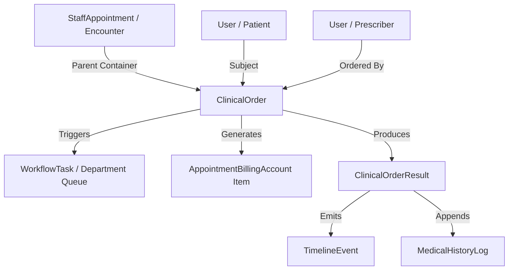
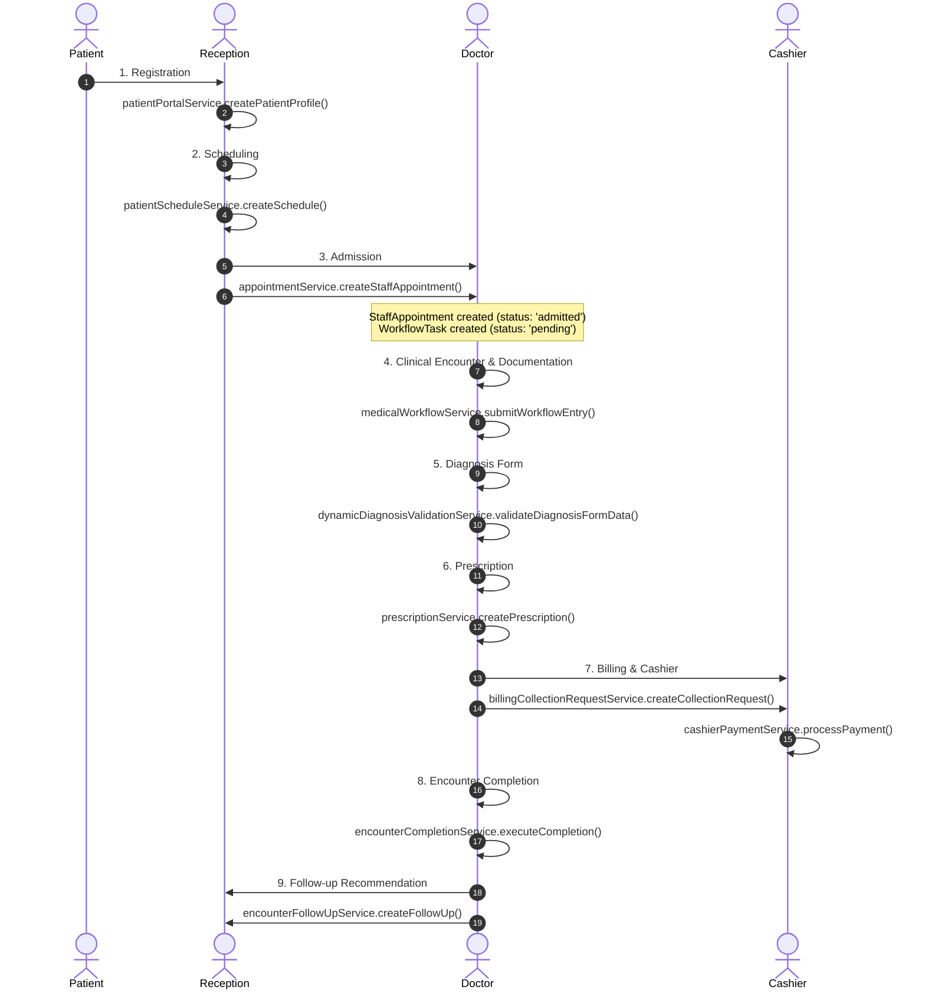
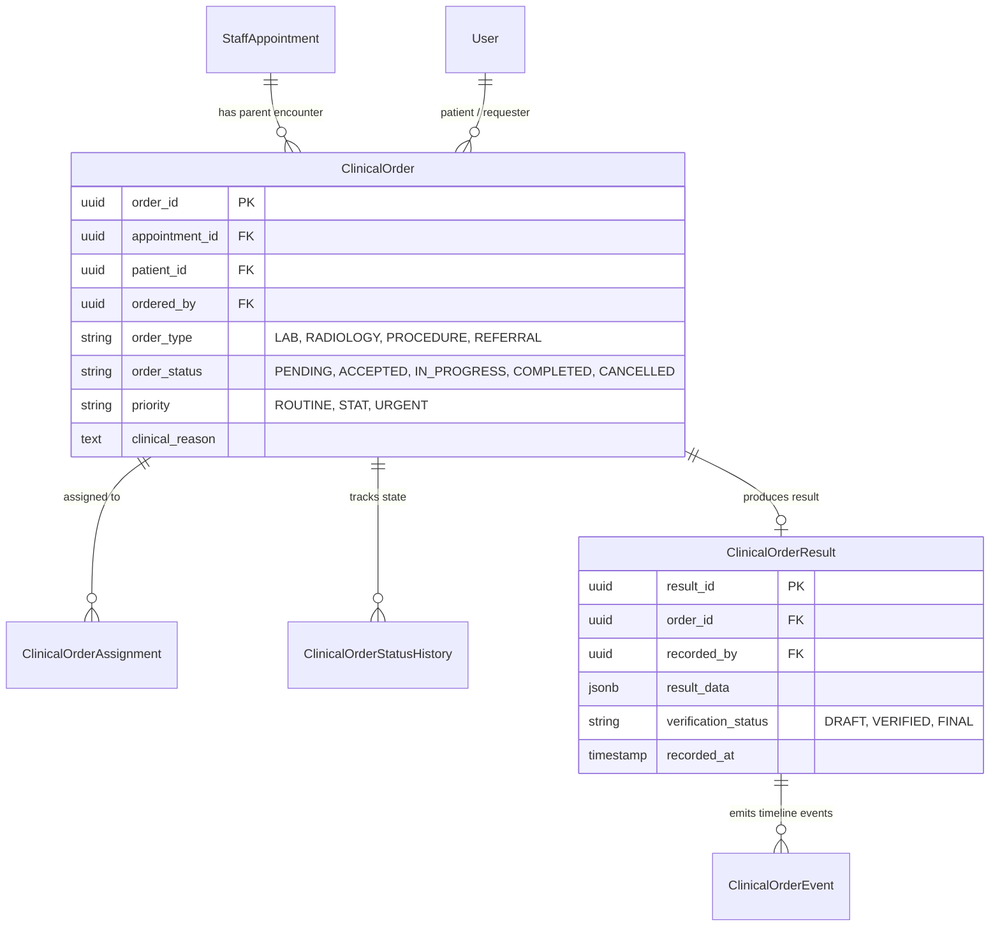

# Phase 2.5.1 — Clinical Order Architecture Analysis Document

**NovaCure Clinical Platform — Pre-Phase 2.5 Architectural Discovery**

> [!IMPORTANT]
> **Source Code Audit Standard**: This document represents a complete, empirical reverse-engineering analysis of the NovaCure Clinical Platform architecture based **strictly on actual source code implementation**. No production code was modified, no database migrations were created, and no models or services were instantiated.

---

## 1. Executive Summary

The NovaCure Clinical Platform currently operates a **task/user-based workflow engine** where clinical progress occurs via ad-hoc routing of patients between individual users (`sender_staff_id` $\to$ `receiver_staff_id`). 

While this architecture supports dynamic clinical handovers, it lacks a **Unified Clinical Order Platform**. Clinical orders (such as Laboratory tests, Radiology imaging, Procedures, and Referrals) are currently recorded as freeform text within general workflow logs (`MedicalHistoryLog.header_title` or `notes`), rather than discrete, trackable, and billable order entities with independent lifecycles.

Phase 2.5 introduces the **Clinical Order Architecture Foundation**. This analysis evaluates the codebase to determine the exact integration points for `ClinicalOrder`, its connection to `StaffAppointment` (Encounter), `PatientSchedule`, `WorkflowTask`, `MedicalHistoryLog`, `TimelineEvent`, `AppointmentBillingAccount`, and RBAC permissions.



---

## 2. Current NovaCure Architecture

The backend of NovaCure is built on Express.js and Sequelize ORM. The platform architecture is modularized into distinct services, controllers, models, and middlewares:

```mermaid
flowchart LR
    subgraph Routing & Auth Layer
        API[Express Router] --> JWT[authMiddleware.js]
        JWT --> RBAC[rbacMiddleware.js]
    end

    subgraph Service & Core Logic Layer
        RBAC --> MWS[medicalWorkflowService.js]
        RBAC --> ECS[encounterCompletionService.js]
        RBAC --> EFS[encounterFollowUpService.js]
        RBAC --> ABS[appointmentBillingService.js]
        RBAC --> CPS[cashierPaymentService.js]
        RBAC --> TES[timelineEventService.js]
    end

    subgraph Persistence Layer (Sequelize ORM)
        MWS --> MHL[MedicalHistoryLog]
        MWS --> WT[WorkflowTask]
        ECS --> SA[StaffAppointment]
        ABS --> ABA[AppointmentBillingAccount]
        CPS --> BCR[BillingCollectionRequest]
    end
```

### Core Architecture Components Matrix
- **Core App Entry**: [backend/app.js](file:///c:/Users/Amanuel%20Daniel/Desktop/PLC-AND-HOLDING-GROUPS/novacure-platform/backend/app.js)
- **Database Models Hub**: [backend/models/index.js](file:///c:/Users/Amanuel%20Daniel/Desktop/PLC-AND-HOLDING-GROUPS/novacure-platform/backend/models/index.js)
- **Authentication Middleware**: [backend/middlewares/authMiddleware.js](file:///c:/Users/Amanuel%20Daniel/Desktop/PLC-AND-HOLDING-GROUPS/novacure-platform/backend/middlewares/authMiddleware.js#L110-L150)
- **RBAC Middleware**: [backend/middlewares/rbacMiddleware.js](file:///c:/Users/Amanuel%20Daniel/Desktop/PLC-AND-HOLDING-GROUPS/novacure-platform/backend/middlewares/rbacMiddleware.js#L15-L60)

---

## 3. Existing Clinical Lifecycle Trace

Below is the complete end-to-end trace of a patient journey through the production codebase:



### Technical Code Reference Table for Lifecycle Steps

| Step | Function / Process | File Path | Model(s) | Controller / Service Method |
| :--- | :--- | :--- | :--- | :--- |
| **1. Registration** | Patient Account Creation | [patientPortalService.js](file:///c:/Users/Amanuel%20Daniel/Desktop/PLC-AND-HOLDING-GROUPS/novacure-platform/backend/services/patientPortalService.js#L50-L100) | `User`, `PatientProfile` | `patientPortalController.registerPatient()` |
| **2. Scheduling** | Slot Booking | [patientScheduleService.js](file:///c:/Users/Amanuel%20Daniel/Desktop/PLC-AND-HOLDING-GROUPS/novacure-platform/backend/services/patientScheduleService.js#L180-L240) | `PatientSchedule` | `patientScheduleController.createSchedule()` |
| **3. Admission** | Encounter Initialization | [appointmentService.js](file:///c:/Users/Amanuel%20Daniel/Desktop/PLC-AND-HOLDING-GROUPS/novacure-platform/backend/services/appointmentService.js#L60-L120) | `StaffAppointment`, `WorkflowTask` | `appointmentController.createStaffAppointment()` |
| **4. Documentation** | Workflow Logging | [medicalWorkflowService.js](file:///c:/Users/Amanuel%20Daniel/Desktop/PLC-AND-HOLDING-GROUPS/novacure-platform/backend/services/medicalWorkflowService.js#L255-L350) | `MedicalHistoryLog`, `WorkflowTask` | `medicalWorkflowController.submitWorkflowEntry()` |
| **5. Diagnosis** | Form Schema & Validation | [dynamicDiagnosisValidationService.js](file:///c:/Users/Amanuel%20Daniel/Desktop/PLC-AND-HOLDING-GROUPS/novacure-platform/backend/services/dynamicDiagnosisValidationService.js#L20-L80) | `DiagnosisFormConfig` | `diagnosisFormConfigController.validateForm()` |
| **6. Prescription** | Rx Issuance | [prescriptionService.js](file:///c:/Users/Amanuel%20Daniel/Desktop/PLC-AND-HOLDING-GROUPS/novacure-platform/backend/services/prescriptionService.js#L80-L140) | `Prescription`, `PrescriptionItem` | `prescriptionController.createPrescription()` |
| **7. Billing** | Collection Request | [billingCollectionRequestService.js](file:///c:/Users/Amanuel%20Daniel/Desktop/PLC-AND-HOLDING-GROUPS/novacure-platform/backend/services/billingCollectionRequestService.js#L30-L80) | `BillingCollectionRequest` | `billingCollectionRequestController.createRequest()` |
| **8. Cashier** | Payment Processing | [cashierPaymentService.js](file:///c:/Users/Amanuel%20Daniel/Desktop/PLC-AND-HOLDING-GROUPS/novacure-platform/backend/services/cashierPaymentService.js#L120-L200) | `CashierPayment`, `AppointmentBillingAccount` | `cashierPaymentController.processPayment()` |
| **9. Completion** | Encounter Closure | [encounterCompletionService.js](file:///c:/Users/Amanuel%20Daniel/Desktop/PLC-AND-HOLDING-GROUPS/novacure-platform/backend/services/encounterCompletionService.js#L52-L105) | `StaffAppointment`, `WorkflowTask` | `encounterCompletionController.executeCompletion()` |
| **10. Follow-up** | Continuity Recommendation | [encounterFollowUpService.js](file:///c:/Users/Amanuel%20Daniel/Desktop/PLC-AND-HOLDING-GROUPS/novacure-platform/backend/services/encounterFollowUpService.js#L120-L180) | `EncounterFollowUp` | `encounterFollowUpController.createFollowUp()` |

---

## 4. Encounter Architecture Analysis

### What Represents a Clinical Visit?
In the NovaCure database schema:
- **`PatientSchedule`** ([patientSchedule.js](file:///c:/Users/Amanuel%20Daniel/Desktop/PLC-AND-HOLDING-GROUPS/novacure-platform/backend/models/scheduling/patientSchedule.js)): Represents the **calendar reservation** (date, time slot, patient ID, assigned staff ID).
- **`StaffAppointment`** ([staffAppointment.js](file:///c:/Users/Amanuel%20Daniel/Desktop/PLC-AND-HOLDING-GROUPS/novacure-platform/backend/models/scheduling/staffAppointment.js)): Represents the **actual clinical encounter** (contains `appointment_id`, `schedule_id`, `admitted_at`, `workflow_status`, `workflow_completed_at`, `completed_by`).

### Root Clinical Container Recommendation
`StaffAppointment` is the authoritative **Encounter container** for all clinical logs, diagnoses, prescriptions, and billing accounts. 

> **Recommendation**: A future `ClinicalOrder` entity **MUST belong directly to `StaffAppointment`** (`appointment_id` foreign key) and inherit `patient_id` from the appointment. It should NOT attach to `PatientSchedule` (which is a pre-admission scheduling entity).

---

## 5. Current Workflow Engine Analysis

### Is `WorkflowTask` Suitable to Represent Clinical Orders?
**Conclusion**: **NO.** `WorkflowTask` is NOT suitable to represent a Clinical Order.

### Technical Justification:
1. **Purpose Mismatch**: `WorkflowTask` ([workflowTask.js](file:///c:/Users/Amanuel%20Daniel/Desktop/PLC-AND-HOLDING-GROUPS/novacure-platform/backend/models/workflow/workflowTask.js)) is a lightweight **user inbox notification task** (`assignee_staff_id`, `status: "pending"|"done"|"cancelled"`).
2. **Lack of Order Lifecycle Attributes**: `WorkflowTask` lacks clinical order fields such as `order_type` (LAB, RADIOLOGY, PROCEDURE), `priority` (ROUTINE, STAT, URGENT), `clinical_reason`, `billing_status`, `result_status`, `specimen_source`, or structured `results`.
3. **No Result Attachment Support**: `WorkflowTask` only links to a single `medical_log_id`. It cannot manage structured laboratory test panels or radiology DICOM/text result reports.
4. **Architectural Role**: `WorkflowTask` should remain the **task assignment mechanism** used to notify staff members when a `ClinicalOrder` requires action.

---

## 6. Existing Clinical Entities & Order Analysis

| Entity | Current Purpose | Model Path | Relationship with Encounter | Relationship with Timeline |
| :--- | :--- | :--- | :--- | :--- |
| **Diagnosis** | Clinical Form Schema & Values | [diagnosisFormConfigService.js](file:///c:/Users/Amanuel%20Daniel/Desktop/PLC-AND-HOLDING-GROUPS/novacure-platform/backend/services/diagnosisFormConfigService.js) | Stored as JSON in `MedicalHistoryLog.form_data` linked via `appointment_id` | Rendered as diagnosis entries in patient timeline |
| **Prescription** | Medication Orders | [prescription.js](file:///c:/Users/Amanuel%20Daniel/Desktop/PLC-AND-HOLDING-GROUPS/novacure-platform/backend/models/pharmacy/prescription.js) | Linked via `appointment_id` & `workflow_log_id` | Attaches to timeline via `attachPrescriptionsToTimeline()` |
| **Medical History** | Longitudinal Workflow Logs | [medicalHistoryLog.js](file:///c:/Users/Amanuel%20Daniel/Desktop/PLC-AND-HOLDING-GROUPS/novacure-platform/backend/models/medical/medicalHistoryLog.js) | Primary child table of `StaffAppointment` | Primary data source for `timelineEventService.js` |
| **Follow-up** | Care Continuity Tracking | [encounterFollowUp.js](file:///c:/Users/Amanuel%20Daniel/Desktop/PLC-AND-HOLDING-GROUPS/novacure-platform/backend/models/followup/encounterFollowUp.js) | Linked via `appointment_id` and `completed_encounter_id` | Generates `FOLLOW_UP_RECOMMENDED` timeline events |

---

## 7. Billing Architecture Analysis

### Current Billing Attachment Point
In [appointmentBillingService.js](file:///c:/Users/Amanuel%20Daniel/Desktop/PLC-AND-HOLDING-GROUPS/novacure-platform/backend/services/appointmentBillingService.js#L50-L100):
- Billing attaches directly to **`StaffAppointment`** via **`AppointmentBillingAccount`** (`appointment_id` foreign key).
- `BillingCollectionRequest` attaches to `AppointmentBillingAccount` and lists `BillingServiceCatalog` item IDs.

### Phase 2.5 Order Billing Integration
> **Recommendation**: When a `ClinicalOrder` is created (e.g., CBC Test or Chest X-Ray), the Order Engine should automatically add an un-billed line item to `AppointmentBillingAccount` or trigger a `BillingCollectionRequest`. Payment verification (`status = 'PAID'`) can optionally serve as a prerequisite before order execution (for self-pay patients).

---

## 8. Timeline Engine Integration

### How Actions Become Timeline Events
In [timelineEventService.js](file:///c:/Users/Amanuel%20Daniel/Desktop/PLC-AND-HOLDING-GROUPS/novacure-platform/backend/services/timelineEventService.js#L80-L150), timeline events are synthesized from `MedicalHistoryLog`, `Prescription`, and `EncounterFollowUp` records.

### Timeline Events Summary Table

| Existing Events | Missing Current Events | Future Order Events Required |
| :--- | :--- | :--- |
| `ADMISSION` | Cashier Payment Receipt Event | `ORDER_CREATED` |
| `DIAGNOSIS_SUBMITTED` | Attachment Direct Upload Event | `ORDER_ACCEPTED` |
| `PRESCRIPTION_ISSUED` | Lab Result Upload Event | `ORDER_EXECUTED` |
| `FOLLOW_UP_RECOMMENDED` | Referral Event | `RESULT_AVAILABLE` |
| `ENCOUNTER_COMPLETED` | Vital Sign Event | `RESULT_REVIEWED` |

---

## 9. RBAC Analysis & Required Permissions

Existing RBAC permissions are defined in [permissions.js](file:///c:/Users/Amanuel%20Daniel/Desktop/PLC-AND-HOLDING-GROUPS/novacure-platform/backend/config/permissions.js) and seeded via Sequelize seeders.

### Existing vs. Required Permissions Matrix

| Module | Permission Key | Status | Description |
| :--- | :--- | :--- | :--- |
| `patients` | `receive_patient` | Existing | Allows user to receive forwarded patient |
| `workflow` | `submit` | Existing | Allows submitting workflow entries |
| `workflow` | `complete` | Existing | Allows completing encounters |
| `billing` | `request_collection` | Existing | Allows requesting cashier collection |
| `followup` | `outcome:create` | Existing | Allows recording follow-up outcome |
| `orders` | `order:create` | **NOT IMPLEMENTED** | Required to order Lab/Rad/Procedure |
| `orders` | `order:view` | **NOT IMPLEMENTED** | Required to view department order queue |
| `orders` | `order:accept` | **NOT IMPLEMENTED** | Required for Lab/Rad tech to claim order |
| `orders` | `order:execute` | **NOT IMPLEMENTED** | Required to execute test/scan |
| `orders` | `result:create` | **NOT IMPLEMENTED** | Required to input test results |
| `orders` | `result:verify` | **NOT IMPLEMENTED** | Required for supervisor verification |
| `orders` | `result:review` | **NOT IMPLEMENTED** | Required for doctor review of results |

---

## 10. Database Architecture Impact (Proposed Relationships)

> [!NOTE]
> **No Database Migrations Are Created By This Analysis Document.**

Below is the conceptual Entity Relationship Diagram for the future Phase 2.5 Clinical Order Platform:



---

## 11. Missing Architectural Concepts (Current Gaps)

1. **No Order Abstraction**: Orders are currently unstructured text strings inside `MedicalHistoryLog`.
2. **No Departmental Queue Concept**: Tasks can only be assigned to a specific individual `assignee_staff_id`, not a shared departmental pool (`department_id`).
3. **No Result Lifecycle**: There is no dedicated entity or service to capture, verify, and review laboratory values or radiology reports.
4. **No Order-to-Billing Auto-Sync**: Order entry does not automatically register billable items on `AppointmentBillingAccount`.

---

## 12. Phase 2.5 Implementation Boundary

To ensure a stable, incremental rollout, Phase 2.5 should be scoped strictly into foundational and advanced boundaries:

### ✅ IN SCOPE for Phase 2.5 Foundation:
- `ClinicalOrder` core data model & migration.
- `ClinicalOrderResult` data model for test output/notes.
- Departmental Order Queue routing (`department_id` assignment).
- Order Lifecycle status transitions (`PENDING` $\to$ `ACCEPTED` $\to$ `COMPLETED`).
- Automatic `TimelineEvent` emission on result submission.
- Integration with `StaffAppointment` and `AppointmentBillingAccount`.

### ❌ OUT OF SCOPE for Phase 2.5 (Future Phases):
- **Full Laboratory Information System (LIS)** (barcode printing, analyzer HL7/ASTM integration).
- **Full Radiology PACS System** (DICOM viewer server integration).
- **Pharmacy Inventory Management** (stock batch numbers, reorder points).
- **Inpatient Bed & Ward Management**.

---
*Analysis Document completed autonomously for NovaCure Clinical Platform Phase 2.5 Architecture Review.*
