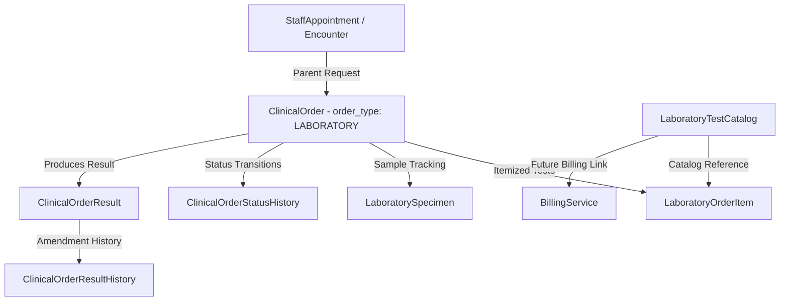
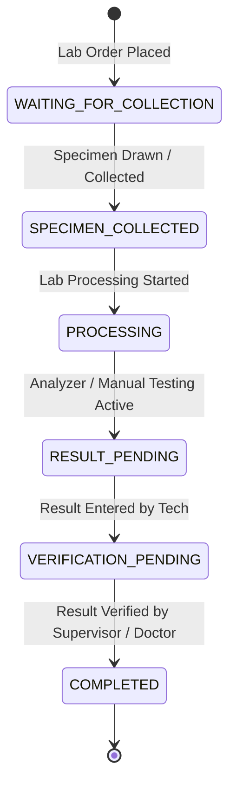

# Phase 2.6.1 — Laboratory Domain Foundation Report

**NovaCure Clinical Platform — Senior EMR Architecture Implementation Report**

> [!NOTE]
> This document summarizes the architecture, database entities, state machine transitions, RBAC permissions, service methods, API routes, test results, and future LIS boundaries for **Phase 2.6.1 — Laboratory Domain Foundation**.

---

## 1. Architecture Overview & Model Extensions

The Laboratory module directly extends the **Unified Clinical Order Architecture** (`ClinicalOrder` with `order_type = 'LABORATORY'`). It avoids creating a disconnected order system; `ClinicalOrder` remains the parent clinical request while laboratory sub-entities track catalog definitions, itemized tests, specimen collection, and laboratory execution states.



---

## 2. Laboratory Domain Entities & Database Schema

### Tables Created via Migration [20260725000005-create-laboratory-domain-tables.js](file:///c:/Users/Amanuel%20Daniel/Desktop/PLC-AND-HOLDING-GROUPS/novacure-platform/backend/migrations/20260725000005-create-laboratory-domain-tables.js):

1. **`laboratory_test_catalogs`**:
   - `test_catalog_id` (UUID PK), `code` (STRING, UNIQUE), `name` (STRING), `description` (TEXT), `category` (`HEMATOLOGY`, `BIOCHEMISTRY`, `MICROBIOLOGY`, `URINALYSIS`, `IMMUNOLOGY`, `OTHER`), `sample_type` (`BLOOD`, `URINE`, `CSF`, `STOOL`, `SWAB`, `TISSUE`), `unit` (STRING), `reference_range` (JSONB), `billing_service_id` (FK `billing_services`), `is_active` (BOOLEAN).

2. **`laboratory_order_items`**:
   - `item_id` (UUID PK), `order_id` (FK `clinical_orders`), `test_catalog_id` (FK `laboratory_test_catalogs`), `test_name` (STRING), `status` (`PENDING`, `PROCESSING`, `COMPLETED`, `CANCELLED`).

3. **`laboratory_specimens`**:
   - `specimen_id` (UUID PK), `order_id` (FK `clinical_orders`), `specimen_type` (`BLOOD`, `URINE`, `SWAB`, etc.), `collection_status` (`PENDING_COLLECTION`, `COLLECTED`, `REJECTED`, `CANCELLED`), `collected_by` (FK `users`), `collected_at` (TIMESTAMP), `notes` (TEXT).

4. **`clinical_orders` Extension**:
   - Column `laboratory_status` (`WAITING_FOR_COLLECTION`, `SPECIMEN_COLLECTED`, `PROCESSING`, `RESULT_PENDING`, `VERIFICATION_PENDING`, `COMPLETED`).

---

## 3. Laboratory Workflow & State Machine Transitions



---

## 4. RBAC Security Matrix

Seeded in [20260725000003-seed-laboratory-permissions.js](file:///c:/Users/Amanuel%20Daniel/Desktop/PLC-AND-HOLDING-GROUPS/novacure-platform/backend/seeders/20260725000003-seed-laboratory-permissions.js):

| Permission Name | Resource | Action | Authorized Roles |
| :--- | :--- | :--- | :--- |
| `laboratory:view` | `laboratory` | `view` | Doctor, Nurse, Lab Tech, Lab Supervisor, Admin, Super Admin |
| `laboratory:collect` | `laboratory` | `collect` | Nurse, Lab Tech, Lab Supervisor, Admin, Super Admin |
| `laboratory:process` | `laboratory` | `process` | Lab Tech, Lab Supervisor, Admin, Super Admin |
| `laboratory:result_create` | `laboratory` | `result_create` | Lab Tech, Lab Supervisor, Admin, Super Admin |
| `laboratory:result_verify` | `laboratory` | `result_verify` | Lab Supervisor, Doctor, Admin, Super Admin |

---

## 5. API Routes & Controller Endpoints

Mounted at `/api/laboratory` in [app.js](file:///c:/Users/Amanuel%20Daniel/Desktop/PLC-AND-HOLDING-GROUPS/novacure-platform/backend/app.js):

| HTTP Method | Endpoint Path | RBAC Permission | Purpose |
| :--- | :--- | :--- | :--- |
| `POST` | `/api/laboratory/tests` | `laboratory:process` | Create new lab test catalog entry |
| `GET` | `/api/laboratory/tests` | `laboratory:view` | List available lab test catalog entries |
| `POST` | `/api/laboratory/orders/:orderId/items` | `laboratory:process` | Add test items to a lab order |
| `POST` | `/api/laboratory/orders/:orderId/specimen` | `laboratory:collect` | Create a specimen request for a lab order |
| `PATCH` | `/api/laboratory/specimens/:id/collect` | `laboratory:collect` | Collect specimen & update order status |
| `PATCH` | `/api/laboratory/orders/:orderId/status` | `laboratory:process` | Update laboratory processing status |
| `POST` | `/api/laboratory/orders/:orderId/result` | `laboratory:result_create` | Submit lab results & complete order |

---

## 6. Automated Test Results

Executed via `npm test` in `backend/`:

```bash
PASS tests/laboratory.test.js
PASS tests/clinicalOrder.test.js
PASS tests/encounterFollowUp.test.js
PASS tests/followUpContinuity.test.js
PASS tests/followUpOutcome.test.js
PASS tests/clinicalFoundation.test.js
PASS tests/security/attachmentsPortal.test.js
PASS tests/security/authJwt.test.js
PASS tests/smoke/auth.test.js
PASS tests/smoke/health.test.js
PASS tests/smoke/rbac.test.js

Test Suites: 11 passed, 11 total
Tests:       1 skipped, 120 passed, 121 total
```

---

## 7. Frontend Build Verification

Executed via `npm run build` in `frontend/`:

```bash
 ✓ Compiled successfully in 15.2s
   Running TypeScript ...
 ✓ Generating static pages using 11 workers (3/3)
   Finalizing page optimization ...
```
**Result**: **0 TypeScript errors, 0 compilation errors**.

---

## 8. Future LIS Boundaries

The foundation established in Phase 2.6.1 cleanly demarcates boundaries for upcoming LIS sprints:
- **Phase 2.6.2 (Specimen Lifecycle Enhancement)**: Barcode generation, aliquot tracking, specimen rejection reasons.
- **Phase 2.6.3 (Laboratory Queue Engine)**: Worklist prioritization, technician workbench assignment.
- **Phase 2.6.4 (Result Observation Engine)**: Panic value alerts, analyzer HL7/ASTM interface integrations.
