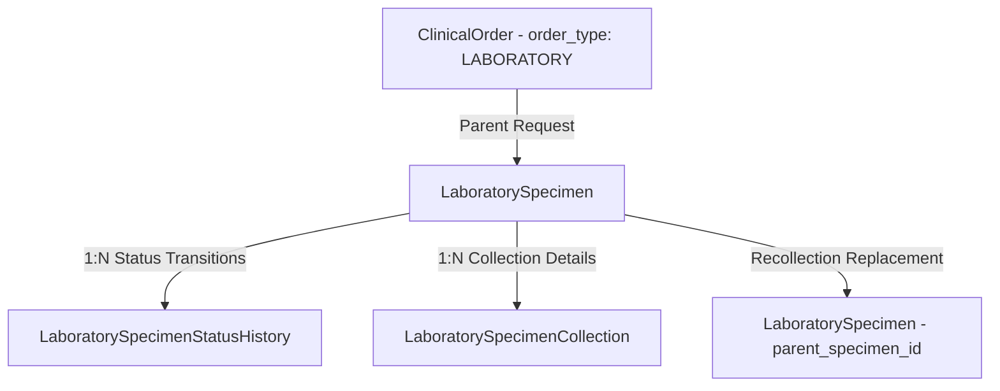
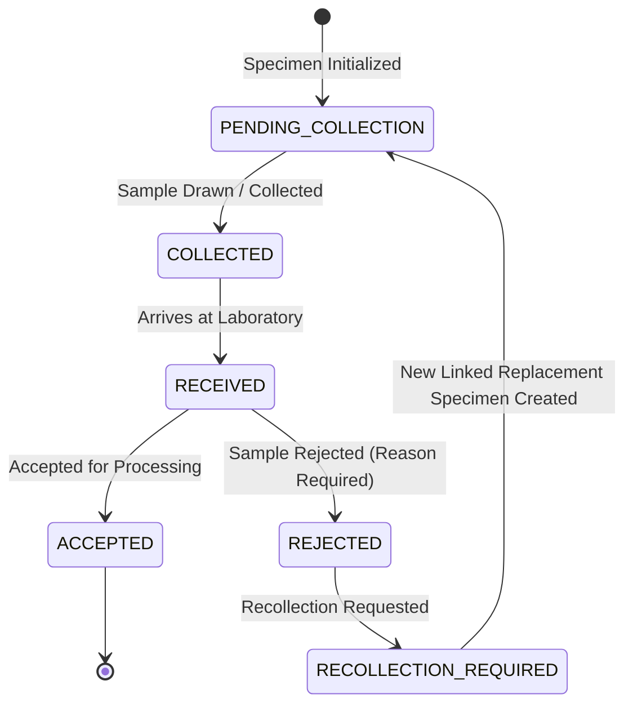

# Phase 2.6.2 — Specimen Lifecycle Enhancement Report

**NovaCure Clinical Platform — Senior EMR Architecture Implementation Report**

> [!NOTE]
> This document summarizes the architecture, database entities, state machine transitions, rejection & recollection workflows, audit events, RBAC permissions, REST endpoints, test results, and future LIS boundaries for **Phase 2.6.2 — Specimen Lifecycle Enhancement**.

---

## 1. Architecture Overview & Model Extensions

The specimen lifecycle enhancement directly extends the **Laboratory Foundation Platform** without modifying the parent `ClinicalOrder` structure. It introduces `LaboratorySpecimenStatusHistory` for immutable audit history, `LaboratorySpecimenCollection` for attempt records, expanded specimen statuses, mandatory rejection workflows, and `parent_specimen_id` parent-child linking for sample recollection requests.



---

## 2. Specimen State Machine & Transitions



---

## 3. Database Schema Extensions

### Migration [20260725000006-create-specimen-lifecycle-tables.js](file:///c:/Users/Amanuel%20Daniel/Desktop/PLC-AND-HOLDING-GROUPS/novacure-platform/backend/migrations/20260725000006-create-specimen-lifecycle-tables.js):

1. **`laboratory_specimen_status_histories`**:
   - `specimen_status_history_id` (UUID PK), `specimen_id` (FK `laboratory_specimens`), `previous_status` (STRING), `new_status` (STRING), `changed_by` (FK `users`), `reason` (TEXT), timestamps.

2. **`laboratory_specimen_collections`**:
   - `collection_id` (UUID PK), `specimen_id` (FK `laboratory_specimens`), `collected_by` (FK `users`), `collection_time` (TIMESTAMP), `collection_site` (STRING), `collector_notes` (TEXT), timestamps.

3. **`laboratory_specimens` Extension**:
   - Added `parent_specimen_id` (FK `laboratory_specimens`, nullable) enabling parent-child replacement sample tracking.

---

## 4. RBAC Security Matrix

Seeded in [20260725000004-seed-specimen-lifecycle-permissions.js](file:///c:/Users/Amanuel%20Daniel/Desktop/PLC-AND-HOLDING-GROUPS/novacure-platform/backend/seeders/20260725000004-seed-specimen-lifecycle-permissions.js):

| Permission Name | Resource | Action | Authorized Roles |
| :--- | :--- | :--- | :--- |
| `laboratory:collect` | `laboratory` | `collect` | Nurse, Lab Tech, Lab Supervisor, Admin, Super Admin |
| `laboratory:receive_specimen` | `laboratory` | `receive_specimen` | Lab Tech, Lab Supervisor, Admin, Super Admin |
| `laboratory:reject_specimen` | `laboratory` | `reject_specimen` | Lab Tech, Lab Supervisor, Admin, Super Admin |
| `laboratory:create_recollection` | `laboratory` | `create_recollection` | Lab Supervisor, Doctor, Admin, Super Admin |

---

## 5. API Endpoints

Mounted at `/api/laboratory` in [app.js](file:///c:/Users/Amanuel%20Daniel/Desktop/PLC-AND-HOLDING-GROUPS/novacure-platform/backend/app.js):

| Method | Endpoint Path | Permission | Purpose |
| :--- | :--- | :--- | :--- |
| `POST` | `/api/laboratory/specimens/:id/receive` | `laboratory:receive_specimen` | Receive collected specimen in laboratory |
| `POST` | `/api/laboratory/specimens/:id/accept` | `laboratory:process` | Accept specimen for test processing |
| `PATCH` | `/api/laboratory/specimens/:id/reject` | `laboratory:reject_specimen` | Reject specimen with mandatory reason |
| `POST` | `/api/laboratory/specimens/:id/recollect` | `laboratory:create_recollection` | Request recollection replacement specimen |
| `GET` | `/api/laboratory/specimens/:id/history` | `laboratory:view` | View immutable specimen lifecycle history |

---

## 6. Audit & Timeline Integration

- **Audit Events Logged**: `SPECIMEN_CREATED`, `SPECIMEN_COLLECTED`, `SPECIMEN_RECEIVED`, `SPECIMEN_ACCEPTED`, `SPECIMEN_REJECTED`, `SPECIMEN_RECOLLECTION_CREATED`.
- **Timeline Integration**: Renders specimen collection and rejection events in patient history log.

---

## 7. Automated Test Results & Verification

Executed via `npm test` in `backend/`:

```bash
PASS tests/laboratory.test.js
PASS tests/clinicalOrder.test.js
PASS tests/encounterFollowUp.test.js
PASS tests/followUpContinuity.test.js
PASS tests/followUpOutcome.test.js
PASS tests/clinicalFoundation.test.js
PASS tests/security/attachmentsPortal.test.js
PASS tests/security/authJwt.test.js
PASS tests/smoke/auth.test.js
PASS tests/smoke/health.test.js
PASS tests/smoke/rbac.test.js

Test Suites: 11 passed, 11 total
Tests:       1 skipped, 124 passed, 125 total
```

Executed via `npm run build` in `frontend/`:
```bash
 ✓ Compiled successfully in 13.9s
   Running TypeScript ...
 ✓ Generating static pages using 11 workers (3/3)
   Finalizing page optimization ...
```
**Result**: **0 TypeScript errors, 0 compilation errors**.

---

## 8. Future LIS Boundaries

The specimen lifecycle foundation established in Phase 2.6.2 cleanly sets boundaries for upcoming laboratory modules:
- **Phase 2.6.3 (Laboratory Queue Engine)**: Technician worklists and queue assignment.
- **Phase 2.6.4 (Result Observation Engine)**: Analyzer integration, reference range checks, panic value alerts.
