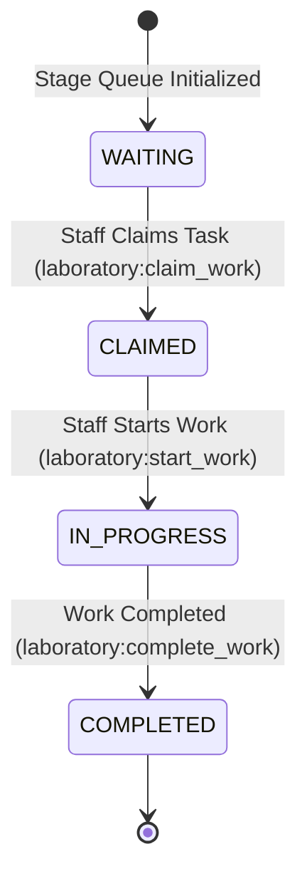

# Phase 2.6.3 — Laboratory Queue & Worklist Engine Implementation Report

**NovaCure Clinical Platform — Senior EMR Architecture Implementation Report**

> [!NOTE]
> This document summarizes the architecture, database entities, queue lifecycle transitions, priority engine rules, audit events, RBAC permissions, REST endpoints, test results, and future LIS boundaries for **Phase 2.6.3 — Laboratory Queue & Worklist Engine**.

---

## 1. Architecture Overview & Model Extensions

The Laboratory Queue Engine introduces an operational task layer (`LaboratoryWorkQueueItem`) on top of the existing `ClinicalOrder` and `LaboratorySpecimen` domain models.

```mermaid
graph TD
    CO[ClinicalOrder - order_type: LABORATORY] -->|Triggers| LWQI[LaboratoryWorkQueueItem]
    LS[LaboratorySpecimen] -->|Linked To| LWQI
    LWQI -->|Queue Types| QT[COLLECTION | RECEPTION | PROCESSING | RESULT_ENTRY | VERIFICATION]
    LWQI -->|Status Lifecycle| ST[WAITING --> CLAIMED --> IN_PROGRESS --> COMPLETED]
    ST -->|Priority Sorting| PR[STAT (1) > URGENT (2) > ROUTINE (3)]
```

---

## 2. Queue Lifecycle State Machine



---

## 3. Database Schema Extensions

### Migration [20260725000007-create-laboratory-work-queue-table.js](file:///c:/Users/Amanuel%20Daniel/Desktop/PLC-AND-HOLDING-GROUPS/novacure-platform/backend/migrations/20260725000007-create-laboratory-work-queue-table.js):

- Table: `laboratory_work_queue_items`
  - `id` (UUID PK), `order_id` (FK `clinical_orders`), `specimen_id` (FK `laboratory_specimens`), `queue_type` (`COLLECTION`, `RECEPTION`, `PROCESSING`, `RESULT_ENTRY`, `VERIFICATION`), `status` (`WAITING`, `CLAIMED`, `IN_PROGRESS`, `COMPLETED`, `CANCELLED`), `priority` (`STAT`, `URGENT`, `ROUTINE`), `assigned_staff_id` (FK `users`), `department_id` (FK `departments`), `entered_at`, `claimed_at`, `completed_at`, timestamps.
  - Indexes: `queue_type`, `status`, `department_id`, `priority`, `created_at`.

---

## 4. RBAC Security Matrix

Seeded in [20260725000005-seed-laboratory-queue-permissions.js](file:///c:/Users/Amanuel%20Daniel/Desktop/PLC-AND-HOLDING-GROUPS/novacure-platform/backend/seeders/20260725000005-seed-laboratory-queue-permissions.js):

| Permission Name | Resource | Action | Authorized Roles |
| :--- | :--- | :--- | :--- |
| `laboratory:view_queue` | `laboratory` | `view_queue` | Doctor, Nurse, Lab Tech, Lab Supervisor, Admin, Super Admin |
| `laboratory:claim_work` | `laboratory` | `claim_work` | Lab Tech, Lab Supervisor, Admin, Super Admin |
| `laboratory:start_work` | `laboratory` | `start_work` | Lab Tech, Lab Supervisor, Admin, Super Admin |
| `laboratory:complete_work` | `laboratory` | `complete_work` | Lab Tech, Lab Supervisor, Admin, Super Admin |

---

## 5. API Routes & Controller Endpoints

Mounted at `/api/laboratory` in [app.js](file:///c:/Users/Amanuel%20Daniel/Desktop/PLC-AND-HOLDING-GROUPS/novacure-platform/backend/app.js):

| Method | Endpoint Path | Permission | Purpose |
| :--- | :--- | :--- | :--- |
| `GET` | `/api/laboratory/workqueue` | `laboratory:view_queue` | Get operational workqueue items sorted by priority |
| `GET` | `/api/laboratory/workqueue/my` | `laboratory:view_queue` | Get active worklist tasks assigned to current staff |
| `PATCH` | `/api/laboratory/workqueue/:id/claim` | `laboratory:claim_work` | Claim waiting workqueue item |
| `PATCH` | `/api/laboratory/workqueue/:id/start` | `laboratory:start_work` | Start work on claimed queue item |
| `PATCH` | `/api/laboratory/workqueue/:id/complete` | `laboratory:complete_work` | Complete work on active queue item |

---

## 6. Audit & Timeline Events

- **Audit Events**: `LAB_QUEUE_CREATED`, `LAB_WORK_CLAIMED`, `LAB_WORK_STARTED`, `LAB_WORK_COMPLETED`.
- **Timeline Integration**: Renders clinical stage milestones (`SPECIMEN_RECEIVED`, `LAB_PROCESSING_STARTED`, `LAB_PROCESSING_COMPLETED`).

---

## 7. Automated Test Results & Build Verification

Executed via `npm test` in `backend/`:

```bash
PASS tests/laboratoryQueue.test.js
PASS tests/laboratory.test.js
PASS tests/clinicalOrder.test.js
PASS tests/encounterFollowUp.test.js
PASS tests/followUpContinuity.test.js
PASS tests/followUpOutcome.test.js
PASS tests/clinicalFoundation.test.js
PASS tests/security/attachmentsPortal.test.js
PASS tests/security/authJwt.test.js
PASS tests/smoke/auth.test.js
PASS tests/smoke/health.test.js
PASS tests/smoke/rbac.test.js

Test Suites: 12 passed, 12 total
Tests:       1 skipped, 133 passed, 134 total
```

Executed via `npm run build` in `frontend/`:
```bash
 ✓ Compiled successfully in 15.1s
   Running TypeScript ...
 ✓ Generating static pages using 11 workers (3/3)
   Finalizing page optimization ...
```
**Result**: **0 TypeScript errors, 0 compilation errors**.

---

## 8. Known Limitations & Future LIS Boundaries

- **Phase 2.6.4 (Result Observation Engine)**: Panic value thresholds, analyzer HL7/ASTM automated result extraction, and laboratory supervisor verification workflows.
